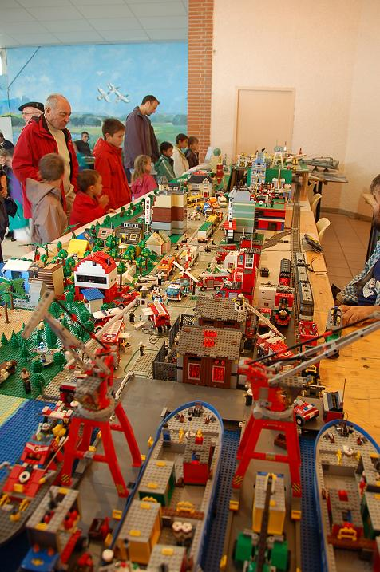
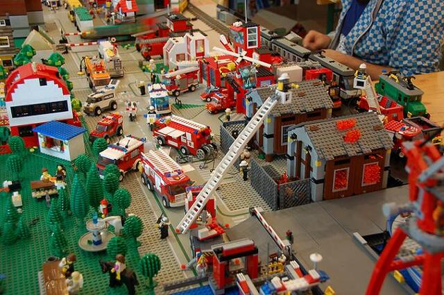
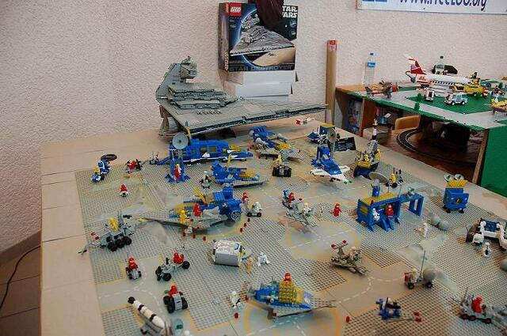

Pour notre première exposition ensemble en Haute-Garonne, nous nous sommes rendu à Fonsorbes pour la journée du modélisme, le dimanche 20 septembre 2009.

Nous fûment accueilli samedi après-midi par Jean-Louis et son équipe pour le montage. Nous disposions de 8 tables en haut d’une extrade. Nous nous sommes aidé de [Bluebrick](http://bluebrick.lswproject.com/) pour préparer notre diorama.

Nous avons présenté : espace classique, un aéroport, un port et un diorama train et ville.

**Vue en longueur**

Vue en longueur du stand avec de bas en haut :  
port, entrepôt, pompiers + plage, la ville, l’aéroport + ferme et enfin le Classic Space

**Vue générale des pompiers**

Le dimanche fut consacré au montage de l’[isd](http://www.bricklink.com/catalogItem.asp?S=10030-1) de Yann (qui était en vrac dans un carton) qui fut fini vers 17h.

**Fin de montage**

ISD fini + Classic Space

Malgré un temps pas très clément, les visiteurs ont trouvé leur bonheur par tout ce qui était présenté : réseau de trains, démonstrations de bateaux sur le lac (pas en LEGO malheureusement...), voitures anciennes, maquettes d’avions (qui n’ont pas volé) et différents autres modélistes (voitures, science-fiction...) et notre stand !

Ce fut un plaisir pour tout le monde de présenter nos constructions qui furent biens accueillies par les visiteurs (collègues de travail en autres :) ) et les autres modélistes.

On remercie Jean-Louis et les habitants de Fonsorbes pour leur accueil. On peut également remercier banban pour Bluebrick et autres chinoiseries.

* * *

[Galerie photos](http://photos.freelug.org/main.php/v/chatpin/Fonsorbes2009/)
