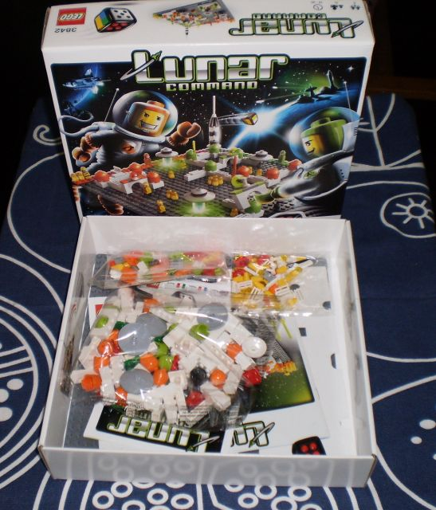
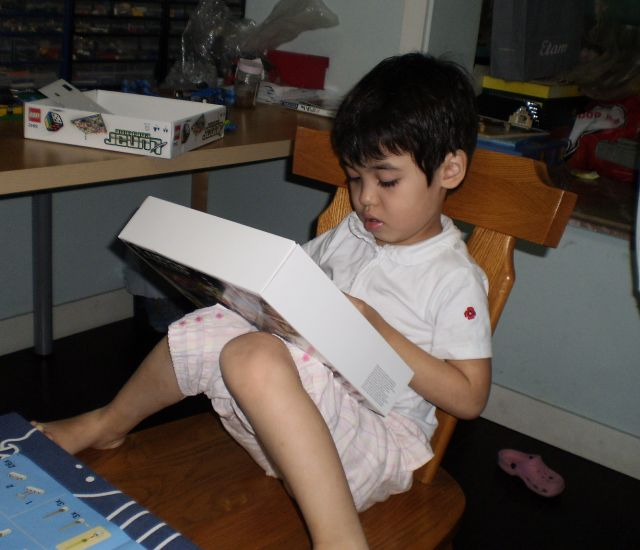
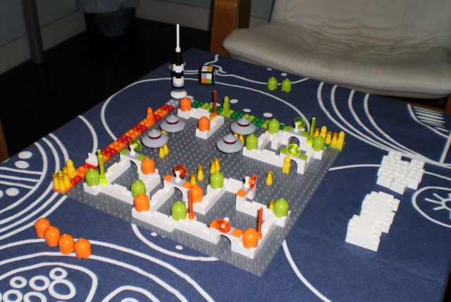
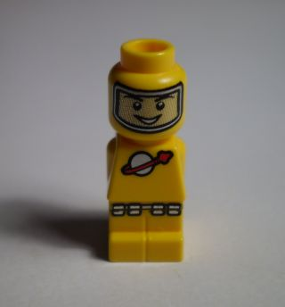
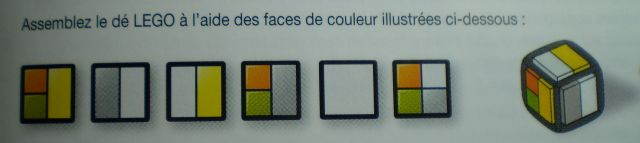
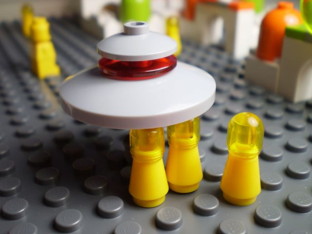
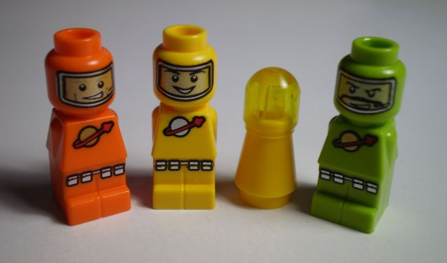

On attaque maintenant les choses sérieuses avec les grosses boîtes de la gamme. J’avais fait une entorse à mon programme de test avec la [revue de la boîte Minotaurus](/articles/976/) (auquel je viens de rejouer et que je trouve toujours aussi fun), mais cette fois-ci on y est pour de bon !

Et voici un autre thème très apprécié des AFOLs : l’espace ! Comble du bonheur le célèbre logo classic-space a été repris pour le nom de la boîte que l’on va s’empresser d’ouvrir :

**Ouverture de la boîte**

Le montage du set s’avère très facile bien qu’un peu répétitif. Facile puisque le jeu débute avec un plateau vide et que c’est un jeu de construction, donc à part les lignes de marquage de point il n’y a presque rien à construire.

Un peu répétitif, car on a tout de même à construire 26 murs identiques constitués d’une brique 1x4 surmontée d’une tile grille 1x2. Je pense qu’en fait les designers auraient pu se contenter d’un mur fait d’une simple brique 1x4, la décoration avec la grille étant superflue (et fastidieuse à monter).

**Montage à la chaîne**

Le jeu est donc un jeu de construction qui pourrait de très loin s’apparenter au [jeu de go](http://fr.wikipedia.org/wiki/Jeu_de_go), puisque le but du jeu est de construire des bases lunaires fermées puis d’y faire entrer des astronautes et des robots pour marquer des points.

Sur les deux cotés de la plaque de base, il y a une échelle de points, une pour chaque joueur. Une microfig (puisque c’est maintenant le terme consacré) pour chaque joueur sert de marqueur de point et se déplace le long de l’échelle de points. Les joueurs doivent marquer suffisamment de points (11 points en fait) pour atteindre la fusée (qui est purement décorative).

**En cours de partie**

Pour marquer des points, c’est assez simple, il suffit de déplacer les robots et les astronautes jaunes à l’intérieur de ses bases lunaires, ou bien de les encercler en créant de nouvelles bases. Une fois qu’un robot ou un astronaute se trouve à l’intérieur d’une base fermée, on les retire du jeu et on compte un point par robot et deux points par astronaute.

Admirez cette microfig avec le logo space-classic !

**Une nouvelle Fig space-classic débarque sur notre planète !**

A son tour de jeu, on lance le dé et selon les couleurs obtenues (parfois une même face du dé possède plusieurs couleurs), on peut faire les actions suivantes :  
**–** blanc : construction d’un mur (il y a certaines règles de construction à respecter, comme toujours placer un mur de tel sorte qu’il soit relié à une des tours de base, mais je vous passe les détails)  
**–** vert ou orange : construction d’un élément coloré de la base (il y a trois types différents d’élément coloré : les sas, les antennes et les dômes)  
**–** jaune : déplacement d’un astronaute et/ou robot de 4 tenons (pouvant être séparés entre plusieurs pions)  
**–** gris : déplacement des OVNI (qui sont des bloqueurs de robots et empêchent la construction de murs).

**Un dé bien coloré**

Un autre point de règle important du point de vue tactique est que les joueurs peuvent faire passer les robots et astronautes à travers leurs sas mais pas à travers les sas de l’adversaire. Donc vos sas sont comme des murs pour l’adversaire, ce qui s’avère très pratique au cours du jeu, car un pion entré dans votre base ne pourra pas en être chassé par votre adversaire, du moins par cette porte.

En lisant les règles j’ai un peu craint que les soucoupes volantes soient difficiles à manier. J’ai eu peur que le syndrome [Race 3000](/articles/982/) refasse surface, mais en fait pas du tout. Car les soucoupes chapeautent complètement les robots donc il est très facile de voir si un robot est bloqué ou non, il n’y a aucune ambiguïté.

**Deux robot coincés sous la soucoupe...**

Finalement pour savoir à qui appartient une base, il suffit de compter le nombre de pièces de votre couleur qui sont contenues dans l’enceinte de la base. En cas d’égalité, les points sont partagés lorsque des robots ou des astronautes entrent dans la base. Ce qui rend le jeu encore plus tactique est que les dômes de couleur se posent par dessus les murs blancs, donc une base peut potentiellement changer de camps après sa fermeture.

Autant vous dire que ce jeu est très tactique et ma fille de 4 ans n’a pas pu y jouer, c’était beaucoup trop compliqué pour elle. L’âge conseillé sur la boîte est de 7 ans, mais pour moi, ce jeu est résolument adulte.

**Photo de famille**

Vous aurez aussi remarqué qu’il s’agit d’un jeu pour deux joueurs uniquement (contrairement à tous les autres de la gamme ou presque qui peuvent être joués jusqu’à 4 joueurs), mais les règles alternatives proposent un jeu à 4 joueurs en équipe de deux. Elle proposent aussi d’abducter les astronautes avec la soucoupe, mais à mon avis cela brise l’équilibre du jeu.

## Mon Impression

Un principe de jeu excellent, un look super cool, des microfigs à donner des envies de MOC en microscale, que demander de plus ? Franchement Lunar Command est pour moi une réussite.

Je ne peux que vous le recommander chaleureusement !

A bientôt pour une prochaine boîte.
