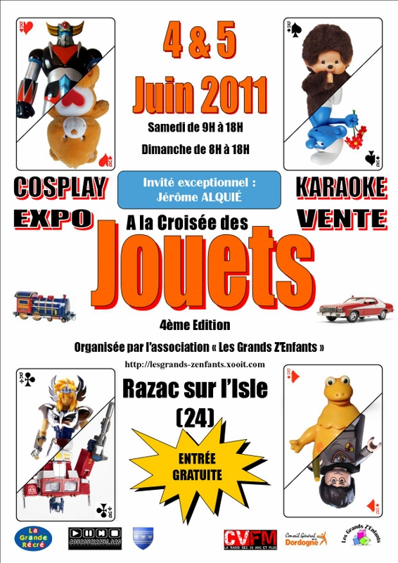
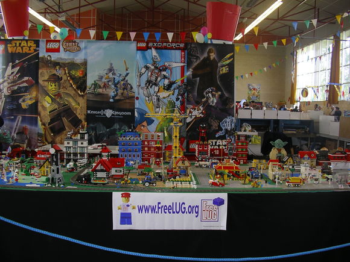

**Nom** : A la croisée des Jouets, 4ème édition

**Lieu** : Razac sur L’Isle (24) à 10 km de Perigueux, sortie 14 sur A89 à 3km

**Date** :  
Le 4 Juin de 9h à 18 h  
Le 5 Juin de 8h à 18 h  
Restauration sur place  
Vide grenier le dimanche

**Entrée Gratuite**

Salle de 1200 m²

Cette année notre association sera représentée par Erik, Pascal et moi-même sur une surface d’environ 16 m par 2m de profondeur

Le thème est "De la terre à la lune" laissant place à l’imagination de chacun.

[Résumé de l’édition 2010](/articles/resume-de-l-expositon-a-razac-sur-l-isle/)

