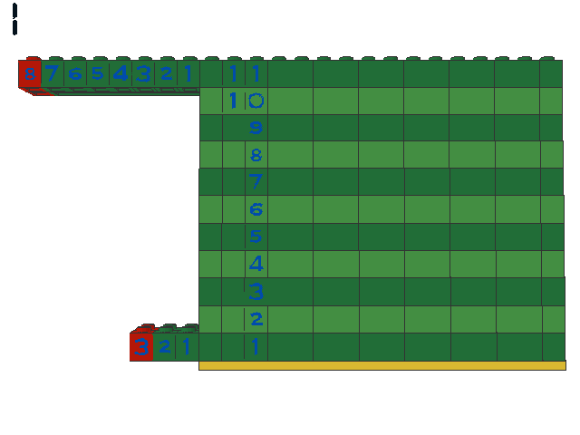
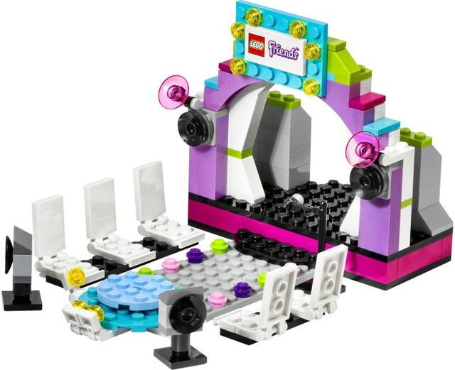

Outre l’Assemblée Générale, le week-end du 28/29 mars sera l’occasion de se rencontrer et de vous proposer quelques animations.

**–** Maitresoda organisera un diorama collectif City où chacun d’entre vous peut ajouter sa pierre ;  
**–** Erik vous proposera un draft ;  
**–** Gzu vous fera construire à l’aveugle ;  
**–** Waga a sollicité quelques cours de Wiki.  
**–** Et l’équipe FAA vous présentera sa cérémonie des "Awards" et vous fera danser la samba lors résultats des [concours pour l’AG.](https://www.freelug.org/spip.php?article1993)

## Décor du défilé du carnaval

_Par Maitresoda_

Pour la réalisation de mes dioramas j’ai mixé une partie des articles du site notamment [Comment transporter ses créations en exposition ?](/articles/comment-transporter-ses-creations-en-exposition/) le [Module standardisé PennLUG](/articles/module-standardise-pennlug/), de [La Rue FreeLUG - le guide de la construction modulaire](/articles/la-rue-freelug-le-guide-de-la-construction-modulaire/), du [quartier des affaires FreeLUG](/articles/le-quartier-des-affaires-freelug/) ; => le résultat de cette cuisine est un Puzzle géant relativement rapide à monter et démonter pour exposer.

Lors de ma dernière "expo" pendant les vacances de noël j’ai dû sous-traiter : les enfants devaient réaliser une construction sur une baseplate de 16 x 16.

Pour le concours "Carnaval FreeLUG" j’amène la route pour faire défiler nos créations mais pour transformer ce banal ruban de brique et ses trottoirs en quartier accueillant le défilé j’ai besoin de votre aide, il me manque :

-   12 petites constructions (baseplate 16x16) avec 1 face visible
-   8 longues constructions (baseplate 16x32) 1 des petites faces est visible
-   8 constructions en angle (baseplate 16x16) 2 des faces sont visibles

Vos créations seront des bâtiments et/ou des parcs, elles doivent s’inscrire sur toute la hauteur dans la limite de la baseplate, un léger débordement est possible au niveau des faces visibles (auvent, balcon, grille ouverte, ...) : 2 tenons pour le premier niveau, moins de 8 pour les niveaux situé à plus de 10 briques du sol.

Le gabarit :

[Inscription sur le wiki](http://wiki.freelug.org/animation+extra+A.G.+2015)

## Draft

_Par Erik_

Lors des soldes, le LEGO Store de SoOuest proposait à prix réduit la boite [Friends 40112](http://brickset.com/sets/40112-1/Model-Catwalk).

J’ai pris quelques boites en vue d’organiser un [draft](/articles/le-draft/) lors de l’AG.  
**–** Nombre de boites disponibles : 8  
**–** Prix : 6,50€ (à me régler sur place)  
**–** [Inventaire des pièces](http://www.bricklink.com/catalogItemInv.asp?S=40112-1)  
**–** Jour et heure : ??

S’inscrire sur [le wiki](http://wiki.freelug.org/animation+extra+A.G.+2015) dans la section adéquate et préciser si vous souhaitez prendre une boite (dans la limite du stock) ou si vous venez avec votre propre boite (dans ce cas, vous n’aurez rien à régler évidemment).

## Concours à l’aveugle

_Par Gzu_

Le principe :  
**–** Faire une construction en suivant une notice (instruction) mais sans pouvoir voir les pièces manipulées, uniquement au toucher.  
**–** Cependant le public voit les pièces et peut influencer (conseiller) le constructeur.  
**–** Les sessions se déroulent de 2 à 8 participants sur une limite de temps de 30 min.  
**–** Le constructeur informe l’arbitre de la fin de sa construction. L’arbitre note le temps de construction et la fidélité de construction (20 points moins le nombre d’écarts/erreurs)  
**–** Le gagnant est le plus rapide et fidèle à la construction.

Pour le concours, on peut proposer l’après-midi 4 sessions de 30 min toutes les 45 min pour 2 à 8 participants et un arbitre pour encadrer le concours.  
Les inscriptions se feraient le matin sur une liste mis à disposition sur un stand.

Matériel nécessaire :  
**–**  Si max 8 participants : Il faut prévoir 8 tables, 8 chaises, 8 plateaux pour mettre les pièces, un espace pour l’arbitre face aux tables et permettre au public de facilement assister au concours.  
**–**  Prévoir un système (drap noir et support) pour que le participant ne puisse voir ses mains et les pièces, mais pouvant facilement les manipuler et pour que le public puisse voir ce qu’il fait (comme sur les photos de la brickcon)  
**–**  Papier et crayon pour noter les inscriptions, et résultats du concours  
**–**  Set de moins de 100 pièces avec notice (exemple : Mixel) + pièces qui ne sont pas dans le set  
**–**  Lots ? Diplôme de Maître Constructeur ?  
**–**  Chacun repart avec sa construction ? (Frais de participation ?)

Pour le concours à l’aveugle, j’avais vu cela sur le net lors d’un compte rendu du brickcon à Seattle :  
[https://www.flickr.com/photos/tomalphin/15465042975/in/pool-nwbrickcon](https://www.flickr.com/photos/tomalphin/15465042975/in/pool-nwbrickcon)  
[https://www.flickr.com/photos/tomalphin/15441913216/in/pool-nwbrickcon](https://www.flickr.com/photos/tomalphin/15441913216/in/pool-nwbrickcon)

## Atelier Wiki

_Par Waga_

Cela a déjà été réalisé il y a 2 ou 3 ans mais je ne souviens de rien et, pour moi, le wiki ressemble à l’Everest. Rien que d’y penser, le souffle me manque.  
Un atelier sera proposé

## Cérémonie des Awards FreeLUG

_Par l’équipe FAA_

Il vous sera présenté au cours d’une petite cérémonie, les lauréats du plus beau MOC, des plus beaux dioramas individuel et collectif ainsi que le FreeLUGien(ne) de l’année écoulée.  
Deux concours de création "spécial AG" vous seront proposés. Vous pourrez vous confronter à des jeux de société reposants avant de défiler au carnaval FreeLUG.

## Et vous ?

Amenez donc vos derniers MOCs et votre bonne humeur pour une ambiance festive.
