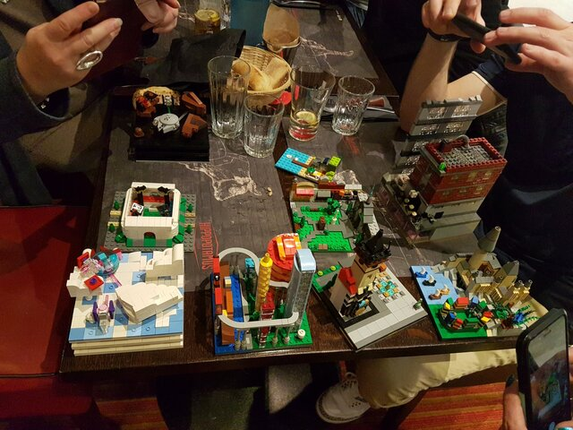
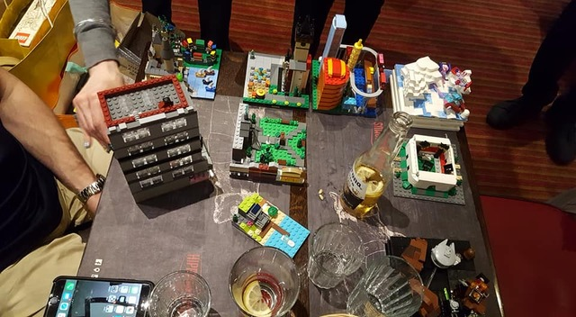
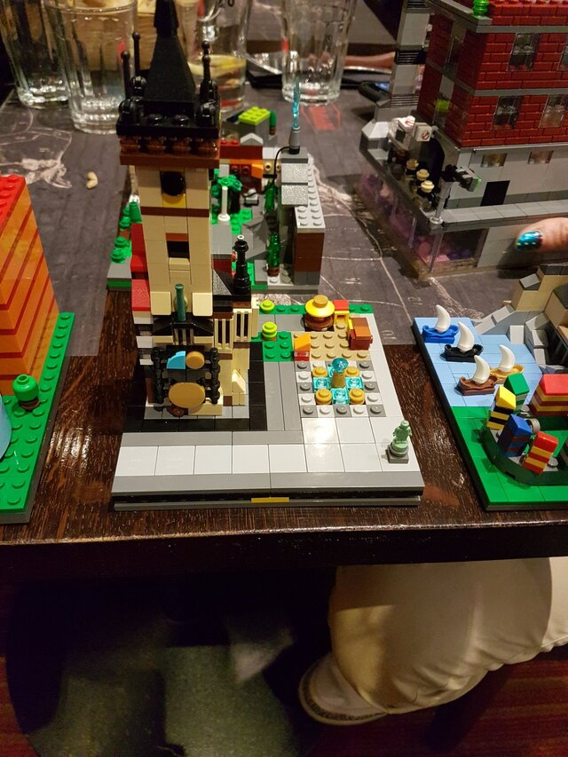
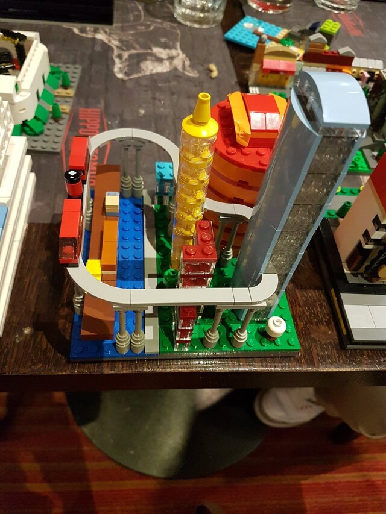
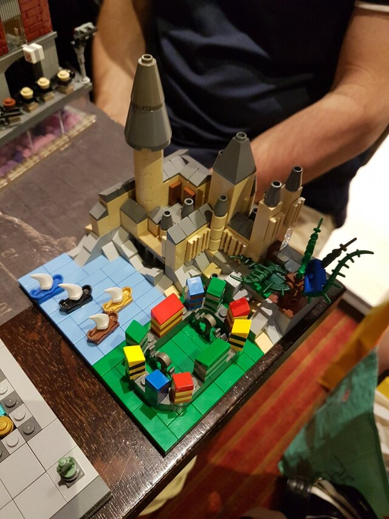

Retour sur l’AFOL’s Day qui s’est déroulé le samedi 14 avril 2018 à Lyon La Part-Dieu.

La journée a débuté dès 9h30 au LEGO Store de Lyon Part-Dieu où nous avons, comme toujours, été très bien reçu. Plus d’une vingtaine de membres étaient présents pour discuter et en profiter pour faire des achats.

Nous nous sommes ensuite retrouvés dès midi au restaurant Hippopotamus où nous avions réservé deux tables - malheureusement insuffisantes pour nous accueillir tous. 5 retardataires n’ont pu se joindre à nous.

Un concours avait été organisé par Marie à l’échelle LEGO microscale.

La seule contrainte était de taille : la création devait mesurer (en tenons) 16/16. Il n’y avait aucune autre obligation et le thème était libre.

Les membres éminents du jury, après la commande des plats et en attendant ceux-ci, ont ainsi décerné les prix (constitués de sets LEGO) :  
**–** 3e : Valentin Passot

  
**–** 2e : Loys Bailly

  
**–** 1ère : Marine Bailly (sur le thème d’Harry Potter)

A noter que lors de cette rencontre, il n’y a eu aucun problème sur le règlement de l’addition à la fin du repas. Cela mérite des applaudissements.

Nous remercions les participants - c’est toujours un très grand plaisir de se retrouver.
