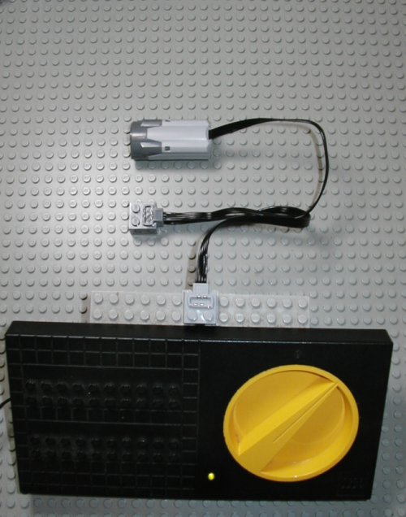
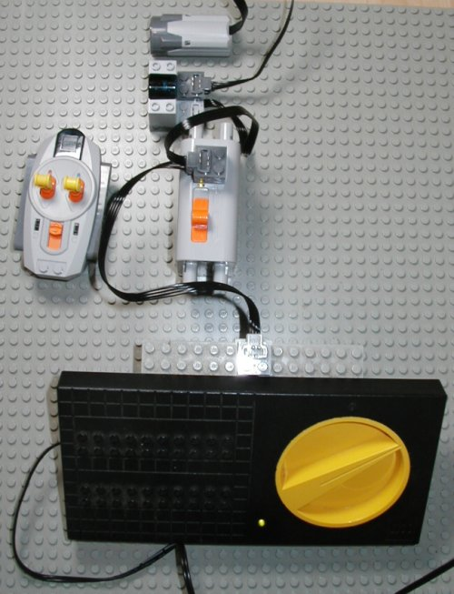

L’[arrivée du PFS avec ses nouvelles prises](/articles/power-functions-le-nouveau-systeme-electrique-lego/) mais sans adaptateur secteur soulève des interrogations quant à la possibilité d’utiliser ces nouveaux éléments avec une source secteur plutôt que des piles.

Heureusement, dans un soucis de rétro-compatibilité, la société LEGO produit un [câble d’adaptation entre le traditionnel 9V (brique 2x2) et les nouvelles prises PFS](http://shop.lego.com/ByTheme/Product.aspx?p=8886).

Toutefois, aucun adaptateur secteur n’existe dans cette nouvelle gamme.

L’électricien qui sommeille en nous se pose donc la question de comment utiliser un régulateur de train 9V (la méthode par excellence pour utiliser le 9V sur secteur) pour alimenter les composants PFS.

## Alimenter directement un moteur

Le premier type de branchement est le plus simple : on veut faire fonctionner un moteur en utilisant le régulateur 9V. Il suffit d’utiliser le câble adaptateur 9V-PFS pour cela.

**Alimentation directe**

Le moteur PFS est relié au régulateur 9V via le câble adaptateur.

Le régulateur permet de moduler la vitesse du moteur, comme c’est le cas avec des moteurs 9V.

## Alimenter un récepteur infra-rouge

Toutefois, l’intérêt du PFS réside dans l’apparition des récepteurs IR qui offrent une nouvelle dimension au jeu. Peut-on les utiliser ?

Nous testons donc le montage le plus intuitif : branchons le récepteur sur le régulateur 9V à l’aide du câble adaptateur. Mais hélas, cela ne marche pas... Une analyse des spécifications du système électrique semble effectivement conforter cette observation.

Qu’à cela ne tienne, _le LEGO, c’est pour les enfants_, donc n’hésitons pas à faire des branchements hasardeux, ça devrait tenir.

Si il faut un boîtier de piles PFS pour alimenter un récepteur IR, branchons le régulateur sur le boîtier de piles ! Prenons quand même le soin de retirer les piles du boîtier, deux sources de courant n’étant pas forcément le plus recommandable.

Nous avons le câblage suivant :  
**–** le boîtier de piles PFS est branché via le câble adaptateur au régulateur 9V  
**–** le récepteur IR est branché sur le boîtier de piles

En actionnant l’interrupteur du boîtier dans le bon sens (cela dépend du sens du régulateur), la DEL verte du boîtier s’allume, ainsi que celle du récepteur !

Nous nous saisissons de la télécommande, et d’une pression sur le levier, nous actionnons le moteur.  
Mais encore plus intéressant, la vitesse du moteur dépend la tension délivrée par le régulateur 9V.

**Alimentation via récepteur IR**

Le boîtier de piles PFS vide est relié au régulateur par le câble adaptateur, et le récepteur IR est branché sur le boîtier de piles.

Finalement, la simple introduction du boîtier de piles PFS (vide) dans le câblage permet d’alimenter un récepteur IR depuis un régulateur 9V.

Maintenant, nous pouvons donc alimenter tous nos montages PFS sans utiliser de piles. Allez, encore quelques mois avant la nouvelle télécommande PFS permettant de moduler la vitesse !
