Le 25 juin avait lieu la kermesse de l’école de Frontenas.

Le beau temps et les activités "habituelles" des kermesses étaient au rendez-vous.  
Château gonflable, promenade en poney, pêche à la ligne, casse boîte...

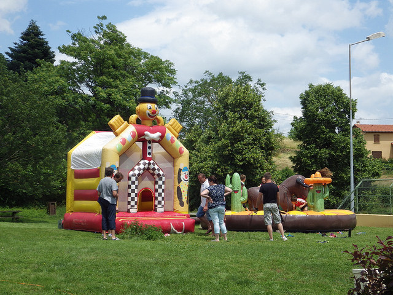

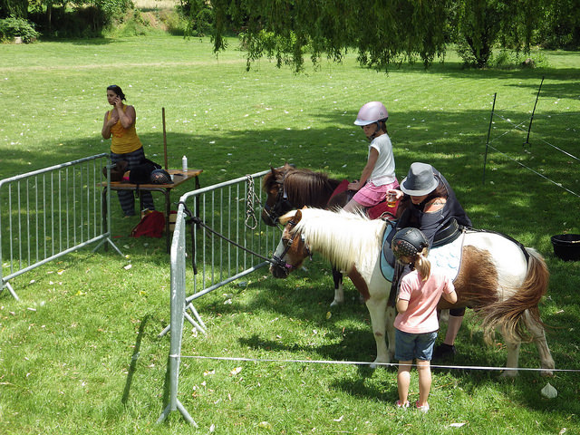

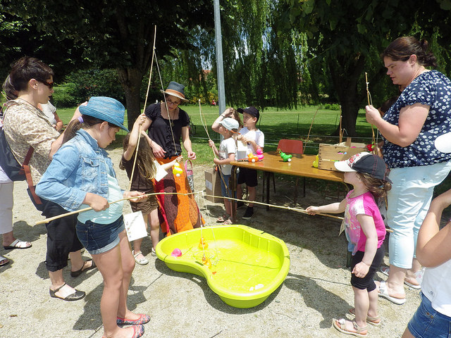

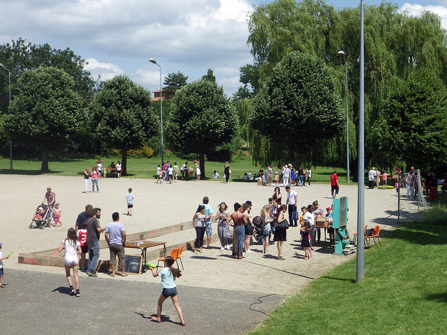

Ainsi que des briques rouges !

Nous étions idéalement placés juste à côté de la buvette, dans la salle pour pas avoir trop chaud.

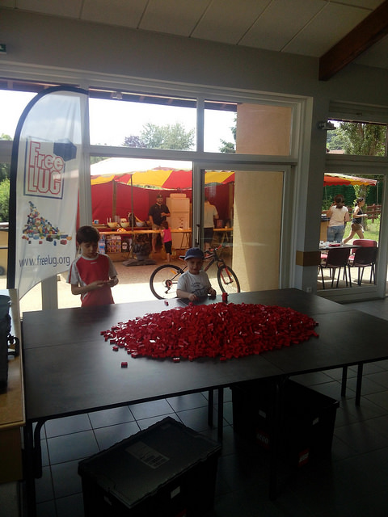

Apres un début d’activité un peu timide, les enfants (et les parents) ont vite investi les tables !

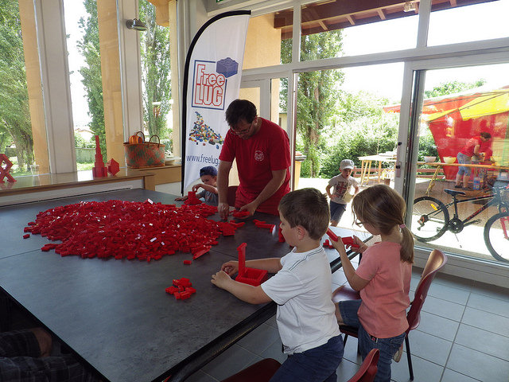

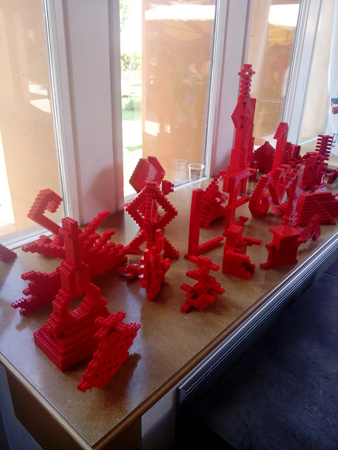

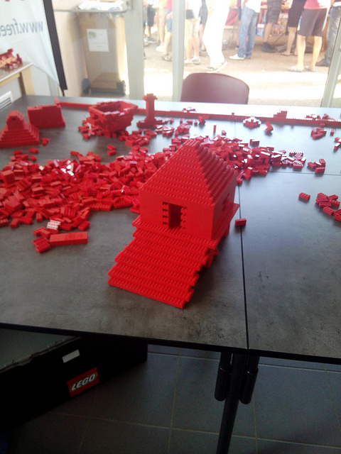

De bien jolies créations, avec dans le lot un joli logo LEGO !

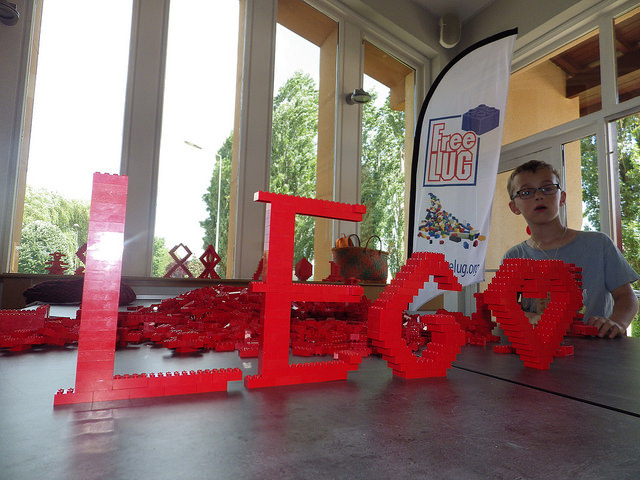

Une journée sympathique, qui, après le spectacle des enfants, s’est terminée par les lampions !

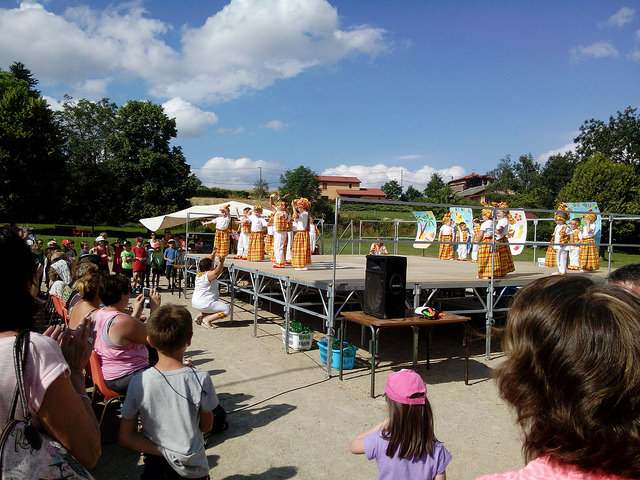

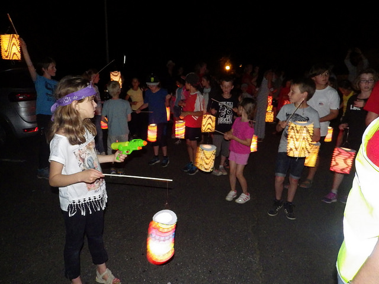

Encore merci à FreeLUG pour le prêt des briques.

Mathieu et Géraldine, pour l’équipe du sou des écoles de Frontenas
