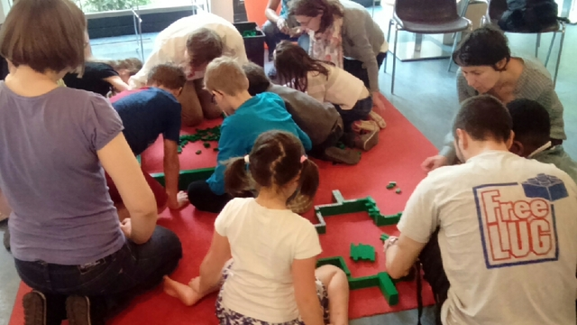
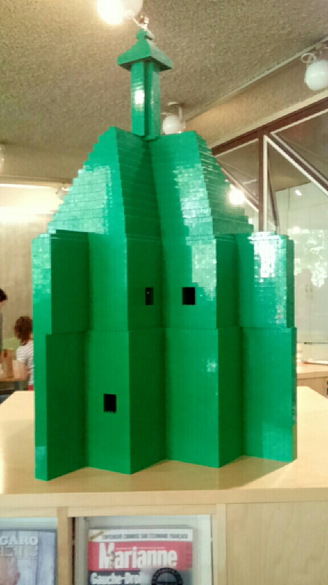
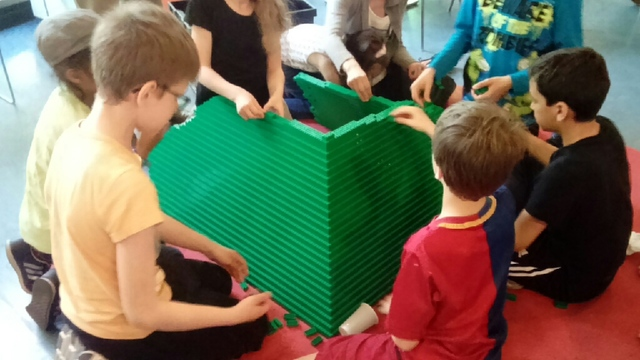

Dans le cadre de son Printemps du Jeu, la [médiathèque d’Argenteuil](http://mediatheques.argenteuil.fr/) a souhaité organiser un atelier de construction LEGO, associant enfants et parents. Celui-ci a eu lieu le 7 mai.

Nous étions deux volontaires FreeLUG pour animer celui-ci, pour une quinzaine d’enfants, quelques adultes, et deux caisses de briques vertes soit 10000 briques.

La salle d’animation était située à gauche en entrant dans la médiathèque, suffisamment en vue pour attirer quelques curieux. C’était une salle de lecture, avec présentoirs, et quelques personnes étudiant ou travaillant.

Après installation d’une table, de chaises et d’un tapis, nous avons préparé les bases des deux constructions proposées, une pyramide et une tour.

Les participants sont arrivés petit à petit, et tous se sont mis à construire l’un des deux projets, ou à faire une construction personnelle sur la table pour certains. Certains adultes ont construit des morceaux pour aider à la pyramide ou la tour.

Après une heure et demie, la tour était terminée, et une partie de la pyramide bien entamée, mais nous étions à court de briques ! Incroyable comme 10000 pièces disparaissent si facilement !

Après quelques photos nous nous sommes livrés avec délectation aux joies de la destruction des constructions.

Et comme il restait un peu de temps, nous avons proposé aux enfants de faire des constructions libres. Beaucoup n’étaient pas très pacifiques, mais qu’importe s’ils s’amusent !

Romain pour sa part a fait une magnifique Tour Eiffel en deux coups de cuillère à pot (il y arriverait sans doute les yeux fermés !).

* * *

Pour ma part je me suis vraiment bien amusé, et j’ai l’impression que ça a plu aux participants (y compris les adultes), et correspondait à ce que la médiathèque attendait, donc super journée.

Et j’ai été impressionné par la vitesse d’utilisation des briques !

Nicolas
