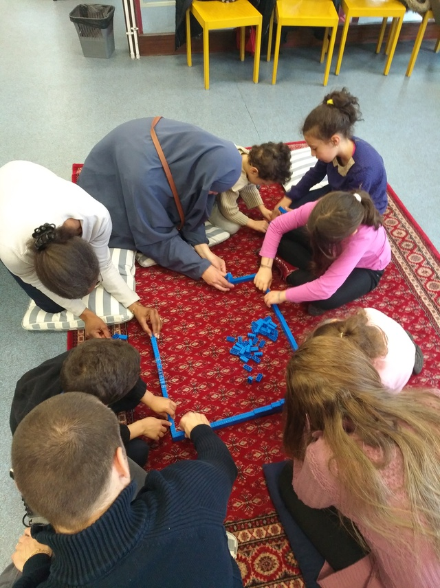
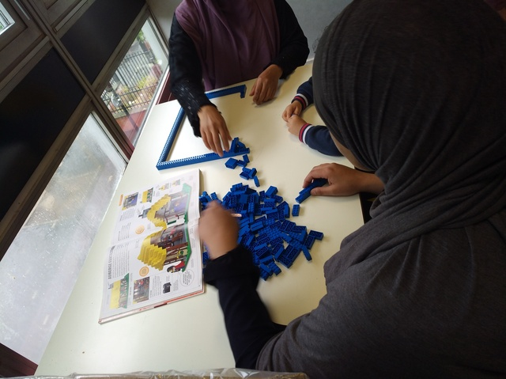
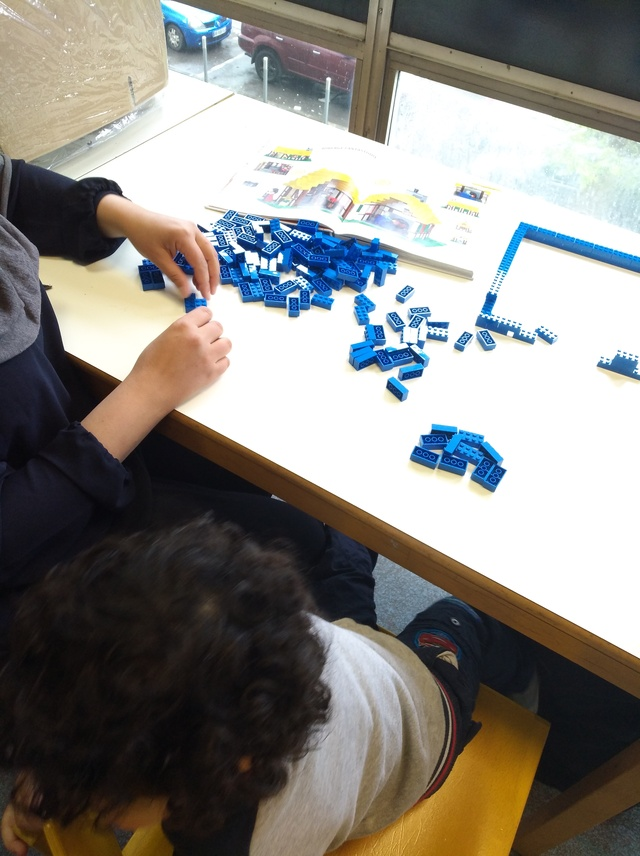
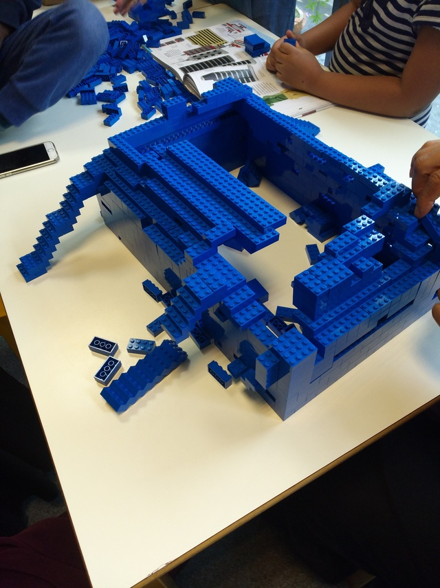
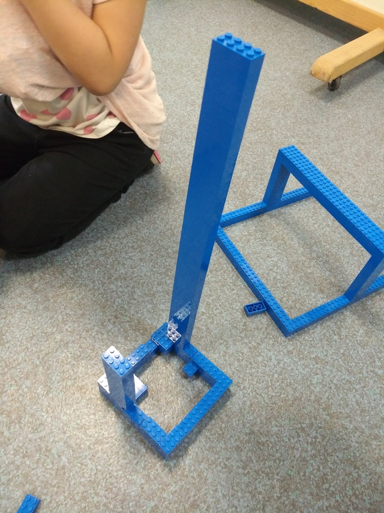
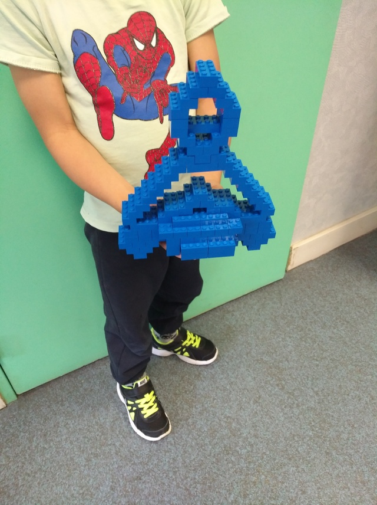
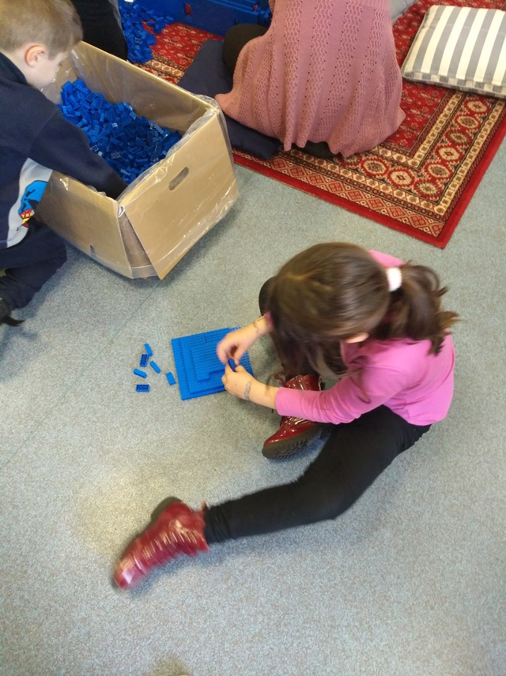
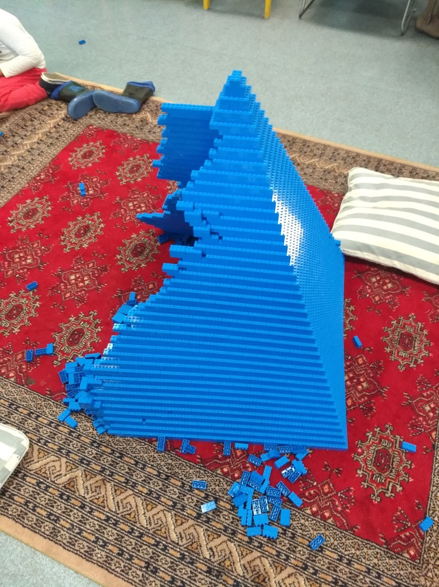
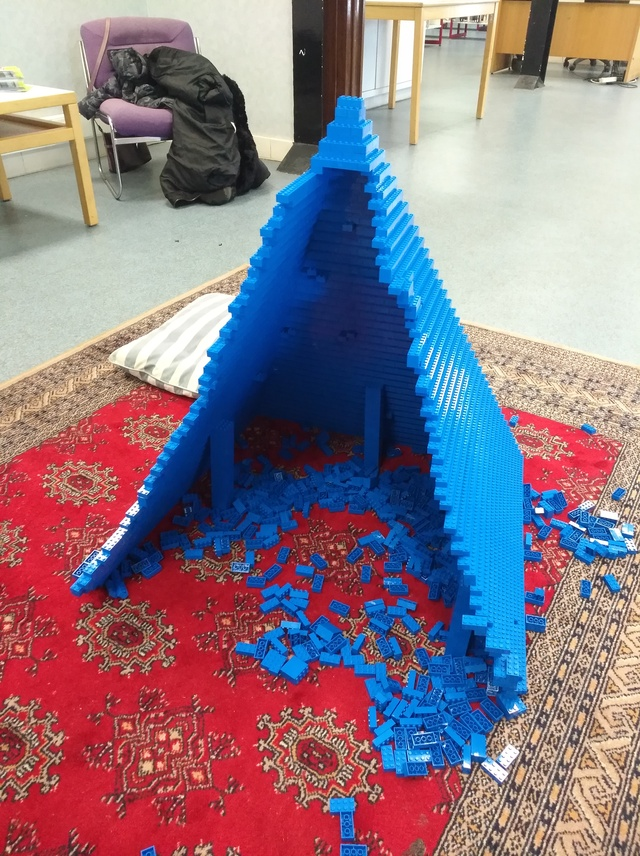
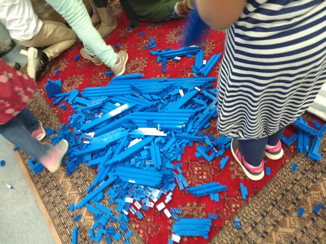

Après l’[animation en 2016 à la médiathèque d’Argenteuil](/articles/animation-a-la-mediatheque-d-argenteuil-le-7-mai-2016/), celle-ci a souhaité recommencer l’opération, à la [médiathèque Robert Desnos](http://mediatheques.argenteuil.fr/mediatheque-robert-desnos), située au Val d’Argenteuil.

Le concept était le même, un atelier de construction associant enfants et parents, également dans le cadre du Printemps du jeu.

Cette année les briques étaient bleues, et trois caisses étaient disponibles, de briques 2x4x1.

Il avait donc été prévu trois activités : construction collective d’une pyramide (dont la base était prête au début), construction collective décidée ensemble, enfin construction individuelle ou en petits groupes.

Les participants, une trentaine dont un tiers d’adultes, se sont bien prêtés au jeu, et la pyramide a rapidement pris de l’ampleur.

La construction collective, dont il n’y a malheureusement pas de photos (la raison est expliquée plus loin), s’est orientée sur une grande maison, comportant balcon, fenêtres et portes.

Les constructions individuelles ont été moins déterminées, et ont évolué au gré des aléas de construction.

L’atelier était prévu pour durer deux heures trente. Il a commencé un peu en retard et s’est terminé un peu en avance, donnant un temps total d’environ une heure trente de construction.

Et les plus motivés étaient presque les parents (qui voulaient voir le résultat final) plutôt que les enfants (qui pour certains voulaient changer de sujet).

Certains ont également fait des constructions personnelles.

Une participante a tenté de construire un toit plat pour la maison réalisée collectivement, en empilant trois niveaux de briques tête-bêche. Le résultat était réussi, encore une fois sans photo.

Voici la pyramide terminée (moins un côté, pour simplifier la construction), je pense qu’un pharaon aurait été satisfait du résultat !

Et c’est là que nous avons fait l’erreur fatale de demander aux participants de démonter _avant_ d’avoir pris des photos des constructions terminées — en un rien de temps tout était en morceaux, plus possible de photographier !

* * *

Tous mes remerciements à Léa B.P. de la médiathèque pour les photos, et bien sûr aux participants !
