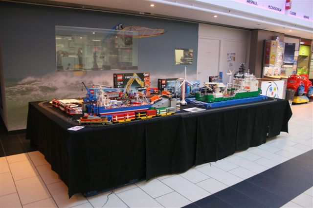
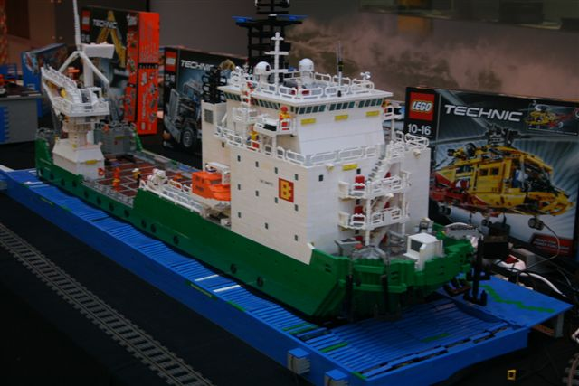

Après avoir contacté la direction de l’hypermarché de Saint-Pol de Léon (29) à 20mn de chez moi, et obtenu leur accord, une date a été choisie (8 au 10 nov) juste après le passage d’un commercial LEGO qui a rempli les rayonnages.

Le 8 dès 6h du matin, j’ai procédé au montage du stand 4x1.60m. A 9h, tout est prêt pour recevoir, conseiller, répondre aux très nombreuses questions de la clientèle jusqu’à 19h30/20h.

Coté présentation du stand, j’ai exposé la barge animée de l’ile de Batz qui a fonctionné comme un métronome, la houle animée avec le Bourbon, un circuit simple de trains de ma collection privée.

Leclerc, à ma demande, a mis des boites Technic et City pour le décor. Pendant l’animation, Leclerc local a fait une vente à prix coutant.

Coté technique, ma houle a eu quelques problèmes, les engrenages avaient tendance à se déplacer, problème réglé en rentrant : l’arrière de la houle a "explosé" par le jeu des vibrations : problème réglé radicalement aussi.

J ’ai eu aussi des crashs type "bataille du rail", la table n’était pas une table ordinaire mais une superposition de palettes et panneaux par dessus avec des variations de niveaux importantes à certains endroits. J ’ai essayé de réduire les écarts, certains trains roulaient très mal comme le train de Mont Blanc, le TER Bretagne.

Comme prévu, la clientèle a cru que tout venait des boîtes, erreur ou ignorance, je leur ai expliqué qu’il n’y avait pas que les boîtes LEGO, on peut aussi faire de la création à partir de toutes les pièces LEGO.

Du coup, j’ai senti un grand intérêt de la part du public. Beaucoup de personnes locales m’ont évidemment reconnu, certaines d’entre elles, ayant vu mes bateaux, m’ont parlé d’un passionné de LEGO vu à la télé (sourire). Je ne vous donne pas la réponse !

J’ai eu de nombreux contacts, informé le public pour les futurs salons locaux. Le 10 novembre, au soir, démontage du stand et félicitations du magasin.

Merci à Damien de Brest d’avoir passé quelques heures avec moi.

[Mes photos](http://photos.freelug.org/main.php/v/barr__/expositions/2012/leclerc/).

jean marc
