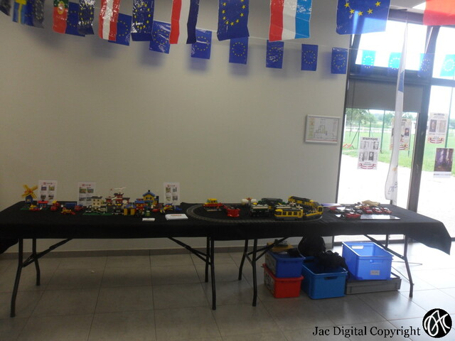
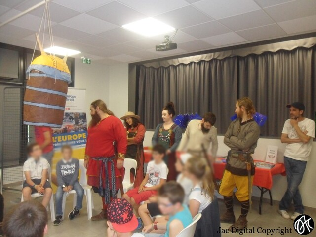

Nous avions été invités à représenter la brique LEGO à une animation qui avait pour thème le Danemark, à Seuillet.

Pour l’animation de ce mercredi 5 juin 2019, à Seuillet (3), les organisateurs avaient prévue de faire découvrir le Danemark aux enfants. Pour représenter la firme danoise de jouets de construction la plus connue du monde, nous avons été invités à présenter un stand avec quelques constructions.

Deux membres de l’association FreeLUG ont pu se rendre disponible pour cette date, juste un après midi. Mais Franck ne pouvant finalement pas être là, il m’a confié quelques vieux sets. Les panneaux fournis avec les dates étaient très pratiques, car je n’ai pas tout en tête.

Seuillet est un petit village et c’est sans soucis que j’ai trouvé la salle des fêtes sous un temps bien mitigé mais qu’importe.

Les présentations sont faites et je retrouve un des membres des Héritiers de la Force qui a pensé à nous lors de l’organisation de cette animation. On place les deux tables et je commence ma petite installation avec les vieux sets d’un côté, quelques trains et des "speed Champions" de l’autre. Le stand est vite pris d’assaut par les personnes présentes. Je commence de suite les explications, grâce aux petits panneaux.

Un jeune habitant de Seuillet demande à exposer ses constructions. Il expose quelques sets modifiés et des Ninja en action sur une table voisine. Il contribue lui aussi à la présence des LEGO sur les lieux.

Une petite troupe déguisée en vikings nous donne quelques informations sur ce peuple du Nord connu comme des envahisseurs, sous forme de quizz. C’était très intéressant. J’ai appris des choses, mais j’en ai oublié aussi.

J’ai passé un après-midi très agréable dans une ambiance sympathique, l’accueil était excellent. Le petit stand a été très apprécié.

[Lien vers la galerie pour plus de photos](https://photos.freelug.org/main.php/v/JAC/Exposition/2019/Seuillet03/)
