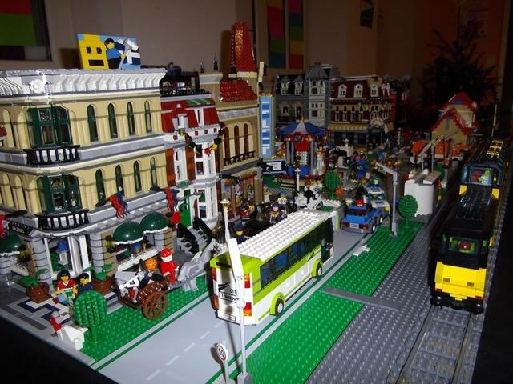
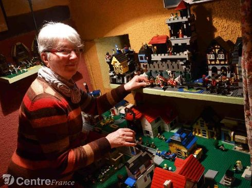

Voilà un petit résumé de ces quelques jours.

Cette petite ville d’Auvergne a offert à ses 6900 habitants une semaine de Noël exceptionnelle :  
\_\* Marché de Noël, aux petits chalets construits par les élèves de la filière bois du lycée Blaise Pascal ;

-   Concerts ;
-   Accro-branches et tyrolienne devant l’église Saint-Jean ;
-   Petits trains de promenades en ville ;
-   Exposition de villages miniatures à la mairie ;
-   Exposition et concours LEGO à l’annexe de la mairie.

La jeune femme qui dirige le service communication, fan de nos petites  
briques, avait contacté l’association FreeLUG pour une participation à l’exposition. En ces semaines de fêtes, j’ai pu seule m’y rendre. J’ai donc présenté ma ville (modular et mocs) sur tables 1,20m x 1,80m et les vaisseaux SW 1999/2000 (déjà à Cusset cette année) dans trois vitrines.

Mme Trait a présenté trois panneaux sur l’histoire de la marque avec quelques photos de sets.

J’ai été très bien accueillie et eu droit à l’aide d’un jeune stagiaire Eric, qui s’est régalé en plaçant les minifigs au gré des scènettes.  
L’expo qui a duré 8 jours sous surveillance de la mairie, a reçu quelques 2000 visiteurs, avec un pic de plus de 500 personnes dimanche 22 décembre.

Mme Trait m’a également offert un reportage et interview par le journal régional La Montagne qui devait être sur mes réalisations, et fut en fait sur moi et mes briques, une page entière et un encart sur la une. Je n’ai pas oublié FreeLUG, voir ci-dessous.

voici donc sur ma galerie [toutes les photos](http://photos.freelug.org/main.php/v/dannylou/expos/2013_001/).

Mamy Danny

* * *

**Extrait de l’article parue dans la montagne, le Jeudi 26 Décembre 2013**

Ambert  
Auvergne > Puy-de-Dôme > Ambert 26/12/13 - 06h00  
Jusqu’au 28 décembre, l’annexe de la mairie accueille le village LEGO® imaginé par Danièle, 72 ans

Dans la mezzanine de sa petite maison, Danièle a aussi un petit village médiéval qui fait la joie de Jeanne, sa petite-fille avec son magicien, sa sorcière, Robin, et ses chevaliers. - JAULHAC François

De 7 à 77 ans. La marque danoise LEGO® peut se targuer de plaire à tous les âges. À 72 ans, Danièle a emboîté sa vie dans cette passion, créant villes et dioramas et assemblant les engins de Star Wars.

Danièle est une de ces mamies qui, hier, devant le sapin de Noël n’aurait pas rechigné a donné le coup de main pour assembler le complexe bateau LEGO®, amené par le Père Noël aux petits-enfants. Car « Mamy Danny », à 72 ans, est une véritable passionnée de ces petites briques danoises, lancées en 1949 au point de créer - de toutes pièces donc - une petite ville, présentée jusqu’à samedi dans le hall du Service enfance-jeunesse-famille de l’annexe de la mairie d’Ambert (voir par ailleurs).

**Dans les années 80**

Rien ne prédestinait pourtant cette retraitée d’un cabinet d’expert-comptable à tomber tout entière dans les LEGO®. « Mes enfants avaient fait des LEGO® dans les années 80 qui avaient été soit perdus, donnés ou jetés », sourit-elle, arguant qu’« elle ne voyait pas alors l’investissement que cela pouvait être ». Sa petite-fille, Jeanne, la fera changer d’avis, à 9 ans, en lui demandant une ferme de la marque. Le modèle Duplo® est trouvé dans une brocante puis rapidement complété d’animaux trouvés sur Internet. Le virus se saisit de la grand-mère plus encore que de la petite-fille. Et entre leurs quatre mains, une ville prend forme un peu partout dans la petite maison de Danièle Quincy-Rossignol, à Lezoux, avant de migrer vers la mezzanine. Jeanne y recrée avec Danièle les maisons de ses ami(e)s à l’aide de briques chinées, achetées, glanées ça et là. « J’ai fait beaucoup de puzzles. Le LEGO®, c’est aussi un puzzle mais en 3D ! », explique Danièle. Cette première ville vivra et grandira avec Jeanne, qui voudra ensuite jouer avec la ville conçue par sa grand-mère.

La seconde brique de la passion de Danièle s’emboîte lors d’une exposition de modélisme ferroviaire, passion d’Alain son compagnon, où elle rencontre les membres de l’association FreeLUG (LEGO User Group), rassemblant les passionnés de la marque. L’amitié se construit et Danièle devient « Mamy Danny ». « Nous organisons des expositions, soit typiquement 100 % LEGO soit des animations comme à Ambert, Randan, à Chamalières (fin octobre) ». Le temps fort est aussi la convention Star Wars de Cusset (Allier) où Danièle a, par exemple, présenté ses modèles de 1999-2000, les premiers sortis par la marque. Et attention, en connaisseuse, la non plus, on ne lui fait pas à Danièle : « J’aime la prélogie (les épisodes IV à VI, N.D.L.R.) et juste La menace fantôme. La suite, c’est de la soupe ! », sourit-elle. Idem pour les LEGO® Star Wars, qu’elle collectionne : « J’aime les modèles afférents à ces quatre épisodes. Tous les deux ou trois ans, LEGO® ressort les mêmes modèles. Ils sont juste un peu plus perfectionnés et de plus en plus beaux ». Quand ils ne sont pas alignés sur une étagère, ces modèles de la Guerre des étoiles font les beaux jours des expositions, telle celle d’Ambert où Danièle présente la forêt d’Endor et ses Ewoks et plusieurs appareils de cette mythologie spatiale : Gungan Sub, Millenium Falcon, Sith Infiltrator de Darth Maul, X-Wing, Tie-Fighter et autres podracers.

**Un autorail en briques**

Et pour ceux qui aiment garder les pieds sur terre, il reste cette ville créée par Danièle. Sur 1,80 m par 1,20 m s’y côtoient la gare d’Ambert, l’Hôtel des Voyageurs, un restaurant chinois, une mairie (ressemblant à celle de Chamalières), un manège, des commerces, un tramway… Tout une vie constituée de briques, de modèles existants - qui coûtent près de 150 € - ou customisés (MOC pour My Own Creation, pour les experts) où Danièle a même conçu un autorail panoramique semblable à celui d’Agrivap !

Inutile donc de poser la question à Danièle quant à savoir de quoi se composait sa liste de Noël. De LEGO®. Vous l’aurez deviné, entre ce petit manège, déjà exposé à Ambert et surtout une nouvelle maison familiale. « Elle a des éléments vitrés intéressants », songe Danièle, déjà prête à créer un nouveau pâté de maison.

Pratique. Exposition jusqu’au 28 décembre, de 14 heures à 18 heures, hall du Service enfance-jeunesse-famille de l’annexe de la mairie, boulevard Henri-IV, à Ambert.

François Jaulhac  
francois.jaulhac@centrefrance.com

* * *
