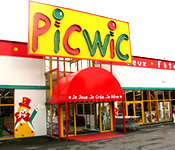

Cinq membres de FreeLUG seront présents le samedi 21 mai 2005 au Pic Wic de Rennes afin d’exposer un diorama Star Wars.

Le magasin [Pic Wic](http://www.picwic.com/page_plan.asp?magasin_id=9) situé quartier Cleunay, en face du Leclerc, nous a convié à exposer nos modèles/MOC/diorama pour la journée du samedi 21 mai.

**Magasin Pic Wic Rennes Cleunay**

photos de l’entree du magasin

A cette occasion, nous présenterons un diorama Star Wars de la planète Tatouine, présente dans les films I, II et IV, ainsi que des modèles personnels et des constructions robotisées avec les sets Mindstorms.

Le magasin est ouvert de 9h30 à 20h00 le samedi ( 10h00 - 19h30 du lundi au vendredi ).

Manu (gyclore), Marc (maya), Ghislain (Dagobot), Laurent (luigi) et Gael (khan) seront là pour faire l’animation autour des créations.

Si vous voulez suivre la préparation, ou en savoir plus sur ce qui sera exposé, rendez vous sur [la page du wiki de FreeLUG](http://wiki.freelug.org/tiki-index.php?page=Exposition+Pic+Wic+Rennes) qui contient le plan du layout et des photos.

N’hésitez pas à me contacter si vous avez des questions.
