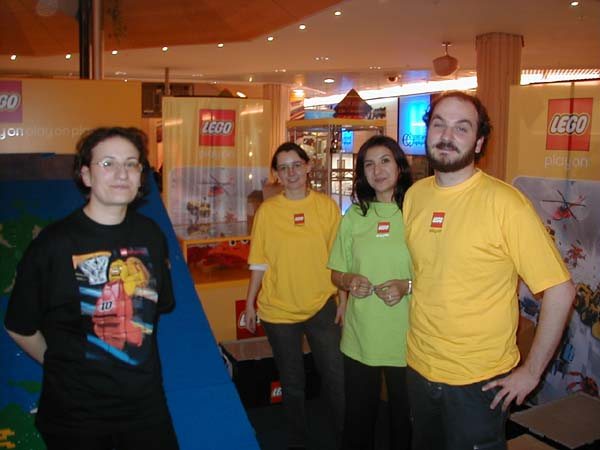
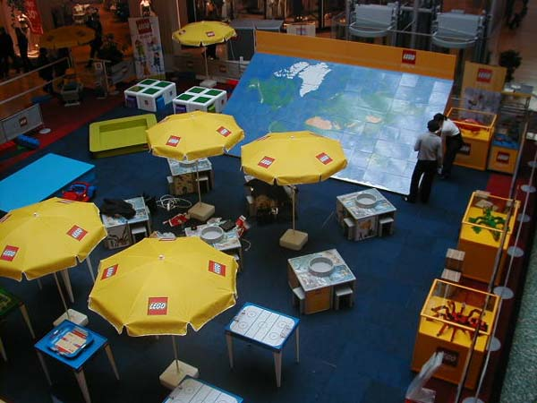
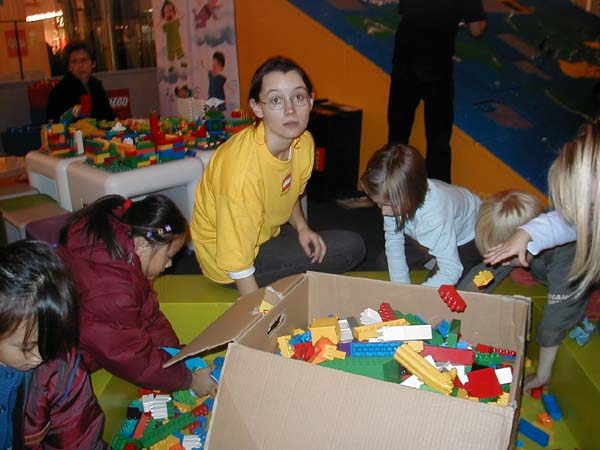
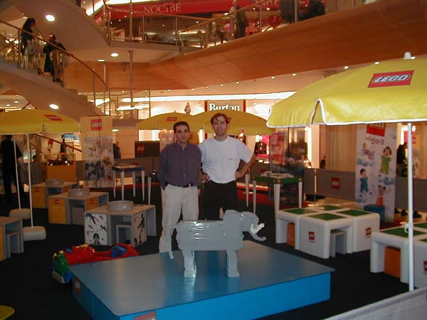

Nous voila donc avec Banban au centre commercial de la Part-Dieu à Lyon, en ce samedi après-midi.

Nous allons  
donner un coup de main sur une animation LEGO, ou nous rencontrons l’équipe d’animateurs :

Isabelle, Elise, Ines et Jean-Marcel

Parmi les animations, certains reconnaitrons notemment la World Map que nous avons déjà eu l’occasion de  
voir à LEGOWorld.

Mais les visiteurs peuvent aussi admirer des nombreuses "sculputures"  
sur le thème des animaux ou faire des partie de foot ou basket miniature, ou tout simplement jouer avec du vrac,  
comme ici avec Elise.

Par ailleurs, de nombreuses caisses sont à notre disposition (surtout de la brique 2x4) de toutes les couleurs.  
Nous nous décidons pour du gris et du blanc afin de faire un éléphant.

Pour cette réalisation il est difficile de faire participer les enfants, mais ils sont nombreux, émerveillés, ainsi que leurs parents, à  
nous poser des questions : avez-vous un plan ? faites-vous cela de mémoire ? est-ce que c’est vous qui avez fait les  
autres animaux ? comment ils sont fait ? etc.

Pour ma part j’ai beaucoup apprécié d’avoir à ma disposition autant de briques pour construire quelquechose de vraiment gros. J’ai appris à construire une structure de cette taille sans brique Technic, ce qui n’est pas aisée. Un seul regret : j’ai pas pu repartir avec mon MOC sous le bras :-).
