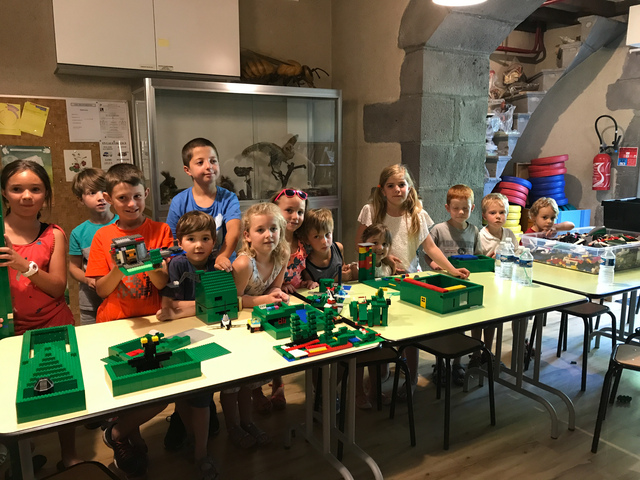
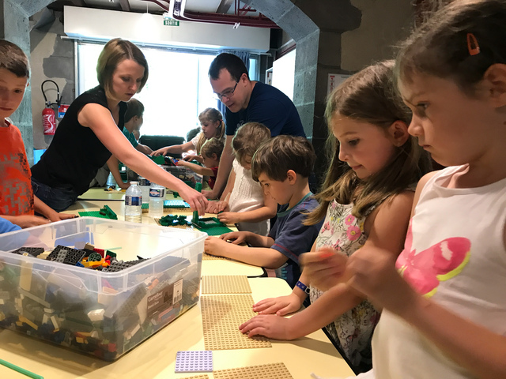

Le mercredi 5 juillet après-midi, le service d’action sociale et culturelle de l’Université Clermont Auvergne a organisé pour les enfants de ses personnels une visite contée de l’exposition _La maison des animaux_ présentée au Muséum Lecoq de Clermont-Ferrand.

A la suite de cette visite, la vingtaine d’enfants présents ont participé à un atelier de construction sur le thème « Reproduire l’habitat des animaux en LEGO ». Cette animation a été montée par une adhérente FreeLUG, responsable du service organisateur, grâce au prêt d’un stock de 6000 briques LEGO par l’association. Elle a, en outre, reçu le soutien très apprécié de deux autres FreeLUGiens : Florent, qui a prêté son stock personnel de briques en vrac et Damien, qui est venu bénévolement animer l’atelier conjointement avec la médiatrice du Musée.

Les enfants, âgés de 4 à 12 ans, ont été ravis de cette animation ludique et se sont montrés très créatifs dans leur construction, reproduisant des terriers de lapins, des tanières de loutres ou encore les animaux eux-mêmes décrits dans la visite vue précédemment.

