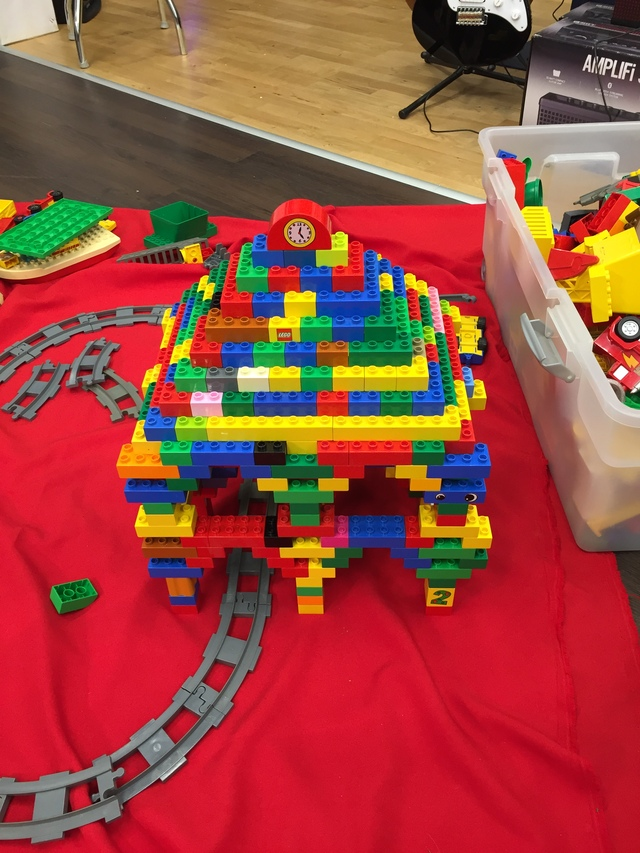
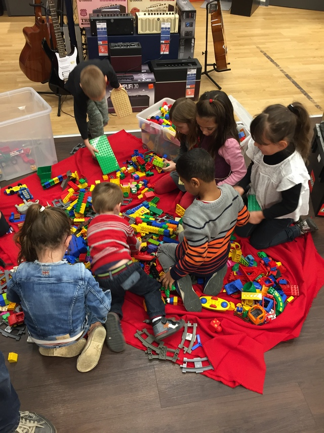
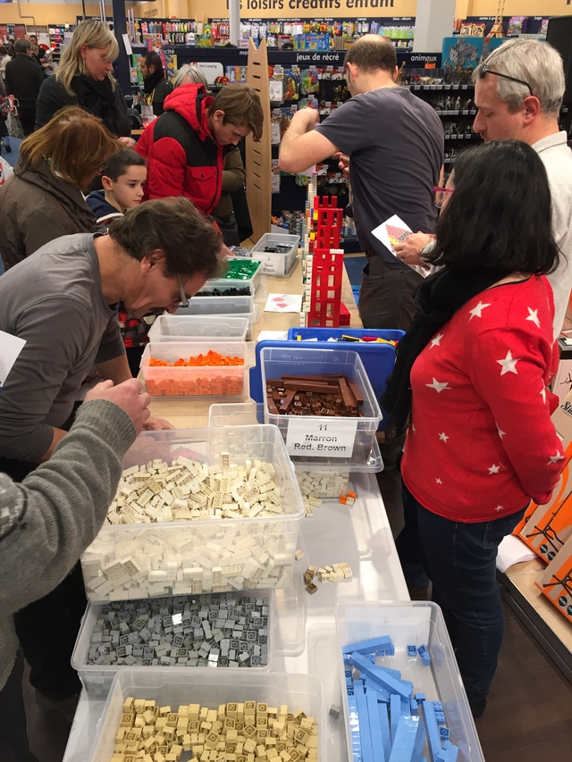
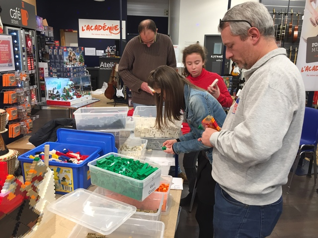
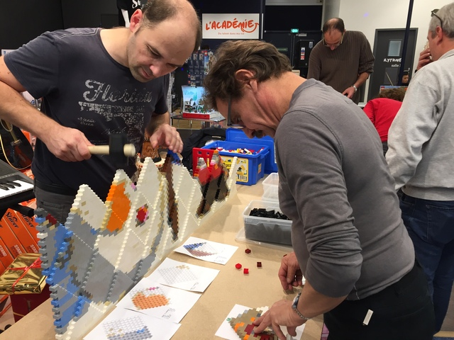
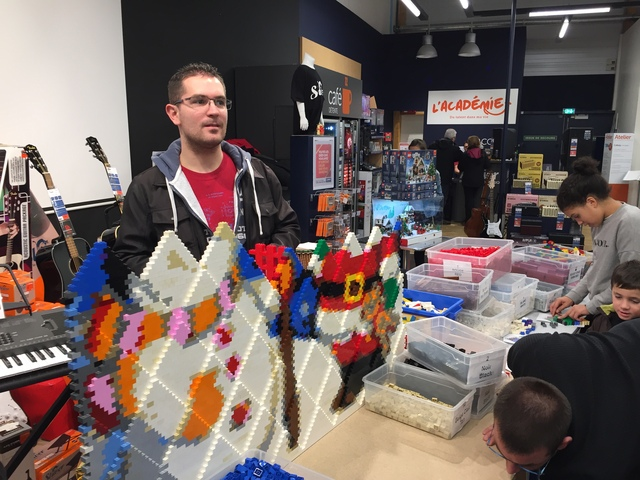
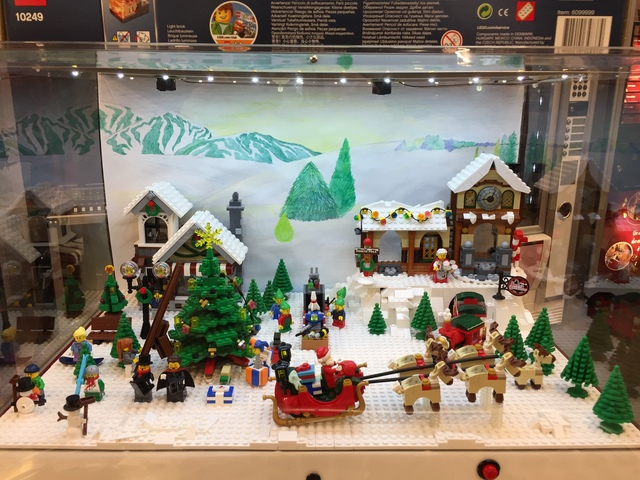
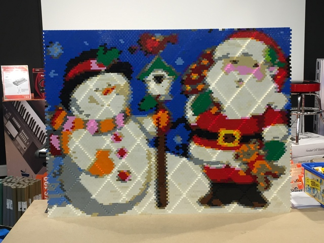

Le samedi 3 décembre nous avions rendez-vous au magasin Cultura à Bourgoin-Jallieu. Depuis la Briqu’Expo Diemoz, Cultura est un partenaire. Ils seront bien sûr au rendez-vous du 2 et 3 septembre 2017 pour la Briqu’Expo Rhône-Alpes.

Pour cet après-midi nous avions prévu les briques rouges, les éléments DUPLO ainsi qu’une vitrine réalisée par Fabrice Brosseau. Didier (et Simon) se chargeait quant à lui de nous préparer une magnifique mosaïque de 8000 pièces.

Plusieurs membres du VoldeCor (le comité régional FreeLUG sur la région Rhône-Alpes) étaient présents : Marine, Arnaud, Pierre, Francis, Didier, Antoine. Francis est venu en sa qualité de représentant d’Emmaüs qui sera aussi partenaire de la Briqu’Expo.

Voici quelques photos de l’animation :

* * *

C’est toujours un plaisir pour venir aider à la création de la mosaïque et revoir quelques FreeLugiens et FreeLugiennes. Resté peu de temps, j’ai bien apprécié ce moment.

Arnaud
