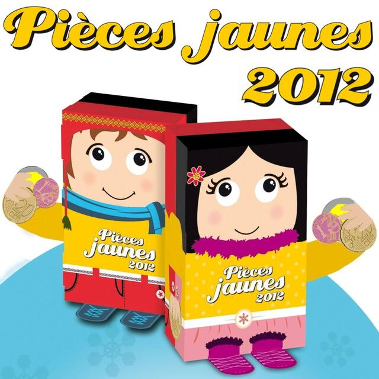
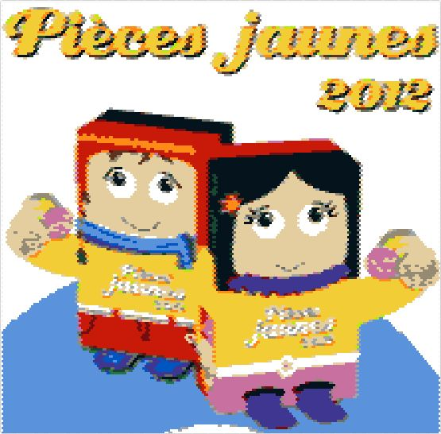
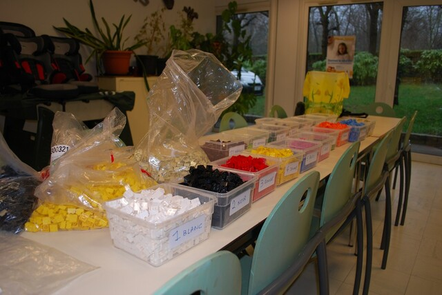
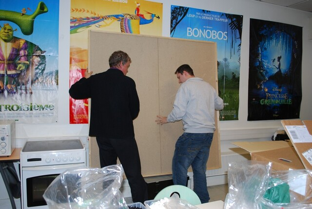
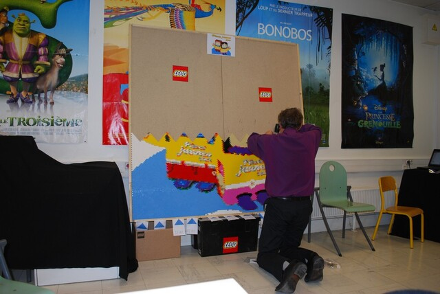
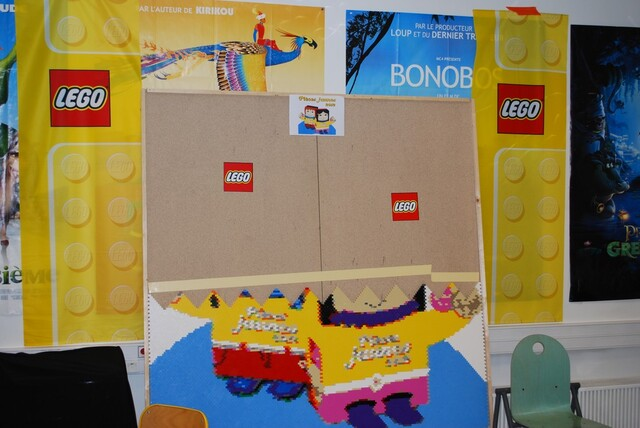
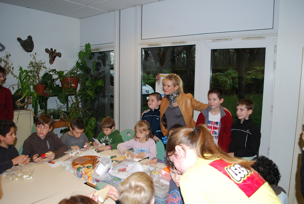
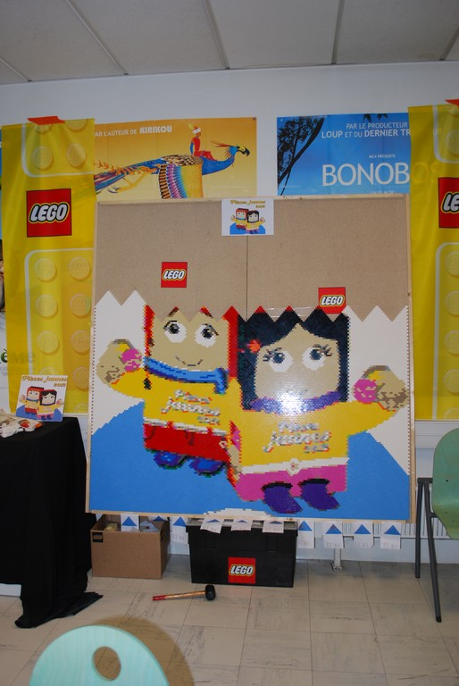
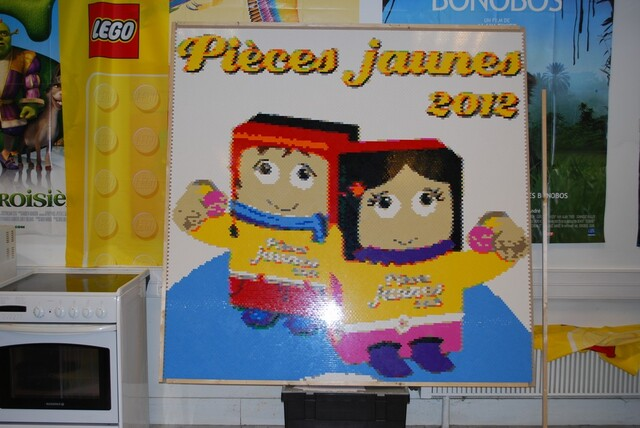

FreeLUG a participé à la demande de LEGO France à l’organisation d’une animation LEGO pour l’ouverture de la campagne Pièces Jaunes 2012.

Objectif de l’animation : monter une mosaïque de 2m par 2m environ et d’animer un atelier pour les enfants hospitalisés sur la base de l’image suivante :

Pour ce projet la demande nous est parvenue le 24 novembre 2011 de la part de LEGO France. Nous étions (Erik et Jérémy) sur le chemin de l’exposition de Saizerais ce jour-là. LEGO France nous demande un accord de principe pour la réalisation pour le lundi. Après quelques coups de téléphone à Simon pour avoir son avis sur la conception de la notice et la faisabilité du projet, nous relevons donc le défi de la faire malgré le peu de temps de préparation que l’on dispose et nous envoyons notre accord à LEGO France.

Un première maquette de construction avec 16 couleurs parvient à LEGO France le 26 novembre. Après discussion avec LEGO Fr et la fondation, nous décidons de ne prendre qu’une partie de l’image, la partie à droite avec les deux boites.

La mosaïque est uniquement constituée de brique 2x2 empilées les unes sur les autres avec un décalage de 1 tenon à chaque rangée.

Simon nous en sort la seconde maquette le 29 novembre. S’en suit un retour de La Fondation des Hôpitaux de Paris, qui nous demande si il est possible de corriger certaines couleurs, dont le violet. Je pars donc à la recherche de briques violettes 2x2. Problème, on ne la trouve essentiellement que dans le bus Harry Potter de 2002 et n’est donc plus produite. La solution intermédiaire est donc de prendre 2 briques de 1x2. Nous pouvons donc sortir une version avec des couleurs de plus. La troisième version avec les changements de couleur part donc le 31 et est validée.

Entre temps, Simon fournit le décompte des briques nécessaires à la mosaïque :  
**–** Blanc : 6656 briques 2x2  
**–** Noir : 1160 briques 2x2  
**–** Rouge : 987 briques 2x2  
**–** Jaune : 2589 briques 2x2  
**–** Bleu : 95 briques 2x2  
**–** Rose : 549 briques 2x2  
**–** Vert : 17 briques 2x2  
**–** Orange : 492 briques 2x2  
**–** Bleu clair : 3004 briques 2x2  
**–** Beige clair : 2292 briques 2x2  
**–** Marron : 250 briques 2x2  
**–** Vert fluo : 78 briques 2x2  
**–** Vert foncé : 163 briques 2x2  
**–** Beige foncé : 408 briques 2x2  
**–** Gris foncé : 244 briques 2x2  
**–** Rouge foncé : 134 briques 2x2  
**–** Gris clair : 249 briques 2x2  
**–** Violet foncé : 1086 briques 1x2

Soit pas loin de 20000 briques 2x2.

Après 1 h de recherche des numéros d’items correspondants, j’envoie la commande de pièces qui part le 1er décembre chez LEGO Fr.

Les cartons arrivent ensuite chez moi le 15 décembre, un rapide coup d’œil au contenu pour vérifier les quantités et les couleurs (ouf de soulagement, je ne me suis pas trompé dans les références d’items). S’en suit un petit relâchement suite aux fêtes de Noël et nouvel an. Nous (Nelly et Jérémy) reprenons le projet mosaïque dès début janvier. Cette reprise consiste en une préparation de petits sachets zip avec le plan et les 100 briques nécessaires à la réalisation de chaque élément de la mosaïque sous forme de losange.

Au passage, on ne résiste pas au montage de quelque uns des modules :)

Nous arrivons donc tous (Nelly, Simon et Jérémy) le 5 janvier au matin vers 10h à l’hôpital de Garches, en 30 minutes nous sommes prêts à commencer.

C’est donc la course contre la montre, il faut que la moitié de la mosaïque soit assemblée pour 14h, heure de passages des officiels, Bernadette Chirac et Lorie, pour les photos des journalistes.

A 14h00 l’objectif premier est atteint, après le passage des officiels, quelques enfants (une soixantaine) viennent nous rejoindre pour faire avancer le montage.

**Lorie avec les enfants en train d’assembler les modules de la mosaique.**

De nouveau à 16h00 nous nous retrouvons seul pour finaliser la mosaïque. Ce qui est finalement fait à 18h00.

La mosaïque restera à la Fondation des Hôpitaux de Paris.

_Simon, Nelly & Jérémy_
