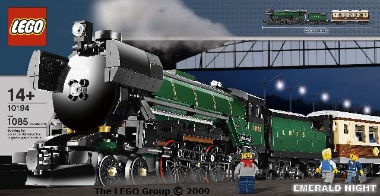
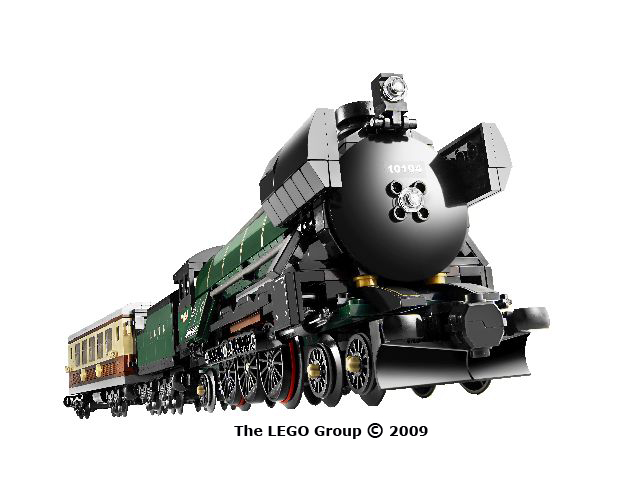
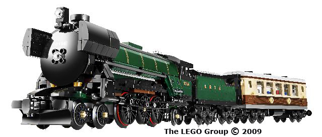
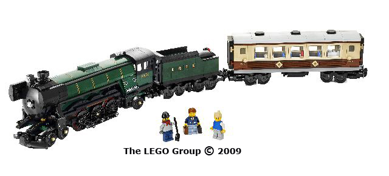
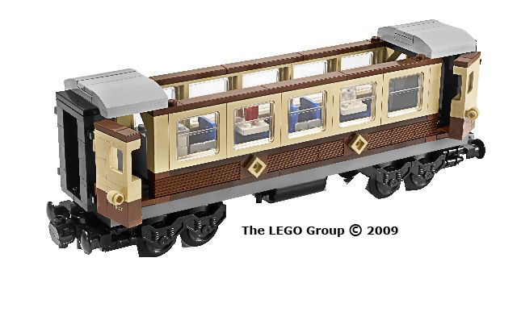
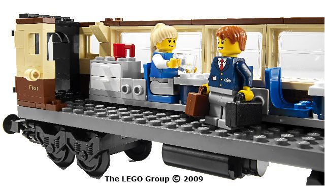
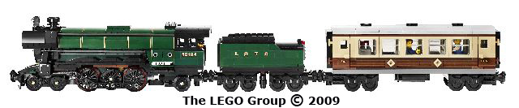

[Traduction de l’annonce de la sortie du nouveau train LEGO 10194, provenant du forum des Ambassadeurs LEGO](http://news.lugnet.com/announce/?n=3916).

_Mise à jour : [le modèle est présent sur le s@h](http://shop.lego.com/ByTheme/Product.aspx?p=10194)_

Suite au dévoilement dans de nombreux blogs et forums de fans durant les derniers jours, nous annonçons que The LEGO Company va lancer le train #10194 Emerald Night Train à la fin du mois de mars, début avril via LEGO Shop at Home et les boutiques LEGO.

La boîte #10194 sera d’abord dévoilée simultanément à BrickFest PDX à Portland dans l’Oregon et au Wunderwelt Modellbau à St. Pölten en Autriche les 27 & 28 mars 2009.

Ci-joint, la communication marketing de The LEGO Company qui aide à découvrir les détails de ce nouveau grand produit. Egalement, vous trouvez quelques informations concernant le prix.

Et il y a encore plus à dire... mais nous gardons tout cela pour les évènements cités ci-dessus.

Vous trouverez de plus amples informations sur le train #10194 Emerald Night le 30 mars sur [www.LEGOshop.com](https://www.legoshop.com/).

Descriptif :  
**–** #10194 - Emerald Night  
**–** Age : 14+  
**–** 1,085 pièces  
**–** Prix :

-   US $ 99.99
-   CA $ 129.99
-   UK £ 68.50
-   DE € 89.99

Avec des roues propulsées par piston, ce train est d’ors et déjà un tout nouveau classique LEGO.

Voici le Emerald Night ! Construits cet incroyable train classique plein de détails, de la locomotive à vapeur avec sa chaudière au tender et à la voiture restaurant avec un toit escamotable, des portes qui s’ouvrent et un intérieur détaillé.

Mesure 68 cm de long ! Inclut trois minifigs, des éléments dans des couleurs rares et de toutes nouvelles grandes roues propulsées par piston !

