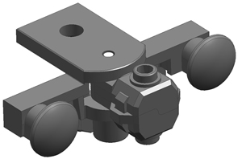
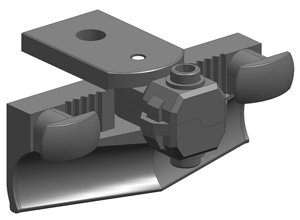

Traduction de l’annonce officielle de Jan Beyer concernant les aimants dans les boîtes LEGO ([version originale](http://www.railbricks.com/index.php?option=com_content&task=view&id=35&Itemid=44))

Bonjour à tous,

Suite à un accident avec un produit d’un autre fabricant de jouets, le groupe LEGO s’attend à une interdiction des petites pièces contenant des aimants aux USA et en Europe à partir de 2009. En conséquence, le groupe LEGO a décidé d’arrêter de vendre les produits contenant des aimants dans de petites pièces pour se conformer dès maintenant aux nouvelles règles et ne pas faire de compromis avec la sûreté des produits.

Cela impacte principalement deux produits : les aimants pour réfrigérateur et les éléments de couplage des trains.

Les aimants de train vont être re-dessinés comme vous pouvez le voir sur les images et nous espérons les introduire dans les boîtes à partir d’août. Les boîtes de trains emballées avant août contiendront toujours le modèle existant des aimants. Le nouvel élément magnétique des trains sera visuellement différent de l’actuel. Toutefois, comme l’aimant peut tourner dans le cache plastique et que la force d’attirance sera aussi forte que les anciens éléments, leur fonctionnalité sera identique et complètement compatible avec le système actuel.

Les aimants pour réfrigérateur vont être également re-dessinés et la nouvelle version est prévue pour la vente fin 2008.

Jan Beyer, LEGO Community Development
