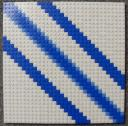
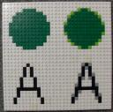
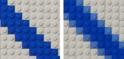
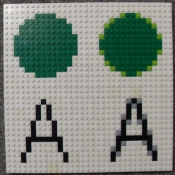
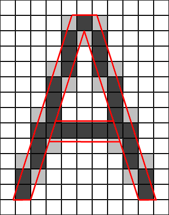
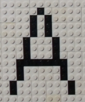
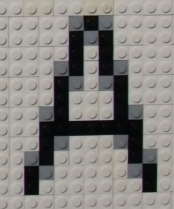
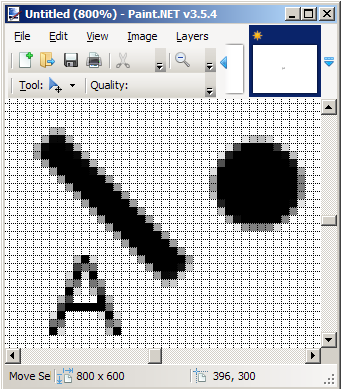

Cet article est une adaptation d’un [article en anglais](http://brickplayer.com/blog/2010/05/03/anti-aliasing-with-lego-part-1/) paru initialement sur [BrickPlayer](http://brickplayer.com/blog/).

Toutes mes [mosaïques LEGO](http://brickplayer.com/blog/category/projects/mosaics/) précédentes appartiennent à l’une de ces deux catégories. D’abord, il y a les mosaïques du type photo-réaliste comme celles de [mes aînés](http://brickplayer.com/blog/2008/01/27/lego-mosaic-maddie-howie/), ou de [mon benjamin](http://brickplayer.com/blog/2008/02/16/lego-mosaic-mathew-abby/). Ensuite, il y a celles du type "à-plats" comme [la mosaïque "Danny Phantom"](http://brickplayer.com/blog/2008/02/09/lego-mosaic-danny-mathew/), ou [la mosaïque du logo de Starbucks](http://brickplayer.com/blog/2008/01/23/starbucks-coffee-mosaic/).

A partir de ce jour, apparaît une autre catégorie, celle des mosaïques à-plats avec anti-crénelage.

Dans la vie, je suis développeur informatique. Cependant, pour le plaisir, j’ai commencé récemment à m’amuser avec la [programmation sur iPhone](http://software.brickplayer.com/). Ce passe-temps m’a fait découvrir le concept de graphisme lissé. De manière simpliste, l’anti-crénelage (AC) consiste à employer des couleurs plus claires (ou sombres) afin de lisser les transitions dans les zones de variations brusques de couleurs. Les briques LEGO sont un bon moyen d’illustrer cette technique.

Ci-dessus deux illustrations de mosaïques LEGO avec et sans AC. La ligne bleue du milieu laisse moins apparaître l’effet d’escalier et le cercle vert et la lettre "A" de droite semblent aussi être plus lisses que ceux de gauche. J’ai intentionnellement montré ces images en taille réduite car la démonstration de l’avantage de l’AC passe par un mélange visuel des pixels.

Les briques LEGO sont disponibles dans de nombreuses couleurs, et par conséquent, la plupart sont disponibles dans au moins deux nuances, ce qui est nécessaire à l’AC. En utilisant une nuance plus claire au bon endroit, l’apparence est, à distance, visuellement lissée.

Ci-dessus un agrandissement d’une partie de la ligne bleue. L’image de droite a été lissée par l’addition de briques bleu clair. Si l’arrière-plan était d’une autre couleur, les briques supplémentaires devraient être d’une autre couleur. La couleur doit être choisie entre les couleurs présentes de chaque côté de la transition.

Ci-dessus un agrandissement de la balle verte et du A. De la même manière que dans l’exemple précédent, des briques vert clair et grise ont été ajouté (et à certains endroits ont remplacé des briques plus sombres).

Cette technique peut être employée sur l’ensemble d’une grande mosaïque pour créer l’apparence du lissage, particulièrement vu de loin.

Nous venons de voir des exemples simples d’anti-crénelage (AC) avec des LEGO. Attachons nous maintenant à déterminer quelle teinte choisir dans une mosaïque, qu’elle soit standard ou lissée.

Sur l’image ci-dessus, la ligne rouge délimite les contours de la lettre A que nous allons construire en mosaïque LEGO. LA première étape consiste à superposer une grille à la taille désirée sur le contour. Plus la grille est fine, plus le résultat sera précis, mais plus grand le nombre de briques nécessaires sera (ainsi que le temps et les efforts). Pour cet exemple, le A est placé dans une grille de 9 par 11.

Pour construire une mosaïque en noir et blanc seulement, la règle veux que si 50% ou plus d’un carré de la grille est noirci, alors la brique doit être noire, sinon, elle doit être blanche. En suivant cette règle, la mosaïque qui en résulte est celle ci-dessous.

Pour construire une mosaïque en noir et blanc avec une couleur additionnelle (gris) pour le lissage, les règles sont celles-ci. Si moins de 33% d’un carré de la grille est noirci alors la brique est blanche. Si de 33% à 67% du carré est couvert, alors la brique est grise. Si plus de 67% de la surface d’un carré est recouverte alors la brique est noire. En suivant ces règles, la mosaïque obtenue est celle ci-dessous.

Le même processus fonctionne avec d’autres couleurs pour le fond et la forme, tant qu’on utilise des briques de couleur intermédiaire pour le lissage. Les exemples précédents utilisent respectivement du bleu clair et du vert clair pour lisser des mosaïques bleues et vertes sur un fond blanc. Les couleurs LEGO effectivement produites limitent les possibilités. De plus, les coloris exotiques sont aussi plus chers et limitent vos choix, surtout pour des projets d’ampleur.

**Parmi d’autres, voici des méthodes pour améliorer ou affiner l’anti-crénelage :**  
**–** Utilisez plus de couleurs. Par exemple, si deux couleurs intermédiaires sont employées, les règles peuvent être ajustées pour créer quatre niveaux (< 25%, entre 25% et 50%, entre 50% et 75%, > %75).  
**–** Ajustez les niveaux pour les nuances qui ne sont pas exactement intermédiaires. Par exemple, si le gris est plus foncé que le mi-chemin entre le blanc et le noir, alors les pourcentages concernant le gris pourraient être remontés pour compenser. Par exemple < 50%, entre 50% et %80, >%80.  
**–** Utilisez, pour plusieurs briques proches qui sont justes au dessus ou au dessous d’un niveau, la couleur de l’autre côté de la limite. Cela évitera d’avoir des zones trop claires ou trop sombres.  
**–** Effectuez plusieurs essais pour évaluer le lissage. Faites les additions et changements de couleurs de manières progressives et comparer les résultats. Je recommande de faire ce type d’évaluation à l’aide d’un logiciel de dessin sur un ordinateur car c’est plus rapide que de le faire avec de vraies briques.

Ce sont quelques idées. Il y a des livres et des sites internet qui détaillent les algorithmes d’anti-crénelage en image de synthèse.

Pour cet article, j’ai utilisé un partagiciel, paint.net, afin de créer les images pour les petites mosaïques. Paint.net dispose d’un outil de lissage dont ne dispose pas des logiciels plus simples comme MS Paint. J’ai utilisé un affichage zoomé à 800% ou 1200% avec la fonction grille active.

Ci-dessus une copie d’écran de Paint.net qui montre l’anti-crénelage (avec bien plus de nuances de gris que le permet LEGO). Comme je n’ai utilisé qu’une couleur intermédiaire, j’ai visuellement fait la concordance du spectre de gris sur mes trois couleurs. J’ai aussi ajusté par symétrie et fait quelques essais pour arriver à un résultat duquel j’étais satisfait.
