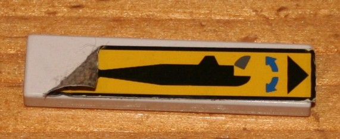
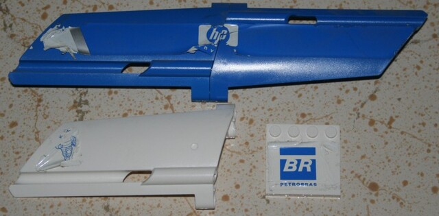
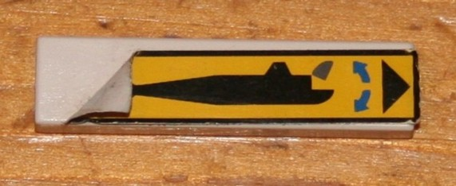
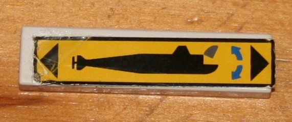
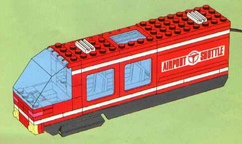
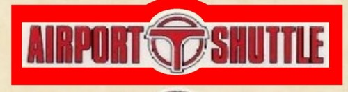
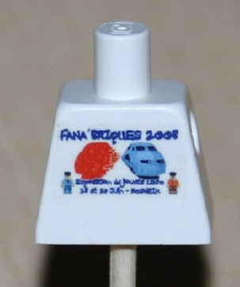

Digressions sur "comment restaurer de vieux autocollants ?" à "la fabrication d’autocollants de remplacement".

## Problématique

La plupart des anciens modèles que vous pouvez trouver sur les vide-greniers ou sur eBay sont souvent incomplets. La plupart des pièces manquantes sont généralement aisément remplaçables, à l’exception des autocollants parce que spécifiques au montage en question. Plusieurs facteurs expliquent la difficulté à trouver des autocollants en bon état mais le principal est que les autocollants vieillissent mal.

Ainsi, s’il est appliqué sur une pièce, il subit les agressions habituelles que subissent les pièces (chocs répétés lors du jeu, lumière du soleil, humidité, poussière et saleté...) et se dégrade de manière irréversible. Et même si le montage est protégé ou si l’autocollant n’est pas appliqué, la colle se modifiant lentement avec le temps, il finit par ne plus coller correctement.

Le but de cet article est de regrouper l’expérience acquise par les membres de l’association FreeLUG en la matière et d’essayer de proposer des solutions à chaque problème que posent les autocollants.

## Les catégories d’autocollants

Avant de discuter leur emploi, leur réparation, leur nettoyage et leur remplacement, il convient de distinguer les différents types d’autocollants.

On peut les séparer en deux grandes familles : ceux qui ont un support opaque et ceux qui ont un support transparent. En effet, s’ils peuvent se distinguer quant à leur usage, ils se distinguent surtout par leur robustesse puisque ceux à support transparent vieillissent bien mieux que ceux à support opaque. Il suffit de les manipuler pour se rendre compte que le support transparent est le plus résistant. Mais, c’est surtout l’examen d’autocollants vieux de quelques années qui révèle que ceux à support opaque ont une nette tendance à s’écailler et à partir en lambeaux (et ne sont plus récupérables) alors que les autres restent intègres (et peuvent être restaurés).

Exemple d’un autocollant partiellement décollé et impossible à remettre en place tel quel puisque de la saleté s’est collée sur la partie collante (voir plus loin pour le nettoyage et la remise en place).

**Sticker de la référence 8480 partiellement décollé et sali.**

Un autre critère pour les distinguer est de savoir s’ils recouvrent plusieurs pièces ou non. Si l’autocollant n’est appliqué que sur une pièce (il suffit alors de considérer que l’on a à faire à une nouvelle référence de pièce), sa tenue dans le temps est principalement conditionnée par la qualité du collage et de son vieillissement. Par contre, si l’autocollant recouvre plusieurs pièces, sa tenue dans le temps est surtout fonction de la stabilité de l’assemblage (sans parler de l’impossibilité de séparer les pièces) : si les différentes pièces bougent beaucoup les unes par rapport aux autres, l’autocollant finira par être déchiré au niveau des séparations entre les pièces.

Exemple d’autocollants très dégradés par le temps : c’est un des pires cas que l’on puisse rencontrer (la planche de la boîte 8461 est grande comme une feuille A4) puisque des autocollants presque entièrement bleus de grande taille recouvrent des pièces de couleur bleue et la partie blanche s’écaille.

**Stickers de la référence 8461 très dégradés.**

## Collage de nouveaux autocollants

_Précautions à prendre :_  
**–** préparation du support : les trois grands ennemis d’un bon collage d’autocollants sont la poussière, les traces de gras et l’air emprisonné entre l’autocollant et les pièces support. Donc, dépoussiérage et dégraissage des pièces sont indispensables avant tout collage.  
**–** manipulation de l’autocollant : le but étant de ne pas mettre du gras des doigts sur la partie collante durant la manipulation, on peut utiliser une pince à épiler (attention à ne pas endommager l’autocollant), un cure-dent ou un cutter pour décoller l’autocollant de la planche et le positionner sur les pièces support.  
**–** élimination de bulles : le mieux est évidemment de ne pas en créer en prenant son temps lorsqu’on applique l’autocollant pour qu’il soit bien appliqué à plat sur les pièces support. Sinon, en cas de bulles, on peut (i) essayer de décoller à nouveau l’autocollant pour l’appliquer mieux mais cela détériore la qualité du collage et on risque de le déchirer ou (ii) piquer les bulles avec une aiguille très fine et en chasser l’air.  
**–** protection : il est tout à fait possible de protéger l’autocollant avec un vernis du type celui utilisé pour les décalcomanies (voir plus bas) mais il vaut mieux faire des essais.

## Nettoyage/Rénovation d’autocollants sans décollage

Parfois, notamment pour ceux qui achètent du vrac d’occasion dans les puces et vide-greniers, les autocollants sur les pièces sont plus "sales" (tâchés, brunis, légèrement rayés par les frottements...) que réellement abîmés (déchirés ou décollés).

Il n’est donc pas forcément pertinent de les remplacer, et c’est en fait un bon nettoyage qui convient le mieux.  
Evidemment le nettoyage à l’eau n’est pas la solution, cela fragilise l’autocollant et risque de le décoller ou le déchirer (car humidifiés et donc ramollis). C’est d’ailleurs comme cela que l’on décolle de vieux autocollants !

Il existe une solution, importée du maquettisme, qui est l’utilisation d’un "COMPOUND", un polish maquette, ou encore une pâte à polir.

Le principe est le même que pour un polish de carrosserie, c’est une pâte, dans ce cas légèrement abrasive, que l’on applique avec un coton (type démaquillant) ou un chiffon doux ou encore un essuie-tout par frottements circulaires légers.

Son effet est d’une part d’éliminer les résidus déposés sur l’autocollant par son effet abrasif mais aussi de raviver son éclat par son effet polish.

Ainsi vous allez non seulement absorber les saletés mais aussi rendre son éclat à l’autocollant.

On peut recommander l’utilisation du COMPOUND Tamiya, produit maquettiste parfaitement adapté, qui existe en différentes textures, "Coarse", "Fine" et "finish". Nous vous conseillons le "Fine" dont l’effet abrasif est un peu moindre et qui est plutôt un polish de surface, bon intermédiaire et parfait compromis entre abrasion et lissage maximum sur les peintures et effet polish maximum, idéal donc pour ce qui nous concerne ici puisque nous ne travaillons pas la profondeur d’une peinture mais une surface.

[http://www.etamiya.com/shop/images/tamiya\_toolspaints/87069.jpg](http://www.etamiya.com/shop/images/tamiya_toolspaints/87069.jpg)  
[http://www.hiroboy.com/catalog/images/tam87069.jpg](http://www.hiroboy.com/catalog/images/tam87069.jpg)

Le prix moyen d’un tube est de 4 à 5 euros et ce produit se trouve facilement dans les boutiques de modélisme spécialisées (maquettisme).

Une recherche rapide sur le Web vous permettra de trouver facilement quelques adresses, VPC ou magasins.

_Note :_ le compound peut aussi être utilisé de la même manière pour rénover les vitres salies et/ou jaunies mais dans ce cas il est généralement, le cas échéant, associé à un ponçage fin de la surface et nécessite une certaine pratique de la technique.

## Décollage et remise en état

**–** 1. On peut décoller l’autocollant pour le nettoyer, nettoyer la pièce support et recoller le tout.

[Article sur le décollement (en anglais)  
sur Classic-Castle.com](http://www.classic-castle.com/howto/articles/stickerremoval.html).

Pour résumer : en chauffant l’autocollant à l’aide d’un sèche cheveux, la colle devient molle au point qu’il est aisé de décoller l’autocollant en partant d’un coin soulevé à l’aide d’un couteau.

**–** 2. Recoller un autocollant partiellement décollé

Il faut d’abord nettoyer la pièce support et l’autocollant en retirant les saletés prises dans la colle et la colle elle-même de la zone décollée. Ceci se fait aisément avec un coton tige imbibé d’un peu de diluant pour vernis à ongle. Puis, après nettoyage, on peut recoller le tout avec n’importe quelle colle translucide non agressive pour le plastique LEGO.

Exemple avec l’autocollant du sous-marin :

**Sticker de la référence 8480 après nettoyage.**

**Sticker de la référence 8480 après recollage.**

_Note :_ le résultat est moyen puisque l’autocollant a été dégradé (plié et froissé) durant la période où il était partiellement décollé.

**–** 3. On ne peut pas le décoller sans le déchirer

Supprimer l’autocollant de la pièce support. Il existe plusieurs techniques mécaniques ou chimiques mais il semble que la technique mécanique préserve mieux la pièce support. On peut utiliser la technique du sèche-cheveux. Une autre méthode consiste à faire tremper la pièce dans de l’eau bien chaude pendant quelques minutes afin de ramollir la colle puis de gratter avec un ongle (ou tout autre outil qui ne raye pas le plastique LEGO) jusqu’à supprimer l’autocollant. Pour supprimer la colle qui reste, on fait d’abord un second trempage dans l’eau bien chaude puis on frotte énergiquement la pièce avec un chiffon en tissu jusqu’à ce qu’elle soit bien propre. C’est long comme procédé, mais c’est très efficace.

## Remplacer les autocollants (Attention : usage personnel et non commercial)

**–** Retrouver les designs (ressources, scan, ...)

Une solution consiste à scanner les autocollants abimés ou à recréer à l’aide d’un logiciel de dessin les designs puis à les imprimer.  
On peut aussi trouver des scans sur Brickfactory avec le plus souvent une règle pour fixer l’échelle.

_Remarque :_ utiliser des copies peut aussi permettre de préserver les originaux (neuf ou déjà anciens) dans un sachet zip hermétiquement fermé afin de limiter le durcissement de la colle par évaporation du diluant.

**–** Imprimer des autocollants sur support autocollant :

Il faudrait des information quant au type de support le mieux adapté selon le type d’imprimante.

Avec une imprimante laser, d’excellents résultats sont obtenus avec les feuilles adhésives de la marque Grab Chemical prévues pour l’extérieur de référence BTRAM10 pour un fond blanc mat et BTRAL10 pour un support transparent (en configurant l’imprimante pour une impression sur transparent). Ces feuilles sont résistantes et lavables puisque prévues pour un usage extérieur mais elles sont onéreuses.

Lorsque l’image contient du blanc et doit être imprimée sur support transparent, on ne peut pas utiliser le procédé habituel puisque seules les imprimantes professionnelles sont en mesure d’imprimer du blanc. Dans ce cas, il faut imprimer l’image sur un papier blanc (le blanc du support étant la partie blanche de l’image) en imprimant aussi le fond de couleur correspondant aux briques sur lesquels l’autocollant sera appliqué. De ce fait, on ne peut pas utiliser l’image brute de l’autocollant original mais il faut la retravailler pour ajouter ce fond coloré. Il est donc particulièrement critique de reproduire les couleurs des briques.

Comme un exemple vaut mieux qu’un long discours, prenons l’exemple de l’inscription Airport Shuttle sur le coté du véhicule : les lettres sont en rouge sur un fond blanc, le tout sur une planche transparente et à coller sur le coté du véhicule fait de briques rouges.

**Véhicule du montage 6399 avec l’autocollant.**

La planche scannée étant disponible sur Brickfactory, il est facile de découper l’image pour en extraire l’inscription qui nous intéresse.

**Inscription brute trouvée sur Brickfactory.**

A l’aide d’un logiciel de dessin (OpenOffice Draw par exemple), il est facile d’entourer de rouge le fond blanc de l’inscription en utilisant des formes simples comme des rectangles ou des arcs de cercle épais.

**Inscription entourée de rouge.**

On obtient ainsi une image qu’il suffira d’imprimer à la bonne échelle sur un papier blanc, de la découper en gardant le contour rouge et de la coller sur les briques rouges.

**–** Acheter les autocollants :

1.  Bricklink : Solution onéreuse (certaines planches se vendent à plusieurs dizaines d’euro) et disponibilité limitée.
2.  On peut acheter des reproductions d’autocollants pour anciens modèles sur différents sites sur la WEB. Cependant, ceci constitue une violation claire de copyrights et nous vous encourageons à ne pas avoir recourt à ces sites.

## L’alternative à l’autocollant : les décalcomanies

La décalcomanie est un procédé de report d’images sur un support papier (spécifique) qui permet de décorer différents objets selon une impression en sérigraphie, jet d’encre ou laser ; elle suit donc un processus identique aux autocollants et peut être envisagée comme une alternative à ceux-ci.

La décalcomanie offre des avantages et possibilités certains mais a aussi des inconvénients qui limitent l’utilisation finale des objets décorés (finalité collection plus que jouabilité) à moins de mettre en oeuvre certaines techniques peu conventionnelles en LEGO (vernissage des pièces) et il convient donc de l’aborder ici comme une alternative marginale au remplacement des autocollants, bien que le sujet peut faire l’objet d’un travail plus fourni et montrer l’utilité de la décalcomanie dans un travail de recherche de personnalisation ou de customisation de pièces.

**Les avantages de la décalcomanie :**  
**–** Tout le monde peut reproduire des décalcomanies à partir d’une simple imprimante “qualité photo” (dont la simple option sur l’imprimante suffit).  
**–** La décalcomanie permet d’avoir un support transférable fin et presque invisible une fois posé, s’adaptant facilement aux formes qui offre un résultat proche de celui de la sérigraphie des pièces.  
**–** La décalcomanie est facile à appliquer, ne laisse aucune trace de colle, est facile à supprimer de la pièce décorée (c’est aussi sa faiblesse sur le point de vue de la jouabilité des pièces décorées) si elle n’est pas protégée après pose.  
**–** La décalcomanie est superposable à d’autres car elle peut être imprimée sur fond transparent (ou blanc) et aussi superposable à des autocollants.

**les inconvénients de la décalcomanie**

Outre les inconvénients déjà présents dans l’impression d’autocollants liés au matériel domestique (pas d’impression du blanc ou de couleurs fluos ou métalliques sauf matériel spécifique type Oki ou ALPS), il existe quelques inconvénients particuliers à la décalcomanie.

**–** Elle est plus fragile que l’autocollant et est notamment hydrophobe (laver une pièce décorée avec une décalcomanie non protégée risque de faire disparaître celle-ci !).  
**–** Elle ne permet pas toujours une couverture aussi efficace qu’avec l’autocollant particulièrement lorsqu’elle est imprimée sur fond transparent et apposée sur des couleurs sombres (il faut donc parfois superposées plusieurs décals identiques pour couvrir suffisamment pour restituer les couleurs et le visuel attendu ou insérer un fond blanc même partiel) et de ce fait est surtout adaptée pour décorer les pièces claires et particulièrement les blanches.  
**–** Elle nécessite l’emploi de vernis ou de "film décal" spécifique (produit de maquettisme) pour figer l’impression et nécessite le vernissage de la pièce décorée pour protéger celle-ci et la rendre "jouable".  
**–** Elle nécessite une certaine pratique (rassurez-vous le coup de main vient vite !) notamment à la pose qui est parfois délicate sur les gros aplats ou les formes tortueuses, même si adapté au LEGO ce sera peu souvent le cas.

Voilà ce que l’on peut dire dans un premier temps de l’alternative décalcomanie.

Quelques [exemples sont visibles dans ma galerie](http://photos.freelug.org/main.php/v/legophil/perso/decals/) avant d’envisager un article plus complet expliquant la mise en oeuvre et les possibilités de la décalcomanie appliquée au LEGO.
