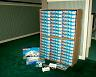
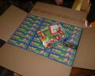

La boite VELUX est arrivée !..

Bonjour,

Pour faire suite à la vente de la boite Promotionnelle 1831 MAERSK, aujourd’hui est arrivé la boite VELUX.

La vente de ces boites est limitée à deux de chaque par personnes.

Il est indispensable d’être membre de FreeLUG et d’être à jour de cotisation pour pouvoir commander ces boites.

Joyeux Montage

**Les camions MAERSK**

Le grand carton de camions MAERSK (1831)

**Les Maisons VELUX**

Le carton de maison VELUX (1854)
