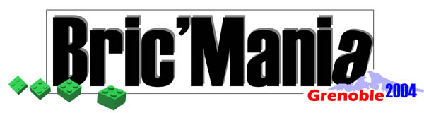
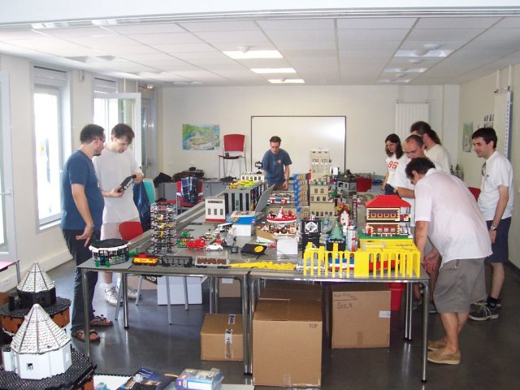
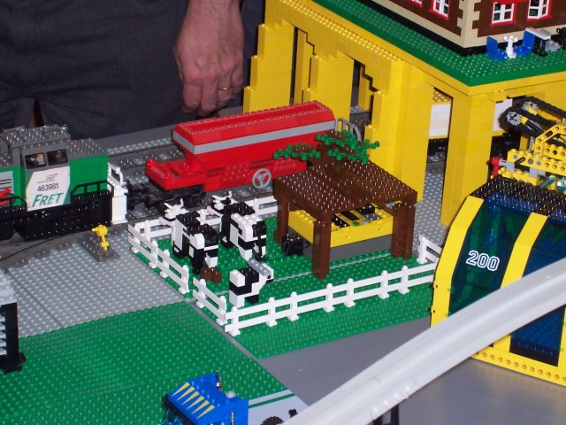

Cette rencontre a donc eu lieu à Grenoble les 24 & 25 juillet. Il y a eu du monde, il y a eu du beau temps et surtout, il y a eu beaucoup de Lego ...

Cela débute par l’arrivée des premiers dès le vendredi après midi. Surement les plus pressés, quoique.. Il y en a un qui a mit près de 12h pour descendre de Paris.. N’est ce pas Gilles !!

La première construction mise en place fut l’imposante [usine Smart](http://gallery.freelug.org/Bricmania2004/dscn1929) de[Denis "Cdhd"](http://gallery.freelug.org/6studs/Denis_CDHD). Ensuite, le [réseau train](http://gallery.freelug.org/BricMania-2004/100_1062) commence à s’assembler sur la grande table..

Et la, le premier soucis du week end apparait : le manque de tables.. Et hop.. les premiers arrivés furent de corvée de convoyage de tables !!!

Le début officiel de Bric’Mania commençait donc le samedi matin. Il ne manquait plus grand monde, même nos amis hollandais, [Casper](http://gallery.freelug.org/BricMania-2004/100_1064) et René étaient là.. Et quelle ne fut pas ma surprise de voir arriver [Laurent "Lauk" Knuchel](http://gallery.freelug.org/BricMania-2004/Portrait_Lauk), en provenance de Suisse... Enfin pour finir avec nos amis, notons que j’ai enfin rencontré Yann Laurent (Yl32) et Jérôme Teissier (Jac), apres deux ans de rencontre sur le web !! :)

Quand toutes les constructions LEGO furent montées, on pouvait voir qu’il y en avait vraiment une belle quantité, et certain comme Jac, [Erik](http://gallery.freelug.org/BricMania-2004/100_1130) ou [Nicolas](http://gallery.freelug.org/Bricmania2004/dscn1951) se sont surpassés vu la taille de leur Moc.

Certaines pièces étaient aussi trés originales, et c’est trés justement que [les vaches d’Erik](http://gallery.freelug.org/BricMania-2004/100_1091) furent désignées "meilleur Moc de Bric’Mania 2004".

Une autre chose fut aussi une réussite, c’est les trois présentations de Didier, Erik et Alban... vraiment très interressant de découvrir les trucs et astuces de certains.

La rigolade collective fut générée par la [Rampe Infernale](http://gallery.freelug.org/Bricmania2004?page=4). Il y avait quelques surprises fabuleuses !!! :)

Alors voila, si en plus on ajoute qu’il y a eu du beau temps pour le pique nique dans un parc le samedi soir, je crois qu’on peut dire que Bric’Mania fut une vraie réussite. En tout cas, pour ma part, je remercie tous les amis qui ont fait tant de kilomètres.

NDLR : Je tiens aussi à remercier Dicky pour son énorme coup de main sur le site Web de Bric’Mania, Cdhd pour le prêt de ses rails pour le réseau, Vauban et [6Studs](http://www.6studs.com/) pour les lots généreusement offerts.

Loys

* * *

Que rajouter de plus ! Tout ceux qui étaient là savent que BricMania fut une rencontre conviviale, joyeuse, enthousiasmante. Une de ces rencontres dont on voudrait qu’elle perdure éternellement.

Je voudrais simplement souligner que les présentations furent un réel succès alors que j’avais des doutes à ce sujet. Je parle (sans fausse modestie) de la [mienne](http://www.6studs.com/present.PDF) - je suis encouragé à en faire d’autres - mais surtout de celles d’Erik qui a développé tout un concept autour du désormais célèbre Topless et d’Alban qui fut surpris de l’enthousiasme des spectateurs pour la création de "BrickFilms" (voir son site [www.lswproject.com](http://www.lswproject.com/)).

et d’un commun accord, je terminerai par ce simple mot : Meeeuuuhhh

Didier

Galeries de photos sur Bric’Mania :

[Galerie 1](http://www.brickshelf.com/cgi-bin/gallery.cgi?f=91316), [Galerie 2](http://www.brickshelf.com/cgi-bin/gallery.cgi?f=91895), [Galerie 3](http://www.brickshelf.com/cgi-bin/gallery.cgi?f=92021), [Galerie 4](http://www.brickshelf.com/cgi-bin/gallery.cgi?f=91862), [Galerie 5](http://www.brickshelf.com/cgi-bin/gallery.cgi?f=92479), [Galerie 6](http://photos.freelug.org/main.php/v/FreeLUG/Evennements/Bricmania_2004/), [Galerie 7](http://photos.freelug.org/main.php/v/Chimere/BricMania-2004/)
