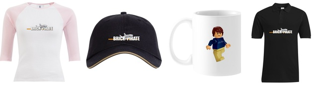
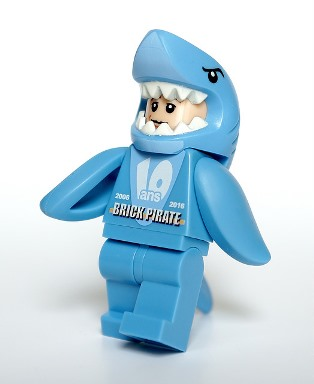
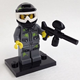
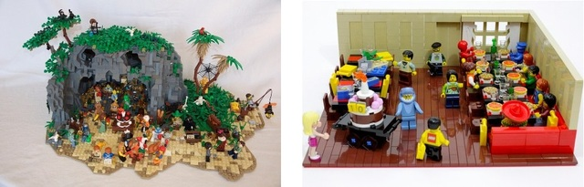
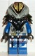

BrickPirate fête ses 10 ans ! Voilà une belle occasion d’interviewer toute la petite équipe qui fait vivre LE forum LEGO français.

[BrickPirate](http://www.brickpirate.net/forum/phpBB3/index.php) est **LE** forum généraliste consacré à la brique danoise. Tout AFOL qui se respecte connait forcément cette mine d’informations : MOCs, techniques de constructions, news, depuis des années, une petite équipe de passionnés (et bénévoles) font vivre ce lieu virtuel de rencontre où chacun vient partager ses créations, avis, et discuter de manière plus générale avec les autres passionnés.

**Bannière 10 ans BrickPirate**

BrickPirate fête cette année ses 10 ans, l’occasion pour nous d’interviewer l’équipe qui fait tourner ce forum, mais également la [frontpage](http://www.brickpirate.net/site/) et la page [Facebook](https://www.facebook.com/BrickPirate/?fref=ts) associée.

Voici donc la réponse de l’équipe BrickPirate à dix questions qui vous permettront de mieux les connaitre.

Note : L’interview a été "enregistrée" sur la période Juin/Juillet 2016.

**Question 1- Tout d’abord, pouvez-vous vous présenter en quelques mots : âge, métier, et votre rapport avec les LEGO : êtes-vous collectionneurs, MOCeur, depuis combien de temps.**

-   \[Mindrunner\] Thierry, 50 ans, agent de proximité intérimaire, MOCeur depuis l’âge de 6 ans à peu près. J’ai toujours fais ça, lorsque j’ai découvert les LEGO j’y ai tout de suite vu un moyen de réaliser ce qui me passait par la tête.

-   \[Ponto\] Ponto, la trentaine, informaticien. A défaut d’être MOCeur, je dirais plutôt collectionneur. Enfant, je MOCais, je passais mon temps à faire et refaire des châteaux forts. Depuis ma reprise du LEGO (fin 2013), je reste plutôt dans la construction de sets, quand je prends le temps de me poser...

-   \[gwenju\] Stéphane, 43 ans, je travaille dans une hotline informatique. Au départ, j’étais plutôt collectionneur, mais très vite, j’ai basculé dans le MOC pour les expos. Je n’achète plus que des sets dans le seul but de les utiliser en exposition.

-   \[Stephle59\] Stéphane, 36 ans, consultant informatique pour un grand groupe banque / assurances français. Papa geek de 3 enfants, marié à une geekette elle aussi.  
    Tombé dedans quand j’étais petit, j’ai lâché les petites briques à la fin de l’adolescence. J’ai toujours aimé créer. Puis en 2007 je suis tombé sur le LEGO Store de Cologne, en Allemagne, et ma petite femme (nous n’étions pas encore mariés) m’a offert un jeu d’échecs (G678), et paf j’ai replongé dedans. J’ai repris par l’achat de sets Star Wars, et deux ou trois ans après l’appel du MOC se faisant plus ressentir, je ne fais depuis plus que cela.

-   \[quentin D\] Quentin, 28 ans, cadre dans le transport routier de personnes. Je suis ressorti du dark-age en 2010, en Juillet plus précisément. Je suis resté 100% collectionneur jusqu’en 2012. A ce moment, début mars, [je me suis mis à MOCer](http://www.brickpirate.net/forum/phpBB3/viewtopic.php?f=34&t=9617#p207080), motivé par toutes les créations visibles sur le forum. Donc pour faire court, ça fait 4 ans que je MOC, 6 ans que je collectionne.

-   \[Séverine Rogue\] Armandine, 36 ans, ancienne bibliothécaire aujourd’hui comptable en cabinet d’expertise. Euh… je ne crois pas avoir fait de dark-age (au grand dam de mes parents qui pendant longtemps ont refusé ma liste de cadeaux de Noël jusqu’à accepter que… j’étais indécrottable). Ma première boite LEGO, je l’ai eu très très jeune : c’était un hochet (que j’ai toujours et mon neveu a désormais le même). MOCeuse ou collectionneuse ? Aucune idée ou plutôt, ça dépend de l’humeur du moment et du temps (et budget) que j’ai devant moi. J’achète (ou me fais offrir) les sets et figurines que j’aime. Et j’aime créer (mais mon rythme est catastrophique).

-   \[Athanor-paris\] Athanor, j’aime bien les LEGO et j’en fais un peu (MOC, expo, etc…). Je suis également membre de FreeLUG, bon je n’ai pas encore payé ma cotisation 2016, ce n’est qu’une question de temps…

-   \[Djaur\] Djaur, 28 ans, collectionneur de LEGO depuis mes 5 ans avec le frangin. S’essayant au MOC sans grand succès pour le moment.

**Question 2- Depuis combien de temps êtes-vous sur le forum et depuis quand faites-vous partie de l’équipe de modération ?**

-   \[Mindrunner\] Ca fait quasiment 10 ans que je suis sur le forum. Et presque autant dans l’équipe.

-   \[Ponto\] Je suis sur le forum depuis l’automne 2013 et j’ai intégré l’équipe un an après.

-   \[gwenju\] Je suis sur le forum depuis presque 6 ans, et cela doit faire 3 ans que je suis modérateur.

-   \[Stephle59\] J’ai découvert le forum fin 2007, et me suis inscrit en 2009. Je suis rentré dans l’équipe début 2011 si je me souviens bien. Il fallait alors renforcer l’équipe de modération, et l’équipe en place hésitait alors à me le proposer car j’avais déjà fort à faire dans le milieu associatif des AFOLs.

-   \[quentin D\] Je suis inscrit depuis début 2012. J’ai rejoint l’équipe rédactionnelle de la [Frontpage](http://www.brickpirate.net/site/) suite à un recrutement lancé fin 2013. J’étais déjà pas mal actif sur le forum, j’avais ma première expo à mon actif, pas mal de rencontres IRL, etc, et j’ai donc choisi de franchir un pas supplémentaire.

-   \[Severine Rogue\] Inscrite en janvier 2011. Quand j’ai décidé d’afficher mon intérêt pour le LEGO sur internet par un blog et qu’on m’a dit « eh, on peut partager notre passion sur ce forum ». J’ai vite sauté le pas.  
    Je ne fais pas partie de l’équipe de modération. J’ai juste été acceptée pour rédiger de temps en temps des articles sur des sujets liés au LEGO mais incongrus. Ayant peu de temps, je rédige peu (et des événements personnels font que j’ai un peu délaissé tout ça ces derniers temps).

-   \[Athanor-paris\] je suis inscrit sur le forum depuis 2007 et j’ai intégré l’équipe de modération il y a quelques années.

-   \[Djaur\] Je me suis inscrit fin 2010, et j’ai intégré l’équipe de modération en Juin 2012.

**Question 3- Quel est votre rôle sur le forum ?**

-   \[Mindrunner\] Alors, j’en ai plusieurs. Je suis le propriétaire, l’hébergeur, le webmaster et l’administrateur. Du coup je ne fais presque plus de modération.

-   \[Ponto\] Je fais le Belge de service ! Sinon, je participe plus ou moins activement selon les projets. Mais essentiellement, je me concentre sur l’aspect modération et support (aussi organisationnel).

-   \[gwenju\] Je passe la plupart de mon temps à lire les messages pour pas que ça dérape et faire respecter les règles du forum. Mais je participe également aux décisions collégiales prises en partie modération.

-   \[Stephle59\] Officiellement, je suis le rédac’chef de la [Frontpage](http://www.brickpirate.net/site/). J’ai en charge la rédaction des articles mettant en avant certains aspects du forum, allant de la promotion de certaines créations, jusqu’aux interviews, dont le concept décalé est la signature depuis maintenant de nombreuses années ; en passant par la mise en avant des expositions.  
    Quentin D m’épaule énormément à cette tâche, et même s’il ne fait pas partie officiellement de l’équipe, je tiens à saluer chaleureusement son dévouement et son implication pour faire vivre notre page vitrine. C’est une activité particulièrement chronophage.  
    Je fais aussi un peu de modération quand le besoin s’en fait sentir.

-   \[quentin D\] Mon rôle de contributeur consiste à rédiger et mettre en ligne des articles pour la [Frontpage](http://www.brickpirate.net/site/). Ces articles peuvent être très variés, allant de la simple news à un MOC mis en valeur, une review qui vaut le détour, un rappel pour un concours, un récapitulatif des expositions ... Il y a tant de choses que c’est parfois difficile de faire le tri.

-   \[Severine Rogue\] Oups, j’ai dû répondre à la question précédente.

-   \[Athanor-paris\] Je ne suis pas en charge d’un poste en particulier mais j’essaie de tenir à jour le topic des expo LEGO. Je modère un peu dans le sens de rappeler les règles de notre communauté (c’est le côté chiant du truc) mais j’ai aussi pour habitude d’enrichir les posts des uns et des autres (rajouter des liens ou des photos qui pointent vers les bases documentaires pour faciliter la lecture ou illustrer le propos des membres (une bonne image vaut mieux qu’un long discours). Parfois il m’arrive aussi de faire des trucs dans ce genre...

-   \[Djaur\] Quand j’ai du temps à dépenser je parcours toutes les catégories du forum à la recherche de messages à corriger, de phrases à supprimer (des attaques, des images volées, des infos qu’on ne doit pas divulguer, des demandes de vente, d’échange en dehors de la partie réservée à cet effet, …). Sinon je m’occupe des concours pour le forum aidé de mes comparses et de Yannoch06 en particulier. Les dotations LEGO sont à la maison, donc je m’occupe également des envois des cadeaux, des pièces de draft pour ceux qui ont déjà pu en bénéficier. Je m’occupe également de la page Facebook de BrickPirate, si vous avez envoyé des messages, c’est moi qui vous répond, ce n’est pas forcément facile de choisir quoi mettre pour l’alimenter d’ailleurs vu l’affluence des pages LEGO sur les réseaux sociaux. Que reste-t-il ? je m’occupe de la gestion du Bulk (ouf, pas du tri), et je suis l’Ambassadeur de BrickPirate, avec un accès à un forum mondial regroupant tous les ambassadeurs et certains employés de LEGO.

**Question 4- BrickPirate est le plus grand forum généraliste Français dédié à la passion du LEGO. Comment présenteriez-vous le forum à un nouvel AFOL qui ne le connait pas, et pourquoi doit-il venir sur le forum ? Que trouvera-t-il ici qu’il ne trouvera nulle part ailleurs ?**

-   \[Mindrunner\] De la convivialité, de la diversité. Une réponse à toutes les questions sur notre passion. Un certain "professionnalisme" de l’équipe aussi : 10 ans, à l’échelle du web, ce n’est pas rien.

-   \[Ponto\] Le forum est un lieu privilégié pour échanger sur notre passion commune. Il permet de discuter avec d’autres fans de LEGO, à tout moment. Il y a tous les profils ! D’ailleurs, des contacts virtuels qui se tissent au fil des discussions émergent souvent des rencontres bien réelles lors d’expo ou autres événements tels que des RestoLEGO. Le forum est aussi une mine d’information et de pointeurs vers plein de ressources concernant le LEGO.

-   \[gwenju\] Brickpirate essaye de rassembler tout le monde. C’est un des seuls lieu où ont peut retrouver des AFOLs de tous les LUGs. C’est aussi une mine d’informations, de reviews, de techniques, de concours, etc.

-   \[Mindrunner\] Exact Gwenju. C’est peut-être même le seul endroit où l’on peut trouver des dates et lieux d’expositions quelque soit le LUG francophone, mais aussi les restoLEGO et autres sorties. Il y en a peut-être d’autres mais il me semble que nous sommes les plus exhaustifs. J’y vois là une marque de confiance des autres LUGs. Il n’a pas toujours été facile de défendre notre neutralité mais je pense que nous y sommes parvenus.

-   \[Stephle59\] J’ajouterai que le forum est un espace communautaire mais pas communautariste. Bref, nous sommes ouverts à tous. Le principe, c’est le partage. Et c’est ce qui doit perdurer. Et garder cet esprit d’ouverture aux autres, tout en réussissant à jongler avec les susceptibilités de tout un chacun. Comme dans toute communauté, il est difficile de plaire à tout le monde, mais on s’efforce de le faire auprès du plus grand nombre.  
    Après je me plais à le répéter, et c’est dans ma signature, mais le forum n’est pas une démocratie, c’est une dictature participative.

-   \[quentin D\] La réponse est dans la question : le forum est généraliste. On y trouve tout ce qu’on veut, même si côté brickfilms et Technic c’est assez pauvre. Un des gros avantages du forum, c’est le côté lieu de rencontre virtuel : suffit d’une connexion et de parler français pour profiter et participer au forum. Donc, que trouverait un AFOL ici et pas ailleurs ? Un lieu de rencontre, de discussion, des réponses à tout un tas de questions, des idées, le tout grâce à des membres ayant chacun sa façon de vivre la passion du LEGO, et encadré par une équipe sérieuse.

-   \[Séverine Rogue\] Tu veux causer LEGO ? Tu n’as pas de personnes en IRL proche connues ? Viens sur le forum. C’est plus pratique pour discuter que facebook. Et y a plein d’infos et de liens pratiques. (peut-être trop au début : n’hésite pas à fouiller).

-   \[Athanor-paris\] Comment le présenter à un nouvel AFOL ? Comme j’aime bien la bouffe je me piquerais d’une allégorie gastronomique. Les forums c’est un peu comme les fromages il y en a de tous les types et nous nous sommes un peu comme un gruyère : un forum généraliste avec des trous.  
    Je m’explique : au début du fofo il y avait pas mal de brickfilmeurs mais avec la montée en puissance de brick-a-brack les fondus du genre se sont repliés là-bas. Il faut dire que les critiques, mêmes constructives, ne sont pas toujours faciles à entendre : à cette époque très lointaine nous avions pas mal de nouveaux entrants qui balançaient des vidéos pas très abouties et avec la même litanie de conseils qui étaient donnés on tournait un peut en rond.  
    Sinon, pour revenir à la question telle qu’elle est posée personne ne doit venir sur le forum mais chacun peut passer le cap de l’inscription pour pouvoir participer : ne plus se contenter d’être un simple spectateur mais devenir aussi un acteur de sa passion.  
    Ceci dit la pratique de notre hobby est assez multiple : entre les collectionneurs, les collectionneurs complétistes, les SWaristes purs et durs, les MOCeurs, les « sérials figurinistes », les photographes, les exposants, les entasseurs, les technistes, les fabulandistes, etc…  
    Au final, je ne peux pas dire que nous accueillons tout le monde mais tout le monde est le bienvenu et j’aimerais que chacun y trouve sa place pour s’exprimer dans le respect des uns et des autres. Nous nous efforçons de le rendre le plus convivial possible mais tout est perfectible (même un modo peut se lever du mauvais pied, marcher pied nu sur une brique 2x4 et sortir le rouge un peu trop vite !...).  
    Donc au risque de répéter ce qui a déjà été dit par mes camarades nous sommes un lieu où l’on discute de tout ce qui se rapporte à la brique danoise.  
    Après, je dirais que le forum n’est que le prélude à se rencontrer IRL en expo et aussi lors de RestoLEGO, j’en organise assez régulièrement, une fois par mois, à Levallois c’est l’occasion de discuter sans ce foutu clavier qui nous ralentis tant.

-   \[Djaur\] Les forums sont faits aussi pour les personnes timides. Beaucoup d’AFOLs le sont, mais seuls dans leur coin, rien ne vaut des discussions sur nos briques préférées, des infos en avant-première, des images, des MOCs, des concours, des lots à gagner, des échanges pour les plus assidus, et pour ceux qui souhaitent sauter le pas : participer aux expositions !

**Question 5- Les forums en général restent très virtuels alors que le LEGO est une passion très concrète et matérielle. Qu’est-ce qui fait que vous consacriez autant de temps au forum au lieu de le consacrer directement aux activités purement LEGO (construction ou collection) ?**

-   \[Mindrunner\] L’informatique est une autre de mes passions, depuis de nombreuses années, ce fut même un métier. Pour moi c’est tout naturel d’utiliser internet pour partager, que ce soit la connaissance ou la passion. Disons que BrickPirate c’est mon apport à la communauté. Il n’y avait pas de forum francophone pour les AFOLs. Maintenant, si. Plusieurs même.

-   \[Ponto\] Le forum est un lieu d’échange et d’interaction. Même virtuel, il est un moyen d’interaction sociale pour l’AFOL. Il permet de s’affranchir de l’isolement géographique. Lorsqu’il n’y a pas d’expo ou autres rencontres organisées dans notre région, il permet de combler le côté "social" de la pratique du LEGO. Et puis, on ne peut pas échanger de la même façon avec notre fils de 6 ans qui aime les LEGO qu’avec d’autres fans adultes.  
    D’ailleurs, je me demande si, à l’heure d’Internet, il y a encore des AFOLs complètement isolés. J’entends par là, qui pratiquent les LEGO seuls dans leur coin...

-   \[Mindrunner\] Il y en a. Je peux te l’assurer.

-   \[gwenju\] On ne peut pas assouvir notre envie de discuter LEGO tous les jours IRL. Le forum le permet. J’adore les restoLEGO ou les expos, mais ça se passe maximum une fois par mois. Le reste du temps, le forum permet de continuer à discuter de notre passion commune. Le forum, j’y passe quand j’ai un moment, le LEGO, je m’y met uniquement quand je sais que j’ai plusieurs heures/jours devant moi.

-   \[quentin D\] C’est simple : le côté pratique de la rencontre virtuel. On discute en instantané avec des passionnés qui se trouvent un peu partout en France et alentour. Cela facilite énormément les échanges même si ça ne remplace pas une bonne rencontre IRL. Autre avantage : l’écrit. Tout ce qui se dit, c’est par écrit, donc les réponses aux questions restent lisibles. Il n’est pas évident de se retrouver IRL tous les jours, avoir un lieu rapide d’accès et lisible de tous, en l’occurrence le forum, est un gros plus. Je pense que notre passion en prendrait un coup si demain nous n’avions plus de lieu de rencontre virtuel, qui nous sert également de support pour nos MOCs, reviews, expos, etc.

-   \[Séverine Rogue\] Je n’y consacre pas tant de temps que ça (bien moins qu’à une époque sur un autre forum de jeux de rôles). Quant au virtuel… quand tu habites un trou paumé, t’es bien content de l’avoir. Quand tu as des horaires de boulot inhabituel, c’est aussi très pratique. Même si aujourd’hui, mon rythme est un tout petit peu plus normal et que je n’habite plus trop un trou paumé, j’ai gardé cette habitude du forum. Et le forum est toujours là et disponible pour avancer à mon rythme (enfin, les gens postent plus vite que je n’ai le temps de lire mais j’ai toujours du neuf à voir) et choisir si je veux répondre ou non.

-   \[Athanor-paris\] Les LEGO sont une de mes passions et j’aime bien causer même si je suis un grand timide, donc le forum, si tu as un ordi ou un téléphone avec toi, tu l’a toujours avec toi, et tu trouveras toujours un sujet qui permettra d’apprendre un truc sur ton hobby. Trouver un AFOL, si tu es en pleine cambrousse ou plongé dans l’anonymat d’une grande ville, ce n’est pas si évident que ça. Avec le fofo tu en as des dizaines sous la main ! Pourquoi s’en priver ?

-   \[Djaur\] Faut bien qu’il y ai des gens pour faire tourner la [boutique](http://www.comboutique.com/fr/shop/brickpirate), étant bénévole dans plusieurs associations, je sais ce que c’est et ça ne me dérange pas. Et monter des sets ou dépoussiérer ça va bien un moment, du coup on se connecte sur Brickpirate.

**Question 6-Le forum ce n’est pas que des discussions, c’est aussi ancré dans le réel avec des expositions. Lesquelles vous tiennent le plus particulièrement à cœur, que ce soit en tant que participant ou en tant qu’organisateur ?**

-   \[gwenju\] Alors je me permet de rectifier un peu la question. BrickPirate est partenaire et RLUG organisateur officiel auprès de LEGO DK depuis 3 ans. On parle de l’exposition [Paint’hièvre briques](https://www.facebook.com/Painthievre-briques-425216354289905/), qui se déroule mi-juillet tous les ans à Pléneuf-val-andré, dans les Côtes d’Armor. La logistique est assurée par les Griffons d’Armor, qui se trouve être mon équipe de paintball sportif. Cette expo nous permet de financer notre saison car c’est un sport très coûteux. Mais depuis l’année dernière, nous avons décidé de financer le forum en faisant un don à BrickPirate. [Paint’hièvre briques](https://www.facebook.com/Painthievre-briques-425216354289905/), cela paye un an d’hébergement du serveur de BrickPirate. Soit environ 500 euros. Ce n’est pas négligeable du tout, car avant on galérait pour récupérer 3 francs 6 sous avec les liens sponsorisés Amazon. Cet argent Amazon est désormais plus utilisé pour payer les goodies. Cette année, les exposants qui seront à Pléneuf repartiront les bras chargés de cadeaux grâce au soutien de LEGO mais aussi de BrickPirate qui a fait des dons de boites pour le concours exposants, ainsi que du vrac qui sera distribué à chaque exposant. Nous sommes complets, mais n’hésitez pas à venir en visiteur ou vous inscrire l’année prochaine. Cela aide grandement le forum. On a également été co-organisateur de l’expo de Nanteuil. Mais je vais laisser Djaur en parler car c’est lui qui a tout géré.

-   \[Séverine Rogue\] Bravo aux organisateurs et aux bénévoles, que ce soit pour une expo avec BP dans l’organisation ou pour une expo en général.

-   \[Djaur\] BrickPirate peut fournir des exposant par le biais de la pub, de ses connaissances, de ses membres présent un peu partout en France (et ailleurs). [Paint’Hièvre](https://www.facebook.com/Painthievre-briques-425216354289905/) par exemple est une réussite quant à la co-organisation d’événements. A voir dans le futur pour d’autres expos de ce type, un essai vient d’être fait dans l’Oise cette année.

**Question 7- Pouvez-vous nous parler de ce que propose BrickPirate pour ses membres (goodies, achats, animations, etc) ?**

-   \[gwenju\] Il faut avouer que depuis que mon pote Ar Sparfel n’est plus dans l’équipe, on a du mal à gérer cette partie. Mais on vous prépare quelques petites choses, à commencer par la figurine spéciale 10 ans qui devrait pointer le bout de son plastique d’ici l’été.

-   \[Stephle59\] C’est amusant que vous posiez la question, car justement j’ai mis en avant notre [boutique](http://www.comboutique.com/fr/shop/brickpirate) _via_ cet [article sur la frontpage](http://www.brickpirate.net/site/actualites/la-boutique-en-ligne-brickpirate/).  
    Effectivement, comme tu le dis Gwenju, Ar Sparfel gérait cette partie de main de maître. Maintenant qu’il est parti pour d’autres horizons, c’est plus compliqué à gérer. Néanmoins notre [boutique](http://www.comboutique.com/fr/shop/brickpirate) existe et elle propose de nombreux articles à l’effigie du forum : t-Shirts, sweats, mugs, sacoches, sac à dos, et même des sous-vêtements.

**Quelques articles disponibles sur la boutique**

-   \[quentin D\] Je laisse cette question à ceux qui s’occupent de la chose ...

-   \[Séverine Rogue\] Désolée si je fais rabat-joie, mais avoir déjà un espace où l’on peut s’exprimer et partager librement sur notre passion, moi, je trouve ça bien. Après, les goodies, c’est cool pour s’affirmer comme pirate aux yeux de tous... (un jour, je ramènerai une tasse BrickPirate au boulot. Pour le moment, j’ai juste un calendrier en LEGO qui fait beaucoup rire mes clients).

-   \[Athanor-paris\] Comme dit plus haut des RestoLEGO sont organisés régulièrement même si ça, n’importe quel membre peut le faire car il « suffit » juste de bloquer une date et créer un topic.  
    Sinon, concrètement nous avons la [boutique](http://www.comboutique.com/fr/shop/brickpirate) BrickPirate avec du textile (T-shirt, sweats, etc…) et des sacoches ou des mugs.

-   \[Djaur\] La fig des 10 ans vient de sortir. D’autres pourraient éventuellement sortir ces prochaines années.

**Question 8- 10 ans, ça se fête, qu’avez-vous prévu pour marquer cet événement ?**

-   \[gwenju\] On organise pas mal de concours avec du lot en pagaille. Un vient de finir, mais il y en aura d’autre(s). On a la figurine spéciale qui arrive. Plein de cadeaux à [Paint’hièvre briques](https://www.facebook.com/Painthievre-briques-425216354289905/).

-   \[Stephle59\] Effectivement Gwenju, nous avons envie de fêter comme il se doit les 10 ans du forum. De faire plaisir et de se faire plaisir. C’est aussi un peu notre marque de fabrique, en tant qu’AFOL. On a lancé de nombreux concours, sur tous les médias dont nous disposons. On a lancé un grand cycle d’interviews de l’équipe et de membres qu’on a choisi, pour fêter l’événement, ce qui représente tout de même 11 interviews en un grand mois. Et comme tu l’as dit, d’autres belles surprises sont prévues. On ne vous en dit pas plus, vous le découvrirez tôt ou tard.

-   \[quentin D\] Idem question 7.

-   \[Séverine Rogue\] un gâteau virtuel ?

-   \[Athanor-paris\] Le cycle des interviews spéciales anniversaire est terminé ([y’a quand même des grands bavards !](http://www.brickpirate.net/site/interviews/brickpirate-fete-ses-10-ans-la-grande-interview-11/)), les réservations de la figurine Sharky de Sam sont en cours (les achats seront possibles dans les jours qui viennent). Nous avons une salve de concours assez bien dotés pour cet été certains sont déjà ouverts et d’autres vont encore venir.  
    Nous continuerons donc de célébrer nos 10 ans dans les mois qui viennent avec d’autres événements.

-   \[Djaur\] Sharky Sam ! Et puis le concours des 10 ans, des interviews, une banderole, ...

**Sharky - La figurine des 10 ans**

**Question 9- Appartenez-vous à un Lug "régional" ?**

-   \[Mindrunner\] Non. Je suis un solitaire. J’ai essayé hein, mais définitivement ce n’est pas fait pour moi.

-   \[Ponto\] Non. Juste BrickPirate ;-) J’ai bien aimé l’accueil des ChtiLugiens lors de ma première expo. Dommage qu’ils soient si loin que pour vraiment faire partie du LUG.

-   \[gwenju\] Je suis membre de Brickouest. J’en ai été l’ambassadeur la première année de sa création.

-   \[Stephle59\] Je suis membre et trésorier de l’association [Fanabriques](http://www.fanabriques.fr/).

-   \[quentin D\] Non, je suis un électron libre. Enfin, pas complètement parce que je me revendique membre de Brickpirate. Mais en dehors, pas d’affiliation particulière.

-   \[Séverine Rogue\] [Fanabriques](http://www.fanabriques.fr/) depuis 2011 bien que je n’habite plus aussi près que je le voudrais (d’abord, je suis toujours dans la région de [Fanabriques](http://www.fanabriques.fr/), je suis dans le Grand Est tirelangue ).

-   \[Athanor-paris\] Je suis membre de FreeLUG, même si je n’ai pas encore payé ma cotisation 2016, ce n’est qu’une question de temps…

-   \[Djaur\] Pas de LUG à part BrickPirate pour ma part. C’est déjà pas mal, je ne vois pas ce qu’un autre LUG pourrait m’apporter de plus.

**Question 10- Où peut on vous rencontrer ? Sur quelles expos êtes-vous régulièrement ?**

-   \[Mindrunner\] Cette année aucune.

-   \[Ponto\] Lors d’expo. Je n’en fais que très peu mais c’est, a priori, l’endroit où vous avez le plus de chance de me croiser. Plutôt dans le noooord : expo du ChtiLug ou expo du BeLUG.

-   \[gwenju\] [Paint’hièvre briques](https://www.facebook.com/Painthievre-briques-425216354289905/) bien sûr. Mais aussi la grande majorité des expos de l’ouest. Cette année je me suis également déplacé chez les chtilug à Cysoing. Un super week-end. Je vais également retourner à Bordeaux pour la deuxième fois. L’année prochaine, j’ai prévu d’en faire également une dans l’est. Grosse préférence pour Dole, car j’ai croisé les organisateurs une fois à [Fanabriques](http://www.fanabriques.fr/), et ils sont super sympas. Sinon je participe au maximum aux restoLEGO de Rennes ou de Brest vu que je me trouve entre les deux.

-   \[Stephle59\] On peut me rencontrer sur pas mal d’expositions régionales, en Alsace. [Fanabriques](http://www.fanabriques.fr/), Briqu’O Rhin, Fanasbruche, et d’autres petits événements. J’aime bien les petites expositions pour leur côté familial. Certes on draine moins de monde, mais on a plus le temps d’en profiter.  
    Je ferai très certainement Dôle en 2017 avec mes potes de [Lug’Est](http://www.lugest.com/).

-   \[quentin D\] Oh que oui ! Je participe aux resto-LEGO parisiens de temps en temps, je suis un fidèle de plusieurs expos, à savoir [Montdidier](https://www.facebook.com/briqueexpo.montdidier/?fref=ts) et [Fanabriques](http://www.fanabriques.fr/) principalement. Je me rends aussi sur certaines expos de [Brick en Bulles](http://www.brickenbulles.fr/) par exemple, et d’autres quand l’occasion se présente. Et comme stephle, je re-signe sans hésiter pour Dole 2017 ...

-   \[Séverine Rogue\] Pour cette année, nulle part. J’ai fait une pause après m’être un peu laissée dépassée par les événements (du retard dans le rangement de mes LEGO suite aux expositions) et actuellement, je suis en plein déménagement. Autant dire que mon atelier (ma pièce) à LEGO ne sera pas opérationnelle avant quelques mois.  
    Mais je reviendrai à Fanasbruche, [Fanabriques](http://www.fanabriques.fr/) et les expositions de [Brick en Bulles](http://www.brickenbulles.fr/) quand ça sera plus calme et rangé chez moi.

-   \[Athanor-paris\] Le plus simple : les RestoLEGO c’est une fois par mois. Le plus cool : les expos. Je suis allé à [Fanabriques](http://www.fanabriques.fr/) 2 fois, on fait des raids avec les parigots (Montdidier, Mennecy, Reims, Mulsanne, Dole, etc…). Je vais à Pléneuf et j’irais aux Herbiers. C’est toujours très sympa de rencontrer les gens en vrai, mettre un visage sur un pseudo et de prendre le temps de discuter.

-   \[Djaur\] Mon domicile est ouvert pour tous les AFOLs. Sinon je fais les expos dans mon secteur : Picardie et Nord Pas-De-Calais (les expos Ch’Ti Lug par exemple). Je vais aussi tous les ans à [Fanabriques](http://www.fanabriques.fr/). Pour l’année prochaine sont programmés aussi Dole en Octobre et l’expo en Suisse en Septembre (expo de nos comparses de chez [LeLug](http://www.lelug.ch/).

**Petite proposition complémentaire : "avec quelle figurine vous représenteriez vous, officielle ou création propre ?"  
Si c’est une création, pourriez-vous me faire une photo ?**

-   \[Stephle59\] Avec celle de mon avatar.

**Stephle59**

-   \[gwenju\]Le paintballeur bien sur. Il trône fièrement sur mon mur de briques souvenir.

**Gwenju**

-   \[Athanor-paris\] Celle de mon avatar pourrait aller mais je n’ai jamais eu cette fig c’est une photo d’un mélange fait chez un ami avec des éléments de ses figs. Je n’ai ni le torse ni la casquette… pourtant il va falloir que j’en trouve ne serait-ce que pour faire la photo du [dio de Gzu](http://www.brickpirate.net/forum/phpBB3/viewtopic.php?p=467797#p467797) avec nos figurines, (une version comme celle de [l’île de Boudelaine peuplée des avatars de membres du fofo](http://www.brickpirate.net/forum/phpBB3/viewtopic.php?f=33&t=19437)).

**Athanor-paris**

**Mocs de Boudelaine et Gzu**

-   \[Djaur\] J’ai "ma" minifig, celle avec laquelle je m’identifiais alors que je jouais avec mon frère, dio qui est resté plus de 10 ans en activité dans ma chambre. Mais la fig ne vaut pas une photo.

-   \[quentin D\] : une figurine qui me représenterait ? Oui, celle des aliens UFO de 97, la version grise/bleue avec armure noire et casque gris. C’est une figurine que je trouve superbe, et avec laquelle j’ai grandi car les SW n’existaient pas encore (le fan qui est en moi y avait trouvé un substitut). LEGO nous montrait déjà à l’époque que leurs gars maitrisaient très bien les dessins sur les torses et les jambes. Je trouve que même avec les années, les figurines de cette gamme n’ont pas à rougir devant les nouveautés.

**Quentin D**

-   \[Mindrunner\] Un cosmonaute. Celui de la série 15 est superbe. Ou le janitor de cette même série.

**Mindrunner**

Merci à vous tous d’avoir joué le jeu de l’interview et à bientôt sur Brickpirate !
