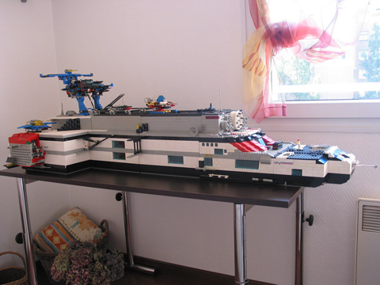
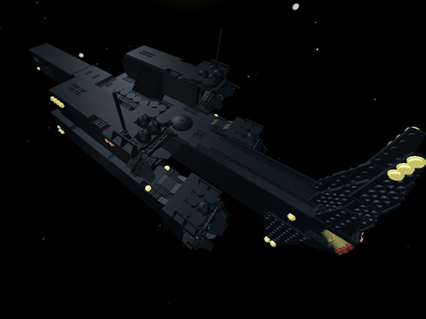
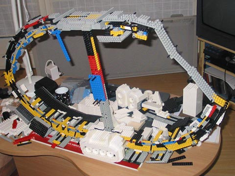
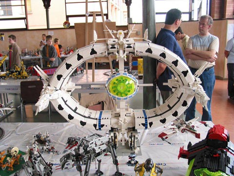

Vous êtes aussi passé par là, sinon vous ne seriez pas ici maintenant.  
Cela dit, chaque histoire est différente et je m’en vais vous conter la mienne.

## 17 septembre 2006 : l’éveil.

Au hasard de mes balades sur le net, je tombe sur le Topic des créations LEGO du forum [HFR](http://forum.hardware.fr/hfr/Discussions/Loisirs/creations-perso-lego-sujet_39740_1.htm). Deux jours plus tard j’étais à jour avec les 111 pages de messages (d’alors).  
Durant ce voyage de deux jours, j’ai prix plusieurs grosses baffes ! Entre [le célèbre porte-avion](http://www.brickshelf.com/cgi-bin/gallery.cgi?f=126969) et d’autres MOC incroyables, j’étais à deux doigts de retomber dedans.

Je décide donc d’aller fouiller la cave de mes parents à la recherche de mes vieilles briques et d’un gros vaisseau spatial que j’avais remis dans un placard aux alentours de mes 15 ans.

C’est le 22 Septembre que je poste [ma première photo sur Brickshelf](http://www.brickshelf.com/cgi-bin/gallery.cgi?f=206519) et par la même occasion sur HFR.  
Ce vaisseau, je l’ai fait entre mes 10 ans et mes 15 ans. J’en étais fier, je pensais avoir réalisé un monstre, grand beau et je ne sais quels autres qualificatifs.

**Gros croiseur**

Mon 1er gros MOC, fait entre mes 10 ans et mes 15 ans

## 26 septembre 2006 : Remise en question

J’envisage fortement de détruire mon vaisseau afin d’en créer un nouveau, mais psychologiquement, j’ai du mal à m’y résoudre...  
Le lendemain, ce n’était plus qu’un mauvais souvenir, j’avais enfin un bon gros stock de pièces (bah oui, je l’ai démonté finalement).

## 29 septembre 2006 : La découverte

Je découvre LDD et me lance dans la création de plusieurs petits vaisseaux, pensant pouvoir créer du LEGO sans en acheter.  
Désillusion !!! Voir un engin en représentation 3D donne envie de l’avoir en vrai !

**Test sous LDD**

Je clique donc, en toute logique sur le bouton « check price » et là... je tombe sur mon postérieur... on me demande 200€ !!! Pour un engin que j’ai inventé !  
Allez hop ! À la poubelle LDD.

Je me tourne donc vers l’autre logiciel de création mais là, blocage... je n’accroche pas du tout avec l’interface. Je me rebute et plonge dans Bricklink où j’explore les méandres de la bête afin d’en cerner les subtilités, à la découverte de nouvelles pièces et couleurs insoupçonnées.

## Le temps passa... 23 octobre 2006 : Le grand saut

Ma première commande, je ne sais plus vraiment quelle boutique ni quelles pièces... Peut être était-ce Sylvain ?  
Quoi qu’il en soit, j’avais passé les jours précédents à me convaincre de ne pas craquer et contradictoirement, j’avais un projet en tête.

Je n’en parlais pas, je ne voulais pas encore lancer de pistes car ne sachant pas encore comment j’allais le réaliser, je ne voulais pas lancer une idée qui serait restée sans suites...

Début novembre, suite à pas mal de travaux de recherche, je plonge donc les mains dans la brique.  
Le projet commence... et [les premières photos](http://www.brickshelf.com/cgi-bin/gallery.cgi?f=215682) arrivent aux alentours du 15 novembre.

**La base du projet**

S’en suit une longue période de commandes, d’assemblage, de fignolages et j’en passe.

## Jusqu’au jour où !

Un mail me titille. Une personne se présente à moi et me demande si je veux exposer mon engin à Fanabriques 2007.  
Ah mais, c’est quoi ce Fanamachin ? A Rosheim en plus ? C’est paumé, ça doit être mortel comme expo (mortel dans le mauvais sens du terme). Enfin bon, c’était surtout par peur de l’inconnu. Un sombre inconnu me propose une sombre expo dans un sombre village d’Alsace... Louche tout ça je vous dis, louche !!!

De fil en aiguille, je fini par inviter cette personne pour lui montrer mon MOC autrement qu’en photos. Il semble impressionné malgré le fait que tout ne soit pas fini.  
Il me propose de venir chez lui pour me montrer sa collection (Arggghhhhh) j’ai failli ne pas en revenir. Il me propose ensuite de devenir un membre de FreeLUG.  
Allez, encore un truc inconnu.  
Petite visite du site, lecture diagonale et avis mitigé.  
Mhhh encore la peur de l’inconnu !

## Que le temps passe vite !

Qu’est ce qu’on à pu me tanner le cuir pour que j’y vienne à cette expo.  
« Allez Seb, va exposer ton vaisseau le 30 juin et 1 juillet à Rosheim » et j’en passe.  
C’est qu’ils se sont passés le mot pour me faire craquer ces gaillards.  
On m’a même fabriqué une boite pour transporter mon MOC. Mais à ce stade là, je n’avais plus peur de l’inconnu, mais peur que ma création s’effondre sur elle-même lors du transport.

## Début juin

J’ai enfin fini !!! J’ai posé la dernière pièce de mon MOC, je ne pensais plus le finir un jour.  
Hourrrraaaaaaa  
« Zut, on va encore me harceler pour que je transporte le monstre fin du mois » et bien sûr, ça n’a pas loupé.

La date avançait à grand pas, me terrifiant à l’idée de devoir prendre une décision... J’y vais ou j’y vais pas ?  
Finalement, quelques jours avant l’évènement, la boite de transport a été déposée chez moi. Je me suis occupé du harnachement et du calage et le vendredi 29, sur les coups de 13h, le transporteur est arrivé, a embarqué le tout et est reparti direction Rosheim.  
Moi, j’ai pris la route 10 minutes plus tard et autant vous dire que j’en menais pas long. J’imaginais les pires catastrophes. Le flip total !  
Finalement...

**projet fini**

L’Odysseus lors de Fana’Briques

## 30 Juin et 1er Juillet

Alors là, je sais plus quoi dire, non pas que je manque d’inspiration, au contraire, ce sont les mots qui me manquent.  
Je ne vais refaire [le déroulement complet de ces deux journées](/articles/fana-briques-2007-une-touche-de-bleu/), y aurait trop de choses à dire.  
L’ambiance, les autres exposants, les visiteurs qui viennent poser des questions, sans oublier l’organisation d’enfer et la Bugatti.  
C’est aussi là que l’on m’a à nouveau rebattu les oreilles à propos de FreeLUG, mais cette fois j’ai eu l’occasion de discuter directement avec des membres... Ca change la donne !  
Aujourd’hui, je suis membre FreeLUG, j’ai sauté le pas, je suis donc officiellement un cinglé du LEGO.  
Je n’irais pas jusqu’à dire que vous avez la chance de m’avoir parmi vous (quoique, ça fait du bien d’être égocentrique de temps en temps) mais si je suis ici aujourd’hui, c’est grâce à Thierry. D’ailleurs, tout est grâce à Thierry.

**En gros**, je suis retombé seul, mais sous influence, dans les LEGO et Thierry, profitant de ma faiblesse d’alors, m’a littéralement mis la tête dedans.

Alors je ne dirais qu’une chose, **MERCI Thierry**
