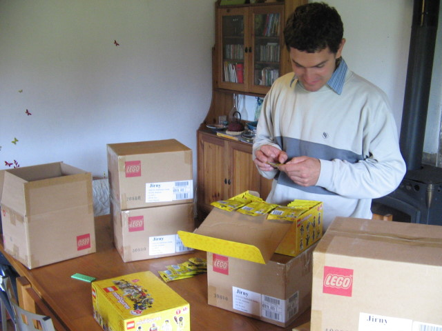
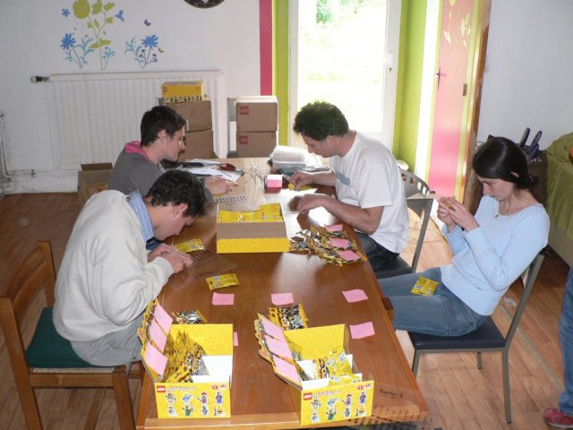
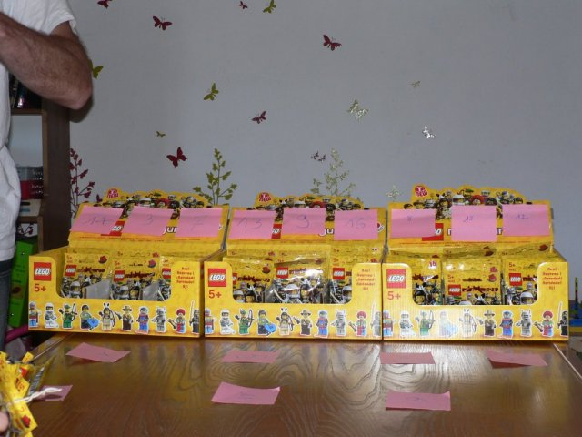

Après un sondage lancé courant février auprès des adhérents, le CA de FreeLUG a pris la décision de commander 24 boîtes 8683 pour espérer avoir au moins 60 collections complètes de figurines de cette première série à proposer à nos adhérents (à cette époque, nous ne savions pas encore que chaque boîte contenait 3 séries complètes).

La commande est arrivée chez notre vice-président. Il n’y avait que la moitié de ce que nous avions demandé (malentendu sur la référence du produit et du colisage), mais cela faisait tout de même une bonne quantité de minifigs à trier. Une nouvelle commande en complément (de 20 boîtes cette fois-ci vu le succès des minifigs auprès des passionnés) est arrivée ultérieurement, avec la commande groupée des produits prestige.

**Pierre dans les cartons...**

Grâce à la liste des codes barres récupérée sur le net, l’expérience de Pierre C et Emilie et la liste imprimée sur une feuille transparente, nous pouvons facilement retrouver les personnages sans ouvrir les sachets. Après un début un peu difficile et quelques ratés, nous avançons tranquillement dans le tri.

**Ils sont petits les codes barres.**

Au bout de deux heures, nous sommes au bout des 720 minifigs, avec 36 séries complètes à proposer à nos adhérents.

**Le tri est fini !**

La suite de la commande a été triée dans un second temps. Nous avons donc un total de 96 collections complètes.

L’opération sera renouvelée avec les prochaines séries.
