12 participants toutes catégories confondues, 12 parcelles de la route 66, mais où la rencontre a réellement eu lieu ?

Il est temps de découvrir les participations du concours "Construis-moi un décor... Route 66".

Bonjour à toutes et à tous,

Vous pouvez retrouver le [règlement de ce concours ici](https://www.freelug.org/spip.php?article3118)

Tout d’abord, nous tenons à remercier les 12 participants qui nous ont proposé un très joli Road Trip.

Les participations sont présentées dans l’ordre de réception.

## Concours catégorie "Réelle"

**01 - Nathan B. (11 ans) - "Aventure 66"**  
Erik a retrouvé Timmy sur la 66 juste au moment où il va se faire arrêter par la police. Erik et Timmy sont contrariés car ça repousse la discussion pour trouver une solution.

[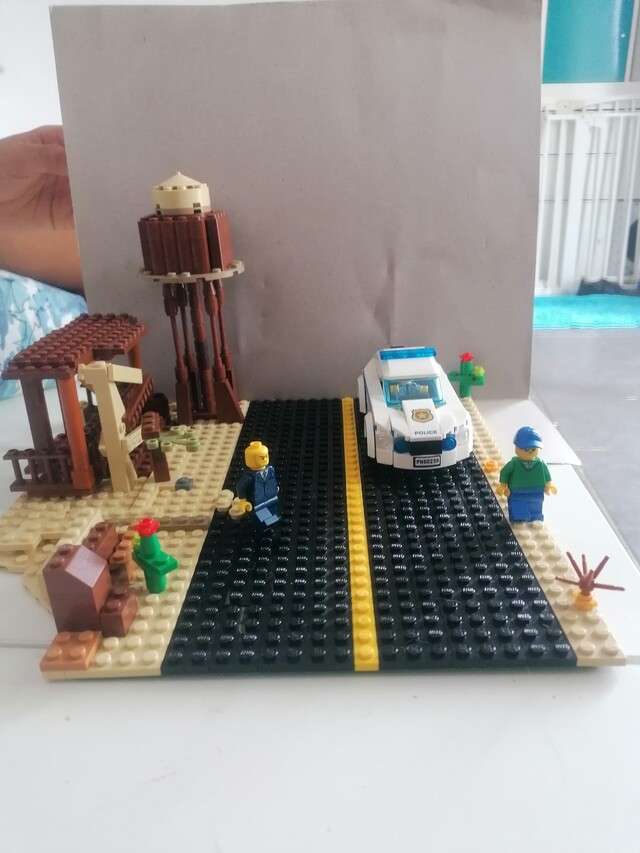](https://www.freelug.org/IMG/jpg/nb-01_personnalise_.jpg)

[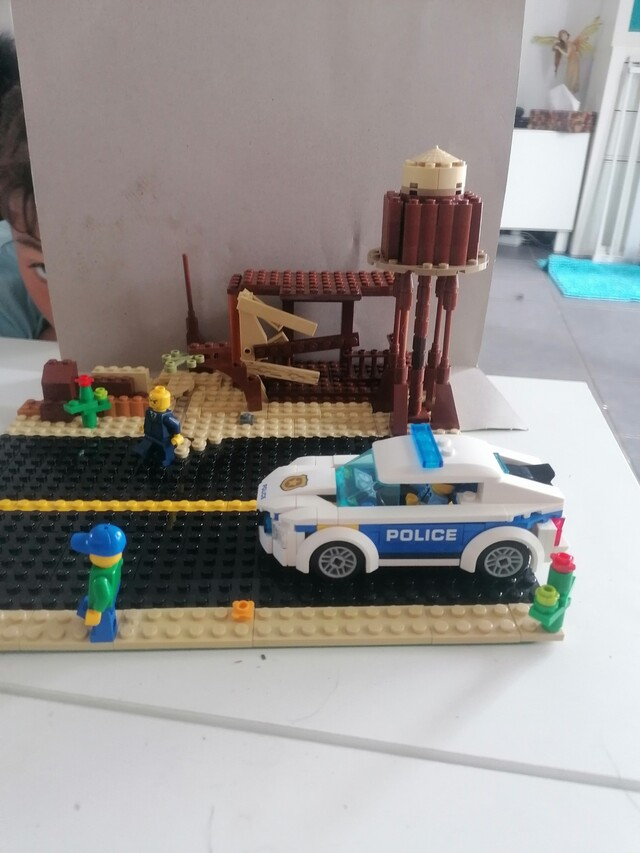](https://www.freelug.org/IMG/jpg/nb-02_personnalise_.jpg)

[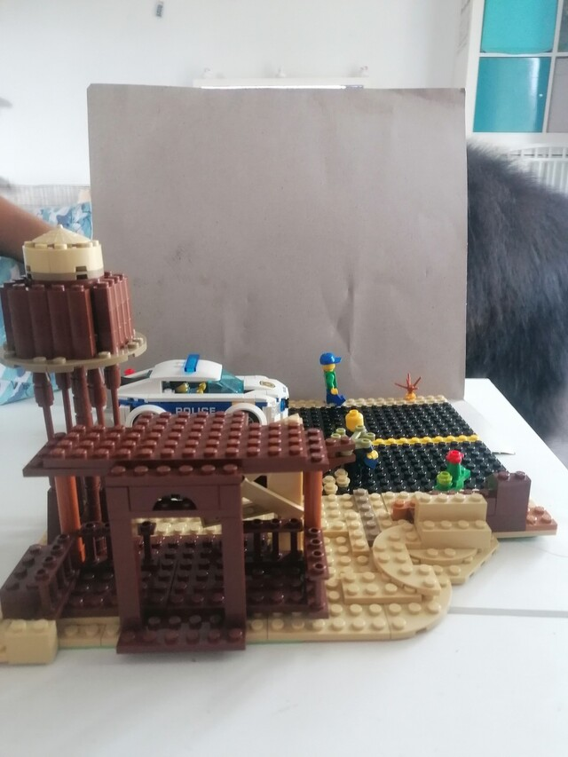](https://www.freelug.org/IMG/jpg/nb-03_personnalise_.jpg)

[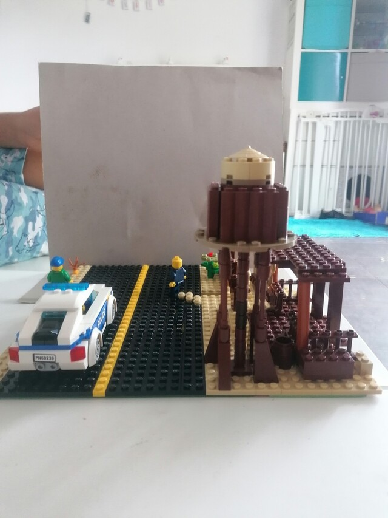](https://www.freelug.org/IMG/jpg/nb-04_personnalise_.jpg)

[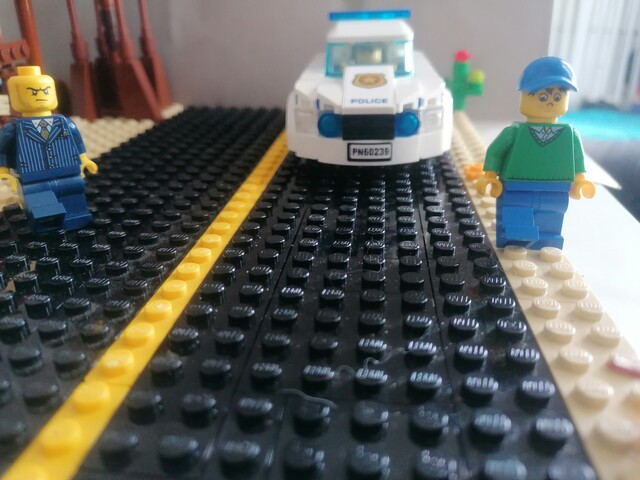](https://www.freelug.org/IMG/jpg/nb-05_personnalise_.jpg)

[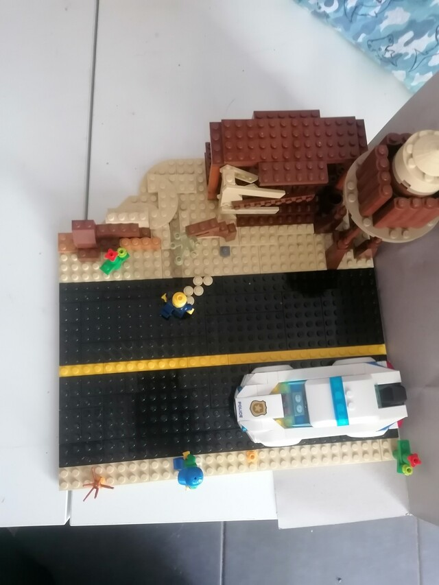](https://www.freelug.org/IMG/jpg/nb-06_personnalise_.jpg)

* * *

**02 - Christophe L. - "Retrouvailles... 23 ans après !"**  
Après avoir parcouru des centaines de kilomètres au volant de son bolide, Erik approche désormais de Lupton dans l’Arizona. C’est dans cette petite ville, sur la Route 66, que l’attend Timmy, à proximité d’une vieille grange. Bien plus qu’une grange en fait, c’est également l’atelier de Timmy qui tente en vain depuis des années d’assembler en toute discrétion un nouveau véhicule qui lui permettra de voyager dans l’espace-temps. On raconte aussi que l’arbre aux feuilles et fleurs roses, un Rosifère, aurait des vertus particulières (il a été planté il y a 23 ans par Timmy, souvenir de son dernier voyage spatio-temporel), mais ça seul Timmy pourrait confirmer. Nos 2 protagonistes arriveront-ils à trouver une solution pour secourir les membres du GFC ???

[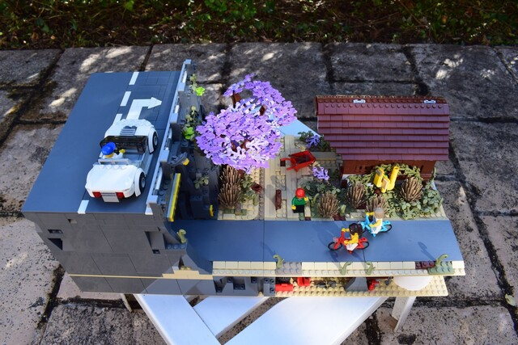](https://www.freelug.org/IMG/jpg/cl-01_personnalise_.jpg)

[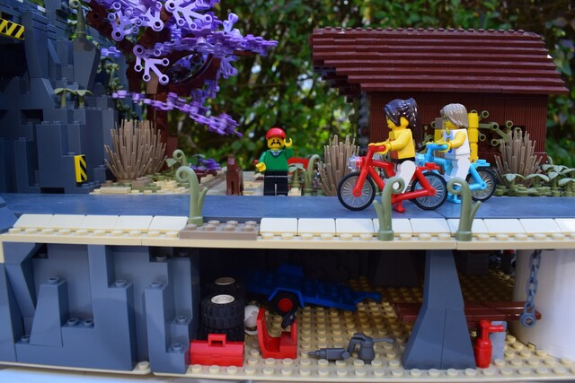](https://www.freelug.org/IMG/jpg/cl-02_personnalise_.jpg)

[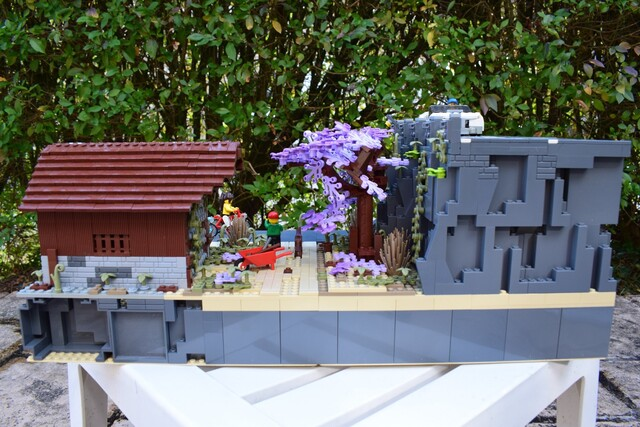](https://www.freelug.org/IMG/jpg/cl-03_personnalise_.jpg)

[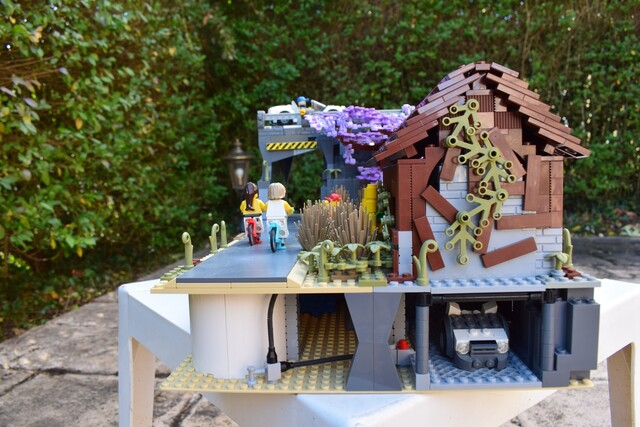](https://www.freelug.org/IMG/jpg/cl-04_personnalise_.jpg)

[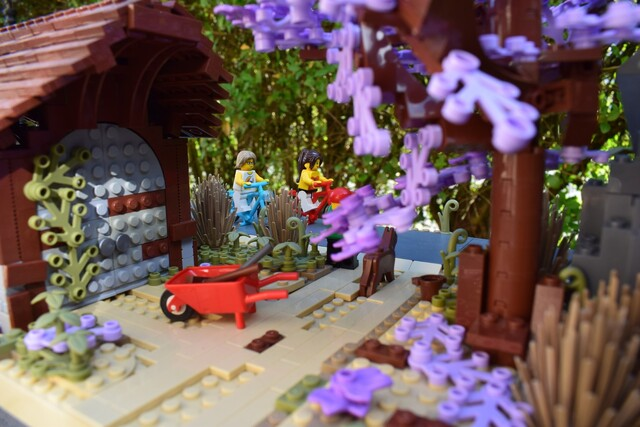](https://www.freelug.org/IMG/jpg/cl-05_personnalise_.jpg)

[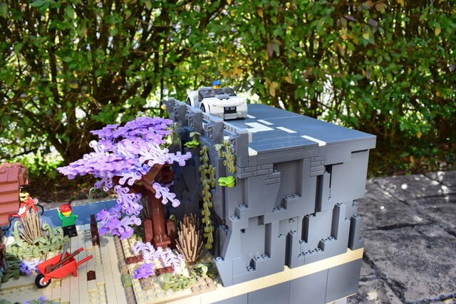](https://www.freelug.org/IMG/jpg/cl-06_personnalise_.jpg)

[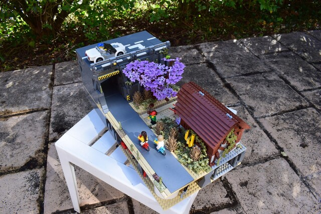](https://www.freelug.org/IMG/jpg/cl-07_personnalise_.jpg)

[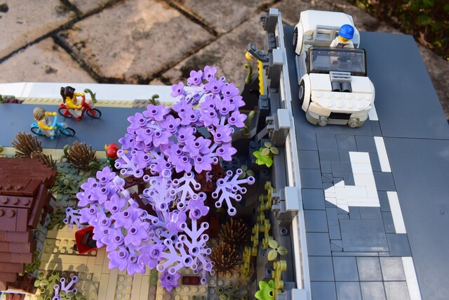](https://www.freelug.org/IMG/jpg/cl-08_personnalise_.jpg)

* * *

**03 - Serge D. - “Quelque part sur la route 66, quelqu’un les a vu...”**  
Le rendez-vous a lieu dans une station essence au beau milieu de la mythique Route 66.  
Erik s’y rend en bus ou l’attend Timmy et son chien le “Dr Cyber”.  
Le sheriff du comté est témoin de cette rencontre. Il n’aime pas les Français.

[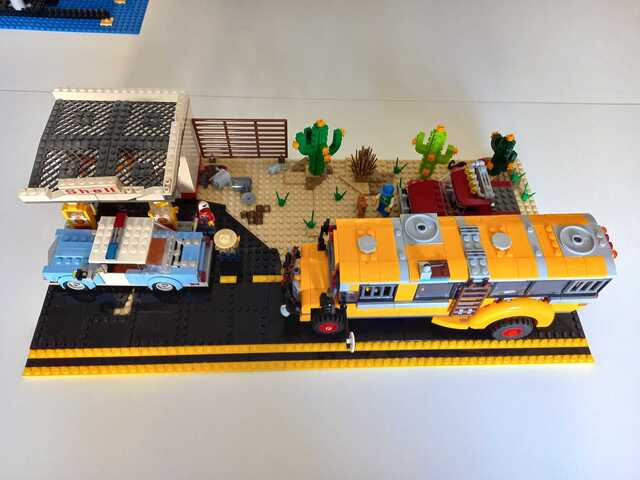](https://www.freelug.org/IMG/jpg/sd-01.jpg)

[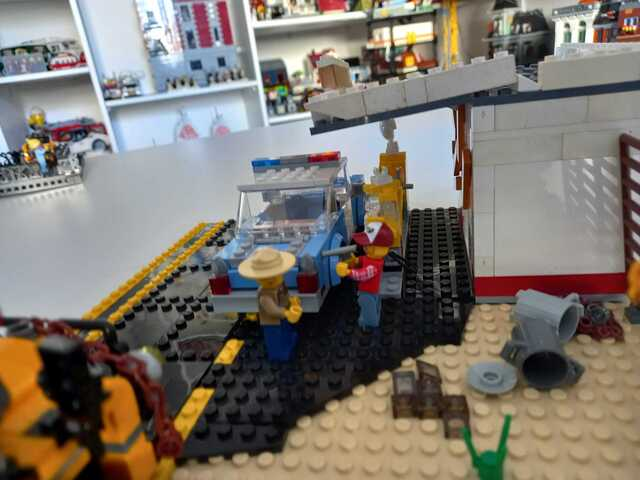](https://www.freelug.org/IMG/jpg/sd-02.jpg)

[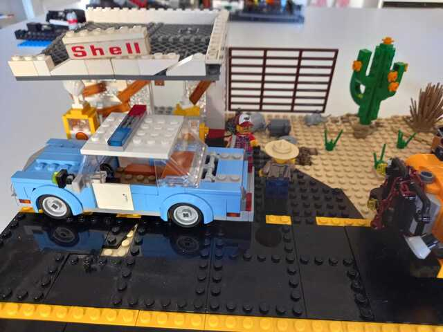](https://www.freelug.org/IMG/jpg/sd-03.jpg)

[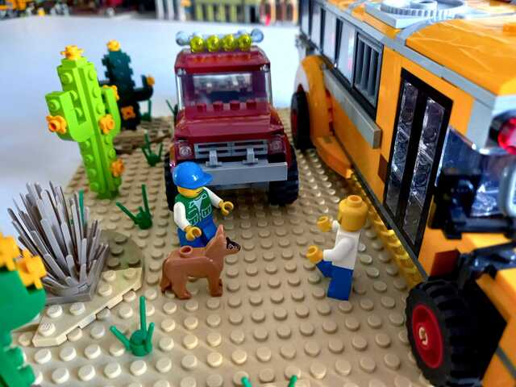](https://www.freelug.org/IMG/jpg/sd-04.jpg)

[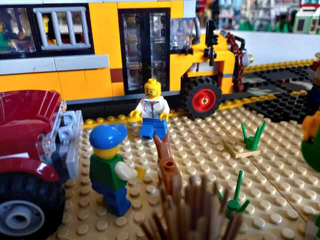](https://www.freelug.org/IMG/jpg/sd-05.jpg)

[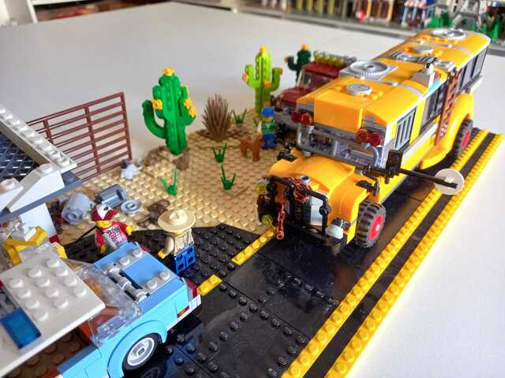](https://www.freelug.org/IMG/jpg/sd-06.jpg)

[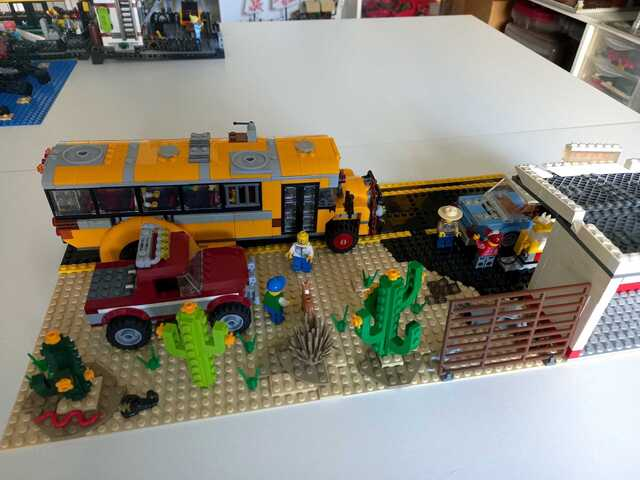](https://www.freelug.org/IMG/jpg/sd-07.jpg)

[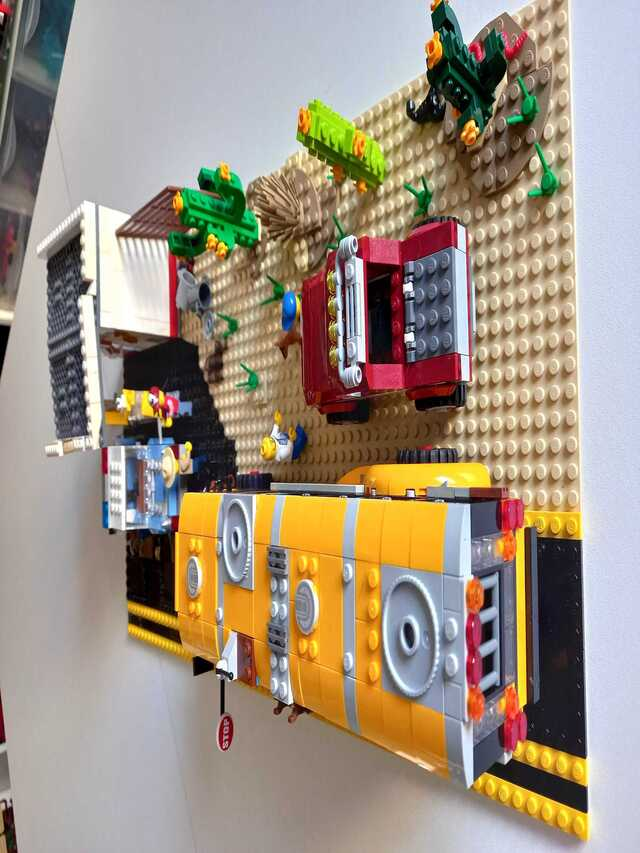](https://www.freelug.org/IMG/jpg/sd-08.jpg)

* * *

**04 - Gaultier O.-G - "Un problème épineux"**  
La charge de travail de notre président Erik est bien grande depuis qu’il doit assumer seul les missions du GFC en plus de ces propres obligations. Après de nombreuses péripéties il a réussi à communiquer avec Timmy.  
« Rendez-vous auprès du plus grand cactus de la Route 66… » Voilà ce que disait le dernier message de celui-ci !  
Cela aurait pu être bien compliqué et Éric s’arrêta durant son périple à chaque kilomètre pour comparer les tailles de centaines de cactus bordant la route mythique. Jusqu’à ce qu’il voit au loin une enseigne très particulière annonçant la proximité d’un Motel : ça c’est un Cactus !  
Erik a enfin retrouvé Timmy ! Il a bien grandi et arbore désormais un look de biker et une longue barbe qui ne dévoile de son visage que les tâches de rousseur du petit garçon qu’il était jadis. Il a aussi abandonné les bateaux volants et autres véhicules étranges du défunt Dr Cyber pour une simple moto… très légèrement customisée !  
Timmy continue dans cette zone désertique les tests de ses machines spatio-temporelles et fait des aller-retours d’une station-service à l’autre. Il est connu partout et plus personne ne s’étonne de faire le plein d’une moto-dragon !  
Il est la dernière personne à pouvoir retrouver les membres du GFC bloqués dans leur bug spatio-temporel : espérons pour Éric mais aussi pour les membres du GFC que Timmy aura une solution.

[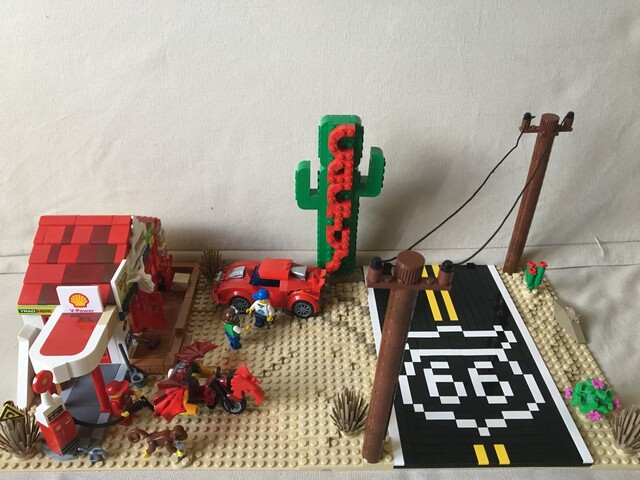](https://www.freelug.org/IMG/jpg/gog-01_personnalise_.jpg)

[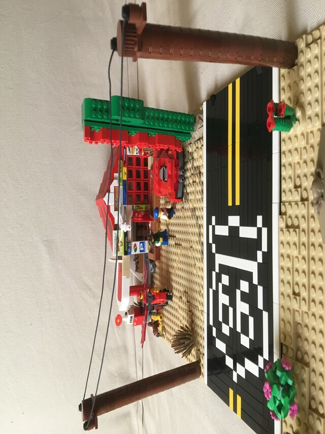](https://www.freelug.org/IMG/jpg/gog-02_personnalise_.jpg)

[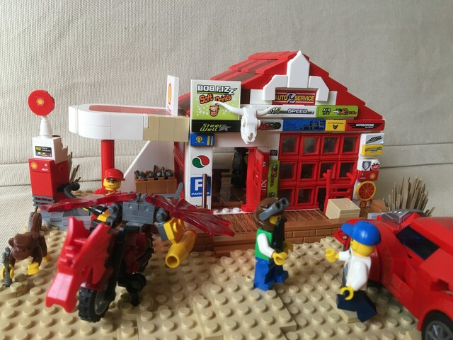](https://www.freelug.org/IMG/jpg/gog-03_personnalise_.jpg)

[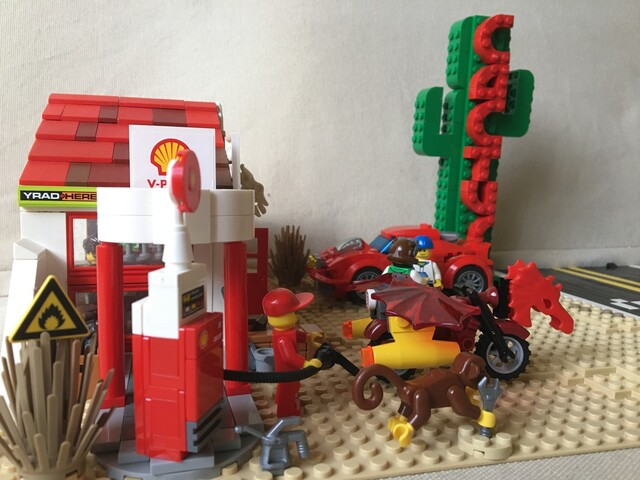](https://www.freelug.org/IMG/jpg/gog-04_personnalise_.jpg)

[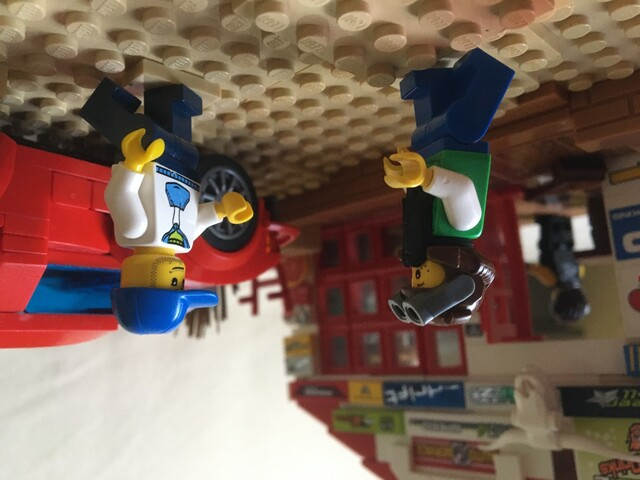](https://www.freelug.org/IMG/jpg/gog-05_personnalise_.jpg)

[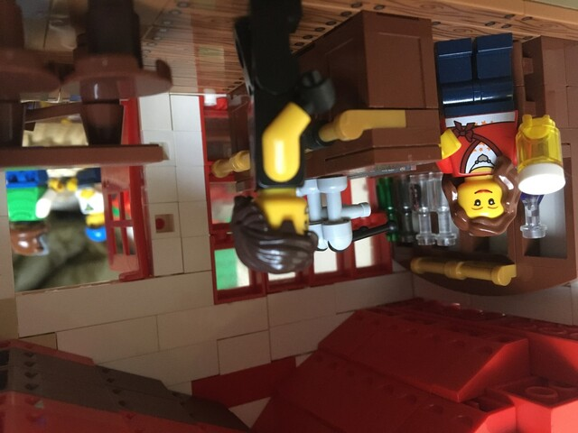](https://www.freelug.org/IMG/jpg/gog-06_personnalise_.jpg)

[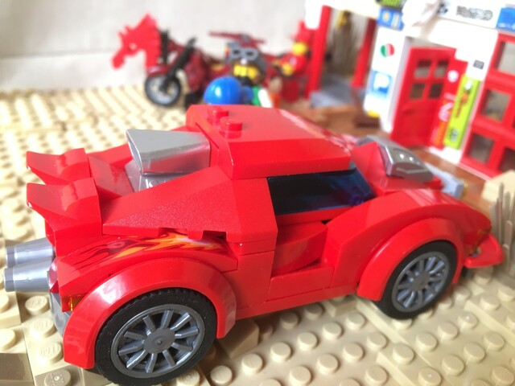](https://www.freelug.org/IMG/jpg/gog-07_personnalise_.jpg)

[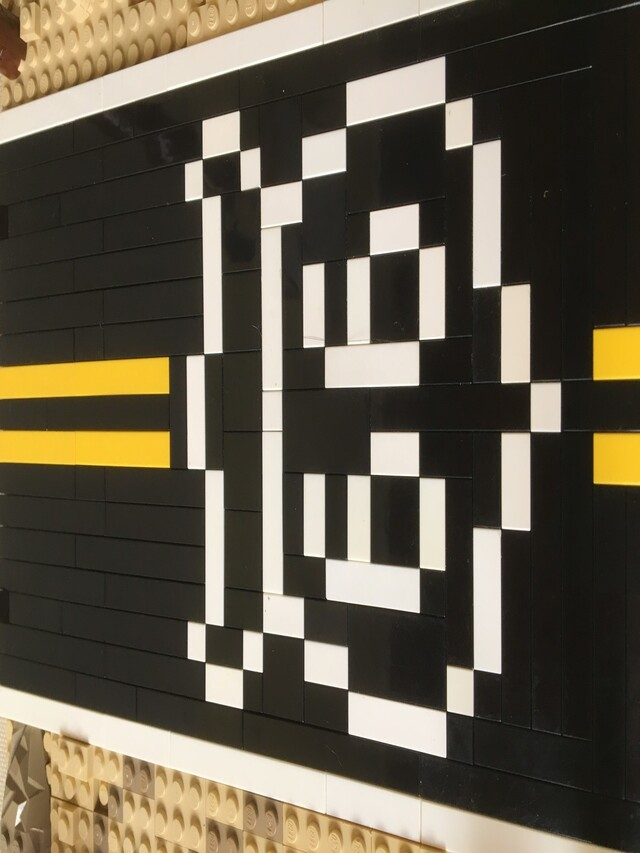](https://www.freelug.org/IMG/jpg/gog-08_personnalise_.jpg)

* * *

**05 - Xavier D. "Time Réunion"**  
Le rendez vous confidentiel d’Eric et Timmy se déroule sur le bord de la route 66. Le retraité du voyage spatio-temporel s’est reconverti en pompiste du désert bien loin de l’animation qu’il a pu connaitre en étant jeune. Malheureusement un leaker a fait fuiter l’info lors d’un meeting interne chez Lego ! Tout le monde a alors voulu revoir ce bon vieux retraité de Timmy (à moins que ce soit pour notre cher président adoré !). Dans ce petit monde des Lego, plusieurs gammes se sont alors réunies pour envoyer des émissaires capables de se fondre dans le décor pour revoir celui que certain considère comme le Messi et surtout pour savoir ce qui se dit ! Mais ce qui devait être un moment discret se transforme en une véritable tornade quand Coyote vole le vaisseau d’un Trooper pour enfin attraper Bibip ! Le tout sous les yeux ébahis de Lone Ranger et de son mentor, d’un lapin Minecraft et d’une Minifig de série essayant de se fondre dans le décor sans bouger. Si vous cherchez l’émissaire City, il a prit du retard et creuse encore le tunnel pour être au plus prêt de la discussion... Timmy quant à lui accueille Erik à bras ouvert sûrement en espérant pouvoir essayer sa Mustang !!!

[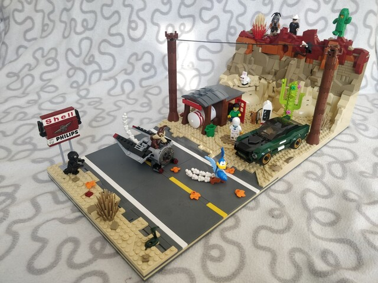](https://www.freelug.org/IMG/jpg/xd-01_personnalise_.jpg)

[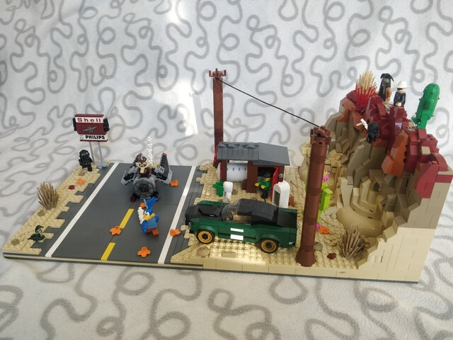](https://www.freelug.org/IMG/jpg/xd-02_personnalise_.jpg)

[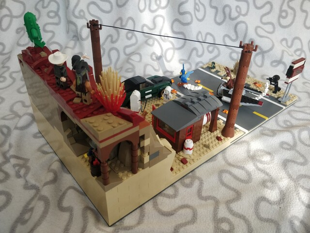](https://www.freelug.org/IMG/jpg/xd-03_personnalise_.jpg)

[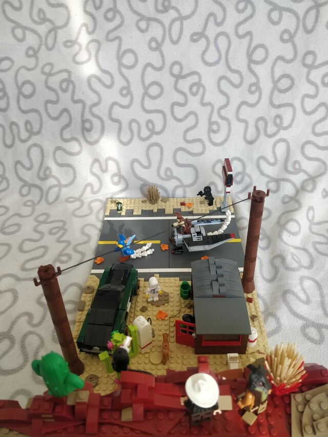](https://www.freelug.org/IMG/jpg/xd-04_personnalise_.jpg)

[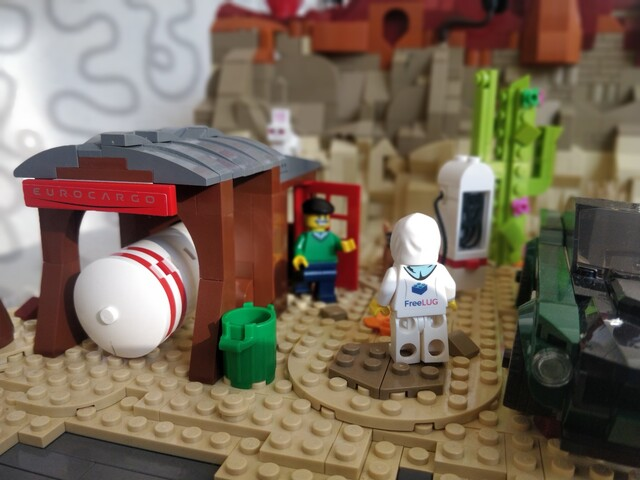](https://www.freelug.org/IMG/jpg/xd-05_personnalise_.jpg)

[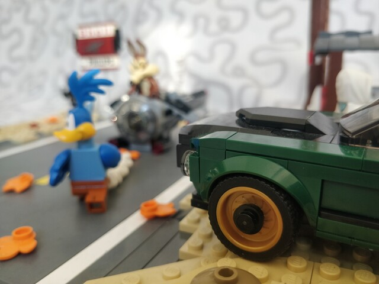](https://www.freelug.org/IMG/jpg/xd-06_personnalise_.jpg)

[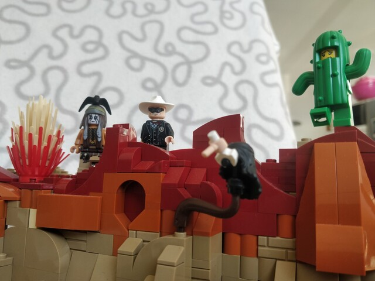](https://www.freelug.org/IMG/jpg/xd-07_personnalise_.jpg)

[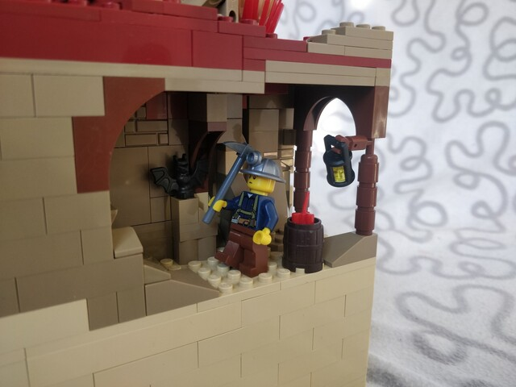](https://www.freelug.org/IMG/jpg/xd-08_personnalise_.jpg)

* * *

**06 - Rémi L. - "RDV au « Cactus Motel »"**  
Timmy a donné RDV à Erik au « Cactus Motel », un vieux motel abandonné le long de la célèbre route 66. Facilement repérable avec son immense enseigne, ce motel fut jadis le lieu de RDV de tous les amoureux, on peut d’ailleurs voir un biker qui attend sa dulcinée derrière le mat de l’enseigne, il semblerait qu’elle ne soit jamais venue… Aujourd’hui, seules quelques chambres et le téléphone du motel ont survécus, le reste sert de repère à la faune locale ou de pot de fleur pour les cactus qui ont colonisés l’endroit. Pour s’y rendre, Erik a du louer une moto à un vieux biker et rouler de longues heures pour enfin arriver au milieu de nulle-part. Timmy était là et il l’attendait en compagnie de son vieux chimpanzé et d’un superbe Hot Rod d’époque flambant neuf, preuve que les voyages dans le temps n’ont aucun secret pour Timmy. Celui-ci n’a pas beaucoup changé en 25 ans, juste un petit peu plus poilu. Quoiqu’il en soit, il a promis à Erik qu’il bricolerait une machine à voyager dans le temps pour récupérer le GFC.  
Affaire à suivre…..

[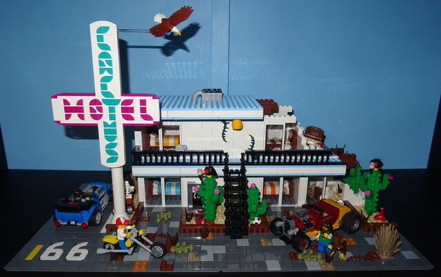](https://www.freelug.org/IMG/jpg/rl-01_personnalise_.jpg)

[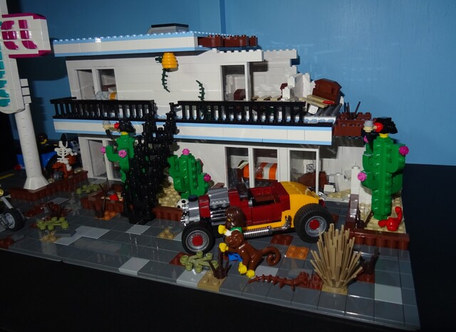](https://www.freelug.org/IMG/jpg/rl-02_personnalise_.jpg)

[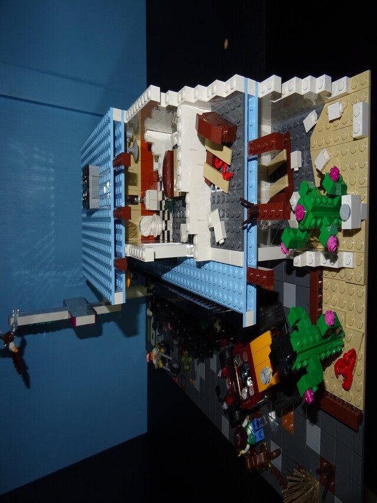](https://www.freelug.org/IMG/jpg/rl-03_personnalise_.jpg)

[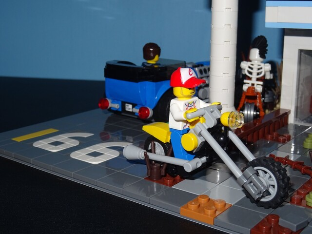](https://www.freelug.org/IMG/jpg/rl-04_personnalise_.jpg)

[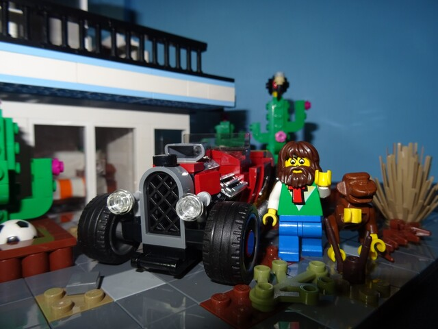](https://www.freelug.org/IMG/jpg/rl-05_personnalise_.jpg)

[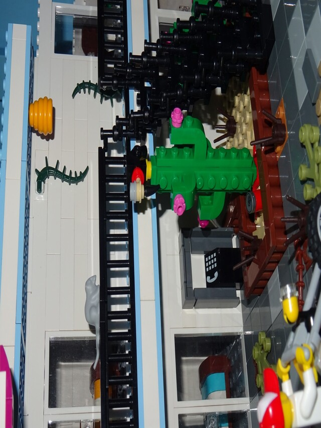](https://www.freelug.org/IMG/jpg/rl-06_personnalise_.jpg)

[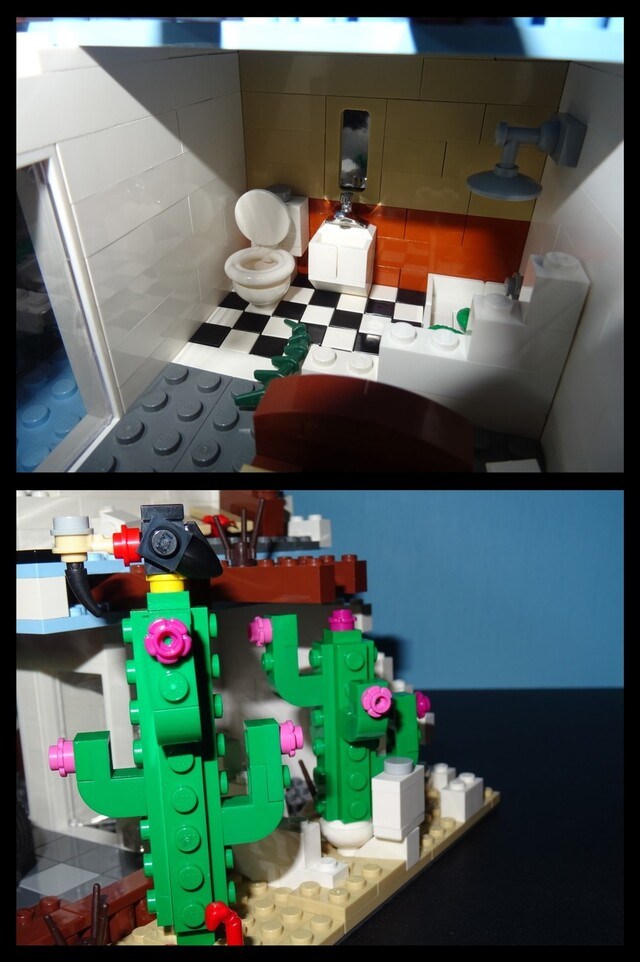](https://www.freelug.org/IMG/jpg/rl-07_personnalise_.jpg)

[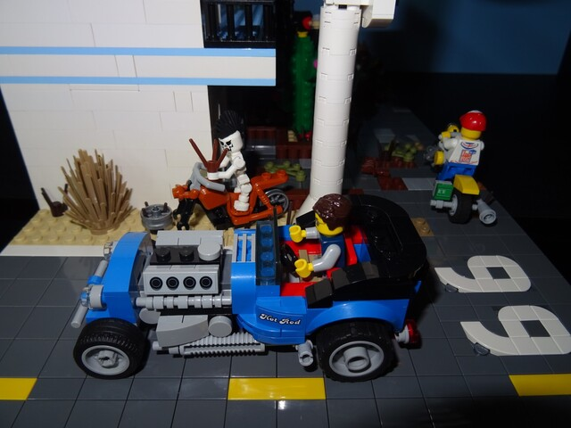](https://www.freelug.org/IMG/jpg/rl-08_personnalise_.jpg)

* * *

**07 - Charles F. - "Welcome To Legoredo Erik !"**  
Erik, à la recherche de ce génial Timmy, a parcouru le tracé de la fameuse Route 66. Après des jours de chevauchée sur sa Harley Davidson, Erik a rendez-vous avec Timmy aux confins de l’Arizona et du Nevada, aux portes de la Californie dans une station service de Legoredo.  
Timmy n’est pas dans ce trou paumé sans raison. Refuge d’aliens échappés de la Zone 51, ceux-ci travaillent pour Timmy ; car seules ces créatures disposent de la connaissance et de la technologie pouvant aider Timmy dans son Retour vers le Futur.  
Comme sa machine à voyager dans le temps carbure aux cristaux temporels et tels des alchimistes, les aliens s’acharnent depuis plus de 20 ans à concevoir de nouveaux cristaux.  
Y parviendront-ils ? Mais quelle est donc cette intrigante machine temporelle ? La suite au prochain concours ?

[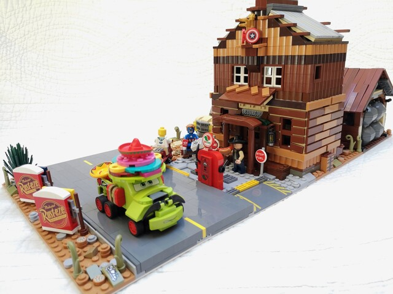](https://www.freelug.org/IMG/jpg/cf-01_personnalise_.jpg)

[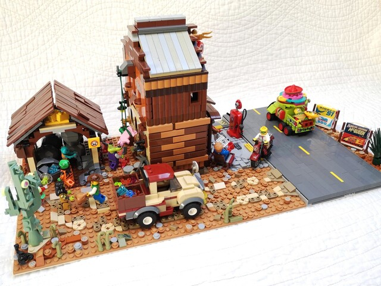](https://www.freelug.org/IMG/jpg/cf-02_personnalise_.jpg)

[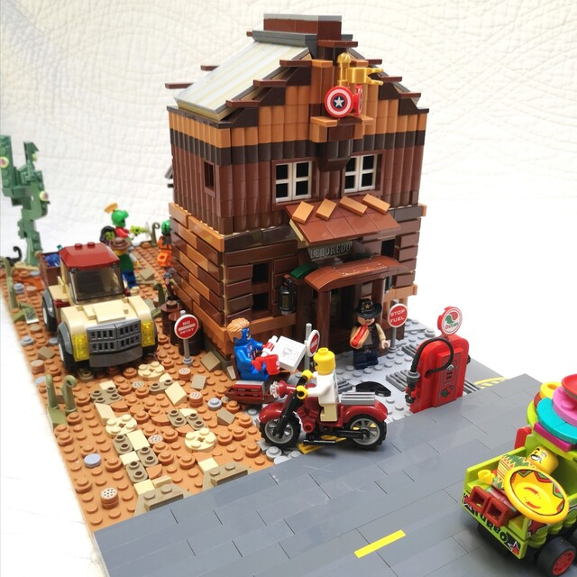](https://www.freelug.org/IMG/jpg/cf-03_personnalise_.jpg)

[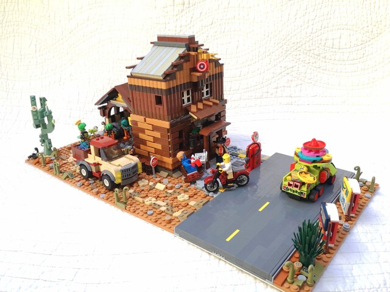](https://www.freelug.org/IMG/jpg/cf-04_personnalise_.jpg)

* * *

**08 - Wilfried R. - "A 100 miles de Roswell..."**  
Alors qu’Erik était sur la route d’Albuquerque, sa voiture sombra brutalement sous la chaleur du Nouveau-Mexique. Au comble du désespoir... et de la soif, Erik avait échoué au relais Roswell (situé sur la Route 66 au plus près de la fameuse localité ovniesque). Etait-ce bien lui qui avait trouvé Timmy ou était-ce l’inverse ? L’incident de Roswell de 1947 ne serait-il pas finalement une autre expérience de Timmy ?

* * *

**09 - Jérôme T. - "Rencontre de 2 types !"**  
Erik a modifié sa Volvo pour effectuer des voyages dans le temps. Mais, malgré tout le travail technologique apporté sur son véhicule, il a du mal à se déplacer comme il le souhaiterait. Il a donc décidé de retrouver Timmy quelque part sur la route 66 pour avoir quelques conseils et astuce. Celui-ci se moque, en lui disant qu’il ne suffit pas d’installer les portes papillons de la De Lorean pour que ça fonctionne. En même temps, Erik lui signale qu’il est sur un Overboard !  
Oui mais tout cela fait qu’on n’est pas près de retrouver les membres du GFC....

* * *

**10 - Renaud B. - Pas de titre ?**  
Erik lui emmène l’horloge nécessaire pour mettre la machine à remonter le temps à l’heure.

* * *

**11 - Erik A. - "Rendez-vous au T-Burger"**  
Timmy et le président FreeLUG se rejoignent au T-Burger, Route 66, Texas, pour essayer de trouver une solution pour rapatrier les membres du GFC. Bien sûr, cet échange se devait d’être accompagné des burgers du chef Bill dont la cuisine est installée dans une vielle caravane Airstream.  
Mais Timmy reste sur ses gardes, l’homme avec ses lunettes de soleil à la station essence pourrait être un agent secret...

* * *

Devant la qualité des réalisations proposés, le GFC a décidé également de récompenser le deuxième et le troisième, et oui on est comme ça au GFC, en période de Noël on fait pleins de cadeaux.

**Les heureux gagnants de ce concours sont :**  
**–** **05 - Xavier D. "Time Réunion"** qui remporte le set LEGO **Ref 10265 - Creator Expert - Ford Mustang**  
**–** **11 - Erik A. - "Rendez-vous au T-Burger"** qui remporte le set LEGO **Ref 76899 - Speed Champions - Lamborghini Urus ST-X & Huracán Super Trofeo EVO**  
**–** **07 - Charles F. - "Welcome To Legoredo Erik !"** qui remporte le set LEGO **Ref 76895 - Speed Champions - Ferrari F8 Tributo**

**Classement :**  
1\. Xavier D. (39 pts)  
2\. Erik A. (38 pts)  
3\. Charles F. (28 pts)  
4\. Gaultier O.-G. & Rémi L. (25 pts)  
5\. Christophe L. (21 pts)  
6\. Serge D. (19 pts)  
7\. Wilfried R. (13 pts)  
5\. Renaud B. (2 pts)  
6\. Jérôme T. & Nathan B. (0 pt)

**Composition du jury catégorie réelle :**  
**–** Mathieu W.  
**–** Pierre C.  
**–** Florent D.  
**–** Stephane P.  
**–** Michael F.  
**–** Aurelien B.  
**–** Stéphane R.  
**–** Yann L.  
**–** Jérémie D.  
**–** SIMON P.  
**–** Vincent H.  
**–** Dominique Q.  
**–** Thibault P.  
**–** Bruno G.

* * *

## Concours catégorie "Virtuelle"

**01 - Jean-Michel R. "Timmy dans la galère ! Vite Erik !!!"**  
Timmy à pas mal voyagé depuis le temps, d’ailleurs il garde des objets dénichés par ci par là durant ses voyages ! (Présent, passé, futur !)  
Il s’est donc installé dans un endroit tranquille, sous la route 66 ! Il y a fait son laboratoire de recherches, et il y accède derrière une montagne, en toute discrétion.  
Erik est arrivé au bon moment d’ailleurs, parce que Timmy à crevé la roue de sa voiture à voyager dans le temps et il ne sait pas la réparer, il ne peut donc plus aller nul part, et pour le moment, là où il va, il a besoin d’une route ! ? Il faut dire que cette vieille route est particulièrement abimée ?

Faute de concurrents, l’heureux gagnant de ce concours est **01 - Jean-Michel R. "Timmy dans la galère ! Vite Erik !!!"** qui remporte le set LEGO **Ref 31108 - Caravan Family Holiday**

**Classement :**  
1\. Jean-Michel R. "Timmy dans la galère ! Vite Erik !!!"

Composition du jury catégorie virtuelle :  
Vu qu’il n’y a eu qu’un seul participant en virtuel, il n’y a pas eu besoin de jury.

* * *

**Merci à toutes et tous et à bientôt pour un nouveau concours !**
