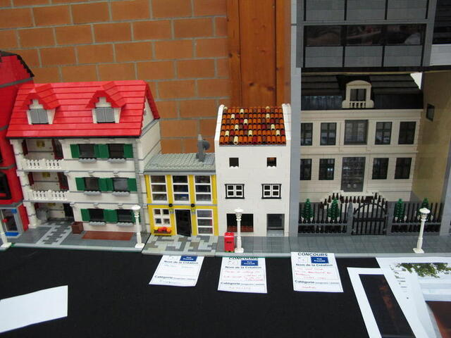

Pour ce WE de l’Assemblée Générale FreeLUG qui aura lieu les 01 et 02 Mars 2014, nous avons mis en place 2 concours de création pour le samedi. Auxquels se rajoutent pour le dimanche un concours de Sumo et un concours de Techball.

## La rue FreeLUG

**Les bâtiments de la rue**

Seconde édition de la Rue FreeLUG, ce concours est devenu en quelque sorte un fil rouge, les créations pouvant au delà de l’AG, se retrouver dans nos rassemblements, expositions,... comme le long de la LGV.

Pour celles et ceux qui n’étaient pas parmi nous en 2012, lors de la première édition et pour tous, voici un petit rappel des informations utiles pour vous lancer dans cette appel à créations dont l’inspiration est la série des bâtiments modulaires.

Cette série est probablement la gamme qui donne envie de faire de la « Ville » au-delà du « City ». La série modulaire a enfin permis d’élargir les fonctions habituelles de la ville du catalogue LEGO®, que sont les casernes de pompiers, postes de police et autres hôpitaux.

Elle offre à chaque nouvelle boite un grand engouement chez les AFOLs. Mais l’attrait des bâtiments modulaires vient également de principes simples de gabarits et d’assemblage des modules entre eux, qui permettent la construction d’ensemble extensible à volonté, pouvant mêler bâtiments officiels LEGO® et créations.  
D’où cette idée, réaliser une « Rue FreeLUG »

La « FreeLUG street » si nous devions, un jour, collaborer à une « LUG’s street ».

Forte d’un peu plus de 260 adhérents répartis aux six coins de l’hexagone et même au-delà de nos frontières, l’association pourrait donc avoir sa rue aux bâtiments tous uniques et originaux représentant chacune nos régions. En reprenant les architectures diverses et variées qui composent nos villes et villages, allant des colombages de l’Est aux briques du Nord en passant par les enduits chauds et colorés du Sud ou les pierres des maisons bretonnes.

Nos rassemblements, expositions, le décor de la LGV, deviennent ainsi des moments privilégiés pour assembler la "Rue FreeLUG", à chaque fois différente par la présence des régions représentées.

Un petit article sur le site est publié depuis la première édition, reprenant la traduction d’un petit guide de construction modulaire ayant déjà fait ses preuves.  
[http://www.freelug.org/spip.php?article1445](http://www.freelug.org/spip.php?article1445)

Pour cette seconde édition, suite à l’expérience de la première, nous introduisons :

**–** un élément nouveau, le fait de réaliser comme dans la gamme "modulaire", l’intérieur des bâtiments et  
**–** une plus grande liberté, car il est toujours conseillé de trouver votre inspiration dans nos villes ou villages pour reproduire un bâtiment existant en bâtiment modulaire afin de le présenter avec une photo de l’original, mais il est à présent possible de réaliser une création totalement originale.

Chaque construction sera "jugée" sur l’originalité et la qualité des détails, intérieurs et extérieurs.

**Rue FreeLUG AG2012**

Photo de Erik Amzallag

**Les "Squares FreeLUG"**

Pour donner une plus grande accessibilité à ce concours et si vous ne sentez pas encore prêts pour vous "attaquer" à un bâtiment modulaire, nous vous donnons la possibilité de créer un square pour agrémenter et donner un peu de verdure à la Rue FreeLUG.

Le principe est simple, sur une ou plusieurs plaques de base de 32x32 alignées, après y avoir apposée un trottoir sur un seul côté, en angle sur deux côtés ou sur le pourtour complet pourquoi pas, il vous est demandé d’imaginer le petit square ou le jardin d’enfants qui donnerait encore plus de vie à la Rue.

Là encore, chaque construction sera "jugée" sur l’originalité et la qualité des détails.

Donc place à la « Rue FreeLUG » seconde édition et bonne construction.

## Concours minifigs

Le principe est très simple, mais la simplicité ne retire en rien la créativité et l’originalité pour ce concours.

Il s’agit de réaliser une vignette de 8x8, racontant une petite histoire et mettant en scène DEUX minifigs provenant de DEUX séries différentes.

Pour ce concours :  
**–** Pas de contrainte de couleur,  
**–** Pas de contrainte du nombre de pièces,  
**–** Hauteur illimitée,  
**–** Possibilité d’introduire d’autres accessoires ou animaux,  
**–** Seule contrainte le 8X8 de base, au sol et sur toute la hauteur.

Chaque construction sera "jugée" sur l’originalité, la qualité des détails et la petite histoire qui se dégagera entre les DEUX minifigs.

Ce concours est ouvert à tous, si vous ne pouvez vous rendre à l’AG, la création peut être confiée à une personne qui la ramènera le 1er mars.

Le jury se tiendra le samedi après l’AG.

Bonne création.
