3 personnes ont fait tourner les aiguilles pour sauver Noël, qui le Père Noël va t’il choisir ?

Il est temps de découvrir les participations du "Concours Technic Tic Tac !".

Bonjour à toutes et à tous,

Vous pouvez retrouver le [règlement de ce concours ici](https://www.freelug.org/spip.php?article3136)

Tout d’abord, nous tenons à remercier les 3 participants de ce défi "Technic". Le sujet n’était pas simple.

Les participations sont présentées dans l’ordre de réception.

**01 - Philippe H. (Philo) - "Santa Clock"**

[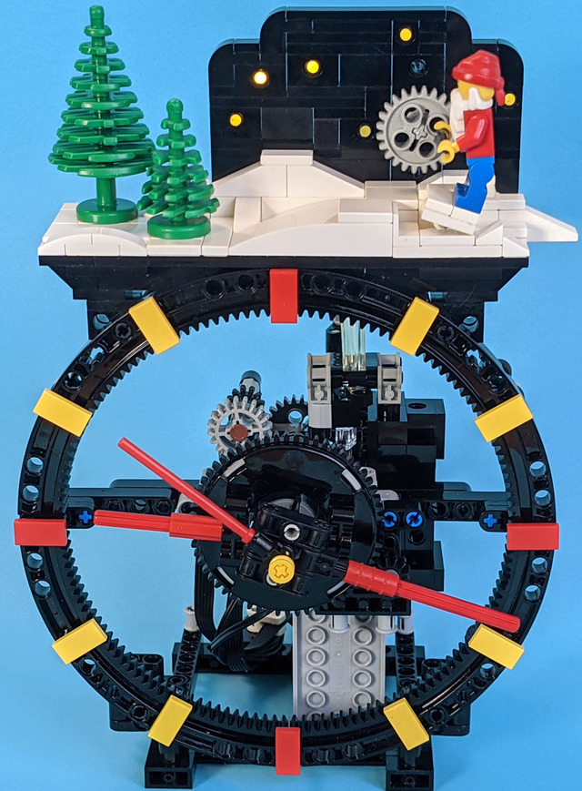](https://www.freelug.org/IMG/jpg/01-01.jpg)

[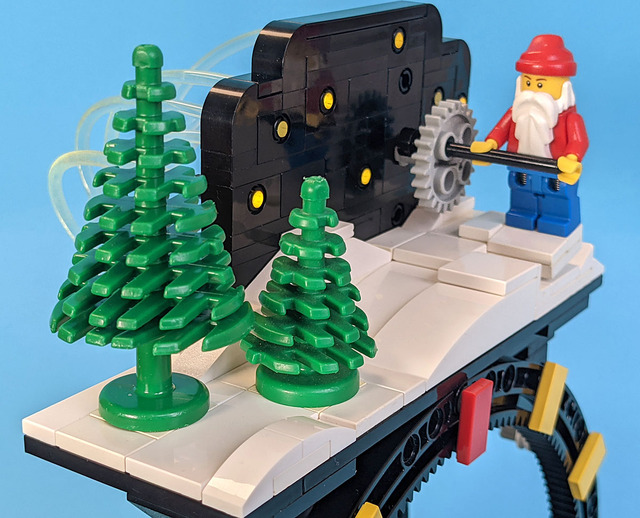](https://www.freelug.org/IMG/jpg/01-02.jpg)

[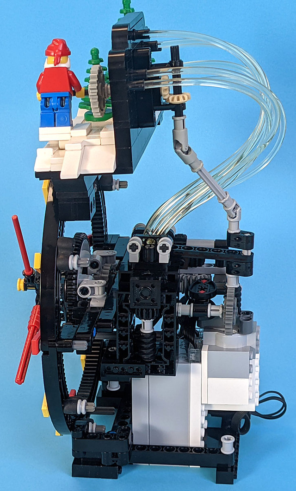](https://www.freelug.org/IMG/jpg/01-03.jpg)

[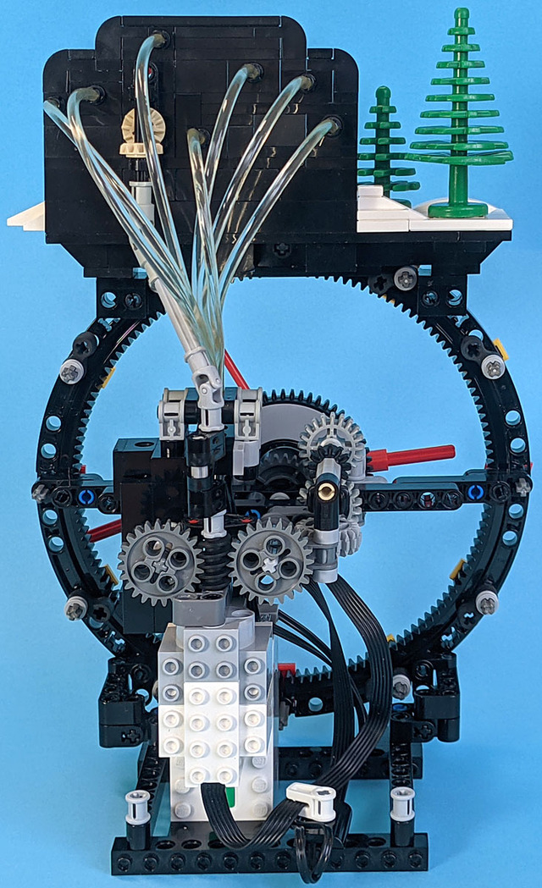](https://www.freelug.org/IMG/jpg/01-04.jpg)

[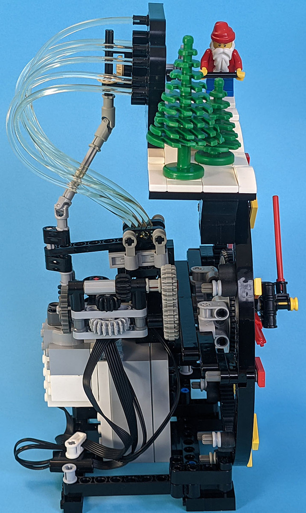](https://www.freelug.org/IMG/jpg/01-05.jpg)

[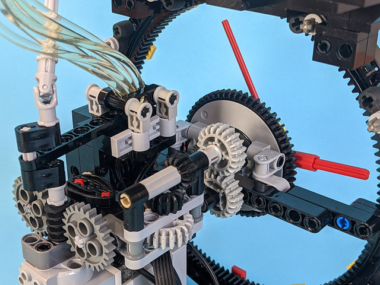](https://www.freelug.org/IMG/jpg/01-06.jpg)

[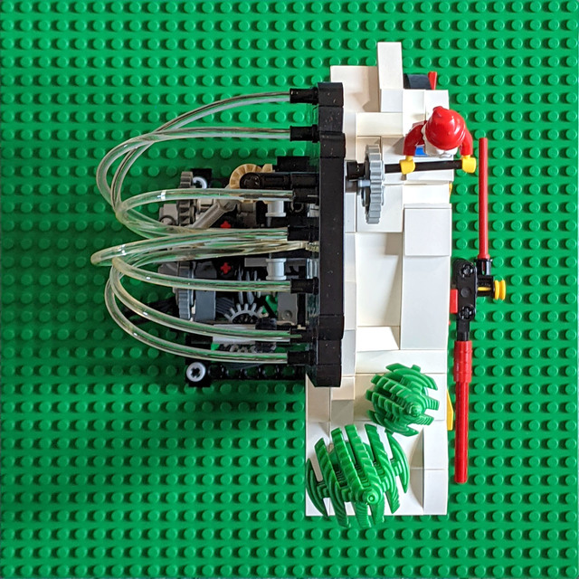](https://www.freelug.org/IMG/jpg/01-07.jpg)

Video Player

[Vidéo de la publication d’origine](https://www.freelug.org/IMG/mp4/01-video.mp4)

Pour les plus curieux, voici le Making-Of :

* * *

**02 - Thomas B. - "Un Père Noël renversant"**

[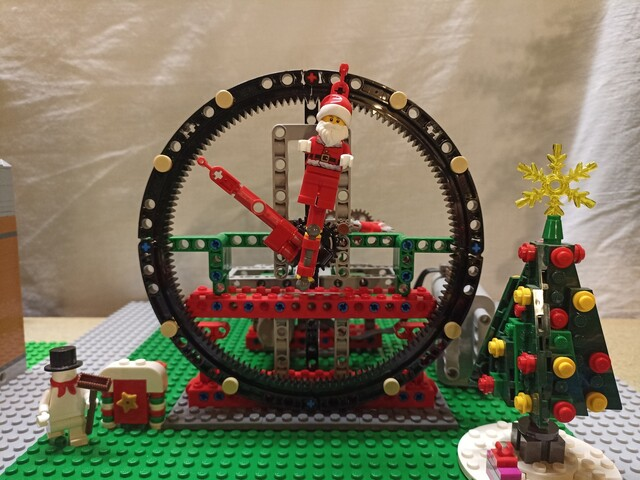](https://www.freelug.org/IMG/jpg/02-01_personnalise_.jpg)

[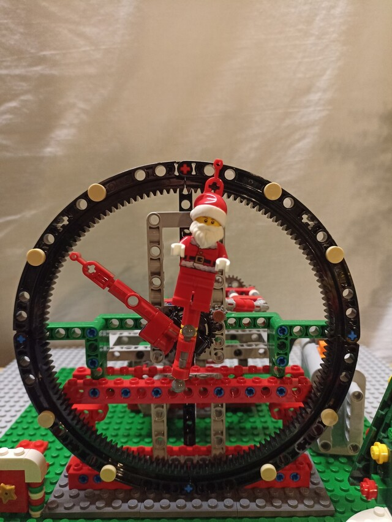](https://www.freelug.org/IMG/jpg/02-02_personnalise_.jpg)

[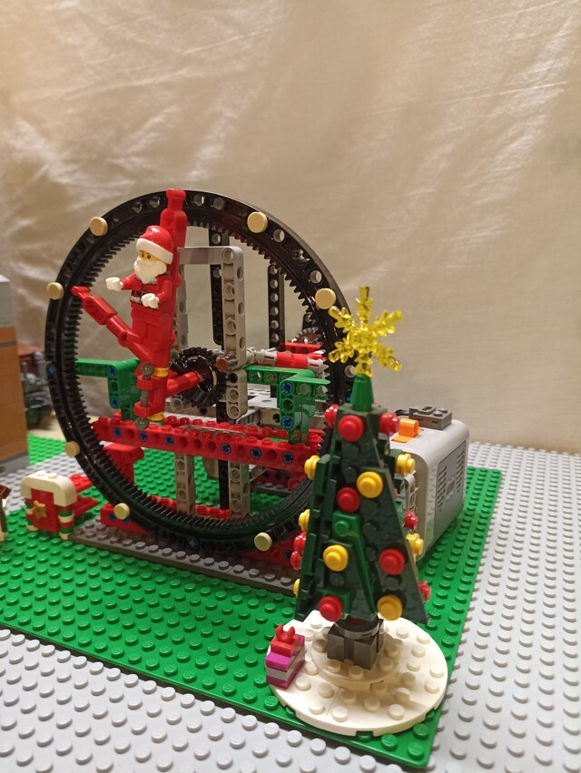](https://www.freelug.org/IMG/jpg/02-03_personnalise_.jpg)

[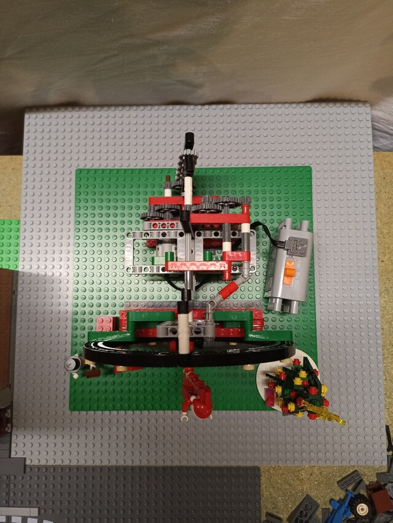](https://www.freelug.org/IMG/jpg/02-04_personnalise_.jpg)

Video Player

[Vidéo de la publication d’origine](https://www.freelug.org/IMG/mp4/02_-_video.mp4)

* * *

**03 - Christophe M. - "Christmas Clock"**  
3 aiguilles, les secondes, les minutes et les heures. Tout est fonctionnel.  
3600 tours de la petite fait 1 tour des minutes et 60 tours des minutes font 1 tour des heures.

[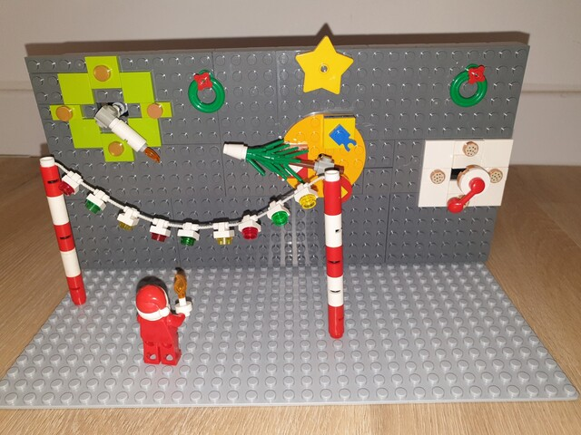](https://www.freelug.org/IMG/jpg/03-01_personnalise_.jpg)

[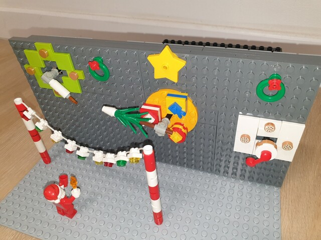](https://www.freelug.org/IMG/jpg/03-02_personnalise_.jpg)

[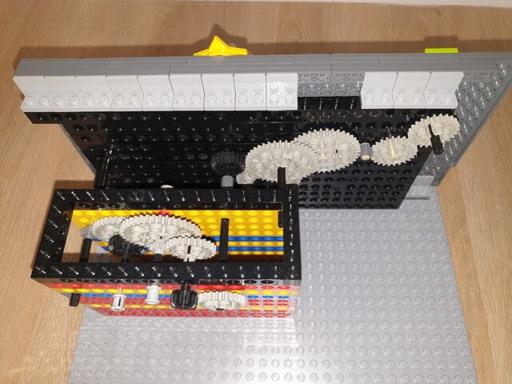](https://www.freelug.org/IMG/jpg/03-03_personnalise_.jpg)

[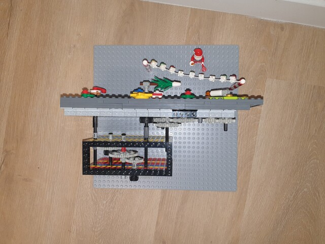](https://www.freelug.org/IMG/jpg/03-04_personnalise_.jpg)

Video Player

[Vidéo de la publication d’origine](https://www.freelug.org/IMG/mp4/03-video.mp4)

* * *

Devant la qualité des réalisations proposés, le GFC a décidé de récompenser le premier et le second.

**Les heureux gagnants de ce concours sont :**  
**–** **01 - Philippe H. (Philo) - "Santa Clock"** qui remporte le set LEGO **Ref 42093 - Chevrolet Corvette ZR1**  
**–** **02 - Thomas B. - "Un Père Noël renversant"** qui remporte le set LEGO **Ref 31095 - Fairground Carousel**

**Classement :**  
1\. Philippe H. (Philo) (26 points)  
2\. Thomas B. (15 points)  
3\. Christophe M. (4 points)

**Composition du jury :**  
Mathieu W. (GFC)  
Pierre C. (GFC)  
Xavier D. (GFC)  
Rémi L. (GFC)  
Charles F. (GFC)  
Denis H.  
Bruno G.  
Yoann G.  
Stéphane M.  
Jérôme V.  
Duy Hai D.  
Gaultier O.G.  
Céline D.  
Coralie G.  
Benoit F.

* * *

**Merci à toutes et tous et à bientôt pour un nouveau concours !**
