5 participants, 5 véhicules, qui va l’emporter ?

Il est temps de découvrir les participations du concours sur les véhicules.

Tout d’abord, nous tenons à remercier les 5 participants qui nous ont proposé de très belles réalisations.

Les participations sont présentées dans l’ordre de réception.

**1\. Nicolas G. - Voiture Blacktron**

[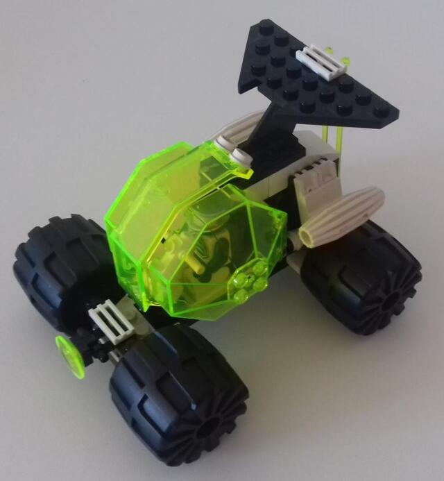](https://www.freelug.org/IMG/jpg/ng01.jpg)

[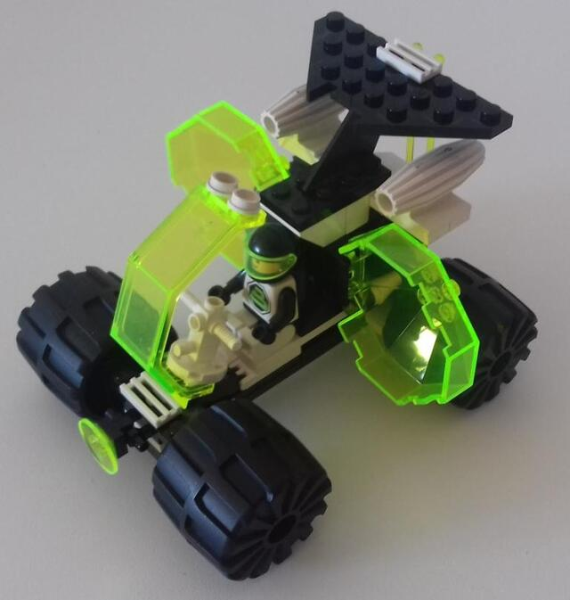](https://www.freelug.org/IMG/jpg/ng02.jpg)

[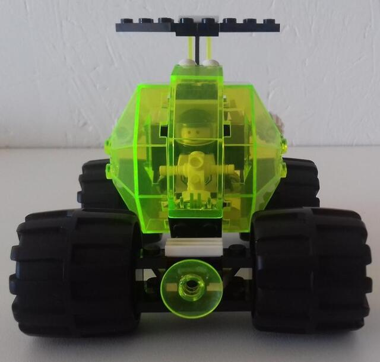](https://www.freelug.org/IMG/jpg/ng03.jpg)

[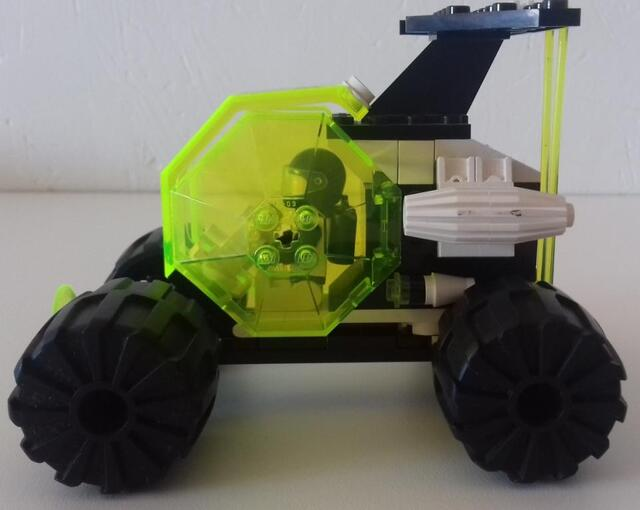](https://www.freelug.org/IMG/jpg/ng04.jpg)

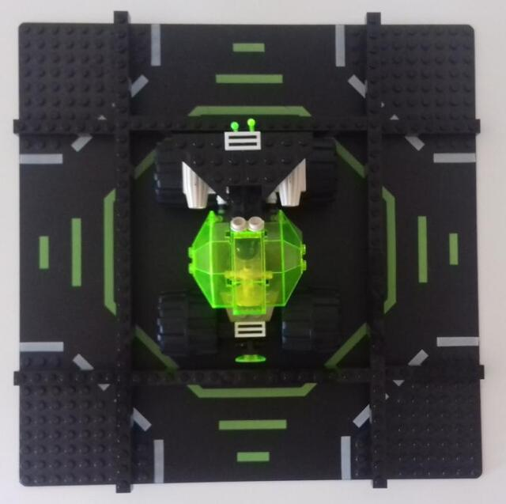

**2\. Richard L. - Monowheel, inspiration années 30**

[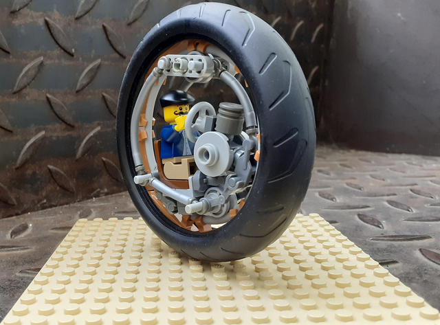](https://www.freelug.org/IMG/jpg/rl01.jpg)

[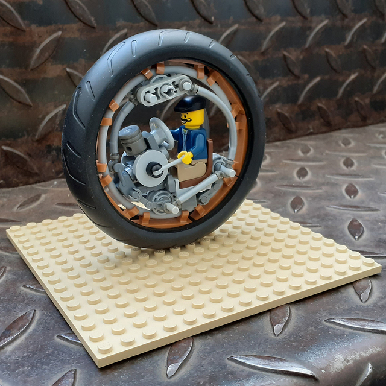](https://www.freelug.org/IMG/jpg/rl02.jpg)

[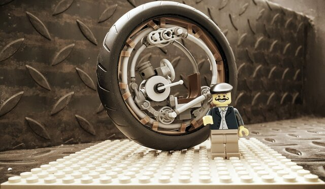](https://www.freelug.org/IMG/jpg/rl03.jpg)

[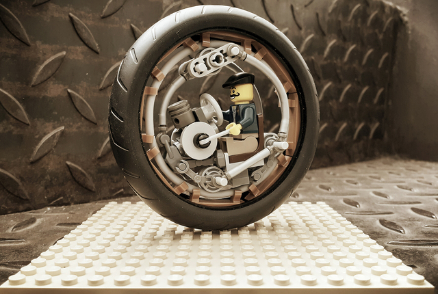](https://www.freelug.org/IMG/jpg/rl04.jpg)

[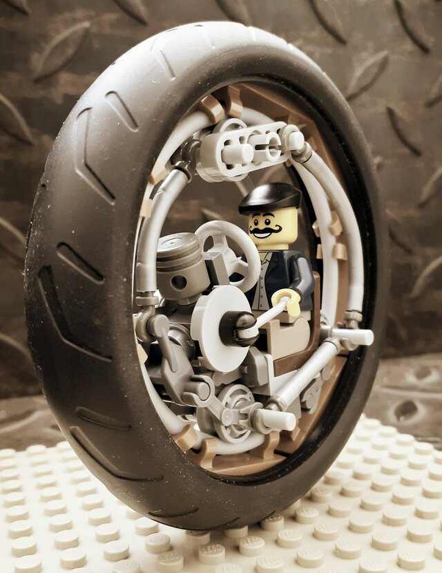](https://www.freelug.org/IMG/jpg/rl05.jpg)

**3\. Jérome T. - Inspiré des Trikes**, celui-là est complètement inventé. J’ai essayé de garder le principe, une fourche moto à l’avant, deux roues motrices à l’arrière et le moteur en porte à faux arrière. N’ayant pas beaucoup de pièces chromées, j’ai plutôt imaginé un style noir, méchant avec le conducteur adéquat....

[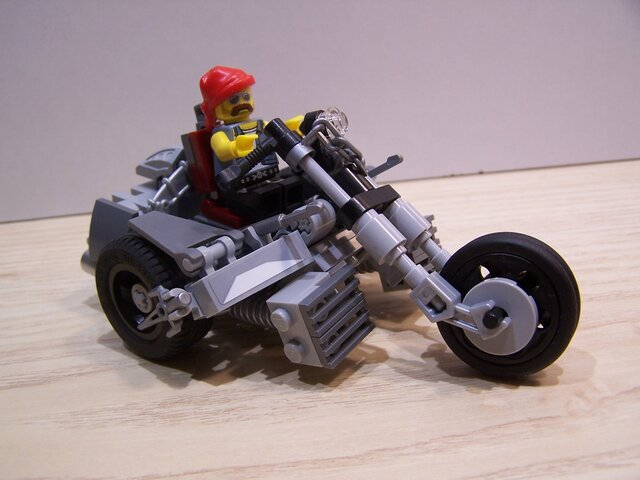](https://www.freelug.org/IMG/jpg/jt01.jpg)

[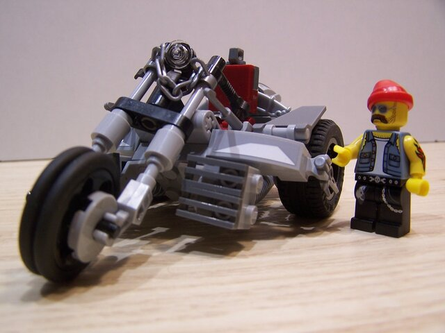](https://www.freelug.org/IMG/jpg/jt02.jpg)

[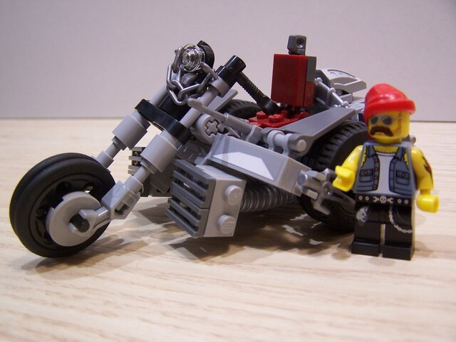](https://www.freelug.org/IMG/jpg/jt03.jpg)

[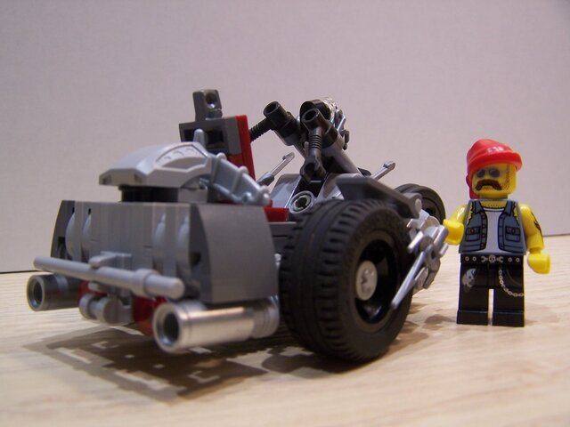](https://www.freelug.org/IMG/jpg/jt04.jpg)

[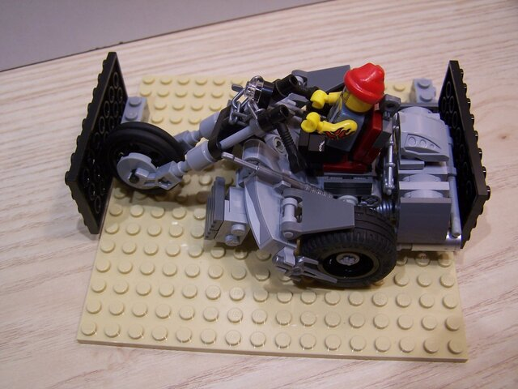](https://www.freelug.org/IMG/jpg/jt05.jpg)

**4\. Lionel T. - Porsche 936 Radio-Commandée**

[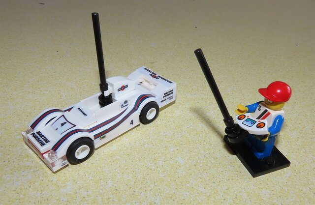](https://www.freelug.org/IMG/jpg/lc01.jpg)

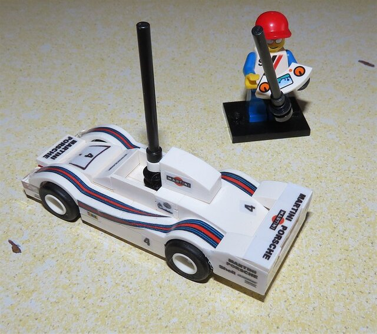

[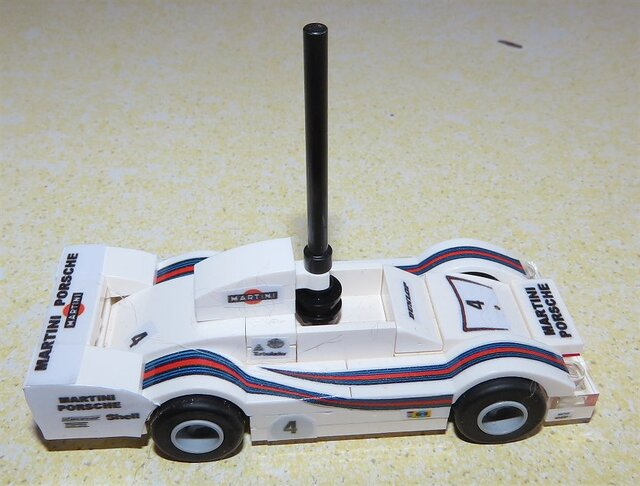](https://www.freelug.org/IMG/jpg/lc03.jpg)

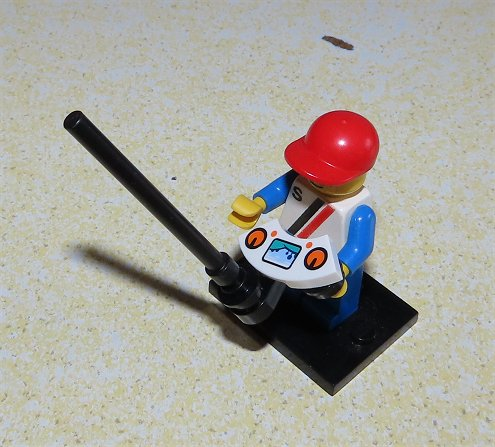

[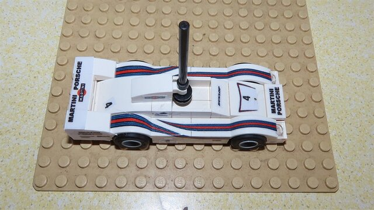](https://www.freelug.org/IMG/jpg/lc05.jpg)

**5\. Rémi L. - Jeep Jurassic Park**  
Steven Spielberg en 1993 sur le tournage de Jurassic Park. Le capot peut être "arraché" par un dinosaure.

[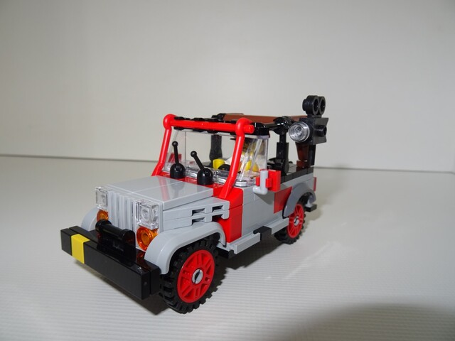](https://www.freelug.org/IMG/jpg/rl01_grand_.jpg)

[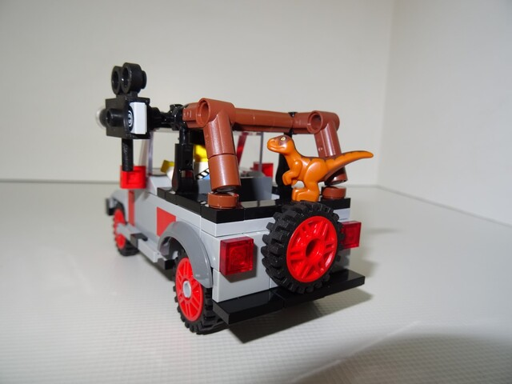](https://www.freelug.org/IMG/jpg/rl02_grand_.jpg)

[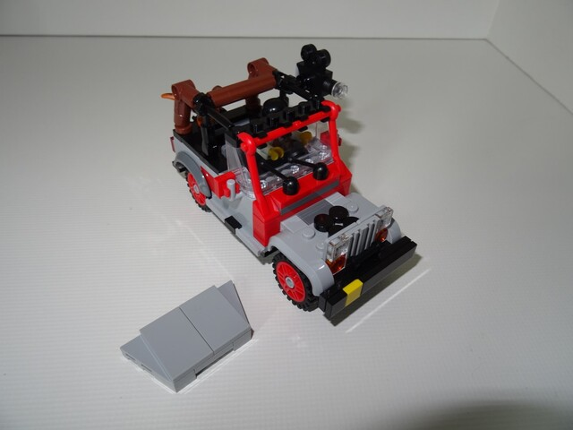](https://www.freelug.org/IMG/jpg/rl03_grand_.jpg)

[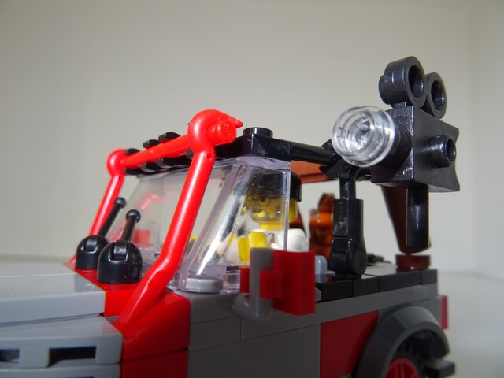](https://www.freelug.org/IMG/jpg/rl04_grand_.jpg)

[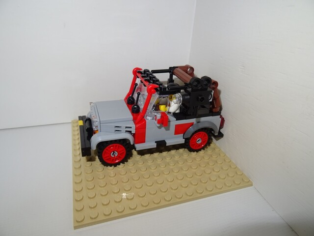](https://www.freelug.org/IMG/jpg/rl05_grand_.jpg)

**L’heureux gagnant de ce concours est Richard L. - Monowheel, inspiration années 30 qui remporte le set Lego Réf 75870 - Speed Champion - Chevrolet Corvette Z06**

Merci à toutes et tous et à bientôt pour un nouveau concours !

* * *

Composition du jury :  
Loïc T. (GFC)  
Mathieu W. (GFC)  
Pierre C. (GFC)  
Yoann G.  
Sylvain J.  
Bruno G.  
Nadège B.  
Nathan B.

Classement :  
1\. Richard L.  
2\. Nicolas G. - Jérome T. - Lionel T.  
3\. Rémi L.
