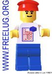

CR de la réunion du CA du 1er Août 2005

**Ordre du jour**

**–** Bilan des Summer AFOL’s Days à Reims  
**–** Point d’avancement sur le bulk  
**–** Point sur la nouvelle série de t-shirts et autres produits dérivés  
**–** Point sur la réalisation de banderoles et d’autocollants  
**–** Etat des demandes de devis pour l’impression de plaquettes et du FreeLUG Mag  
**–** Dans quelles conditions préparer le bulk3 ?

_Présents (10)_  
**–** Erik Amzallag  
**–** Loys Bailly  
**–** Jean Louis Bergamo  
**–** Emmanuel Bonnard  
**–** Pascal Bréard  
**–** Pascal Brugier  
**–** Gaël Frazier  
**–** Nicolas Huard  
**–** Philippe Label  
**–** Marc Schickelé

_Absents (2)_  
**–** Yann Laurent  
**–** Didier Malon

_Début de la réunion : 20h05_

**Bilan des Summer AFOL’s Days à Reims**

**–** Le bilan est formidable pour tous. Un article a été rédigé en anglais pour BrickJournal, la version francaise pour FreeLUG ne devrait pas tarder.

Toutefois, on peut noter un léger manque de communication sur l’événement, dû entre autre à l’organisation un peu tardive. Nous étions tout de même 45 (AFOLs et familles).

Egalement, des petits problèmes de planning entre les différents événements, réunion du CA et réunion de préparation avec les organisateurs du LEGOWorld sont venus perturber le bon déroulement des festivités.

**–** Bilan financier :

-   Location de la salle : 420 Euro ;
-   Dons : 50 Euro ;
-   deux nouveaux adhérents.

Dix exemplaires du journal dans lequel nous sommes ont été envoyés à Nicolas, qui va les remettre aux membres les ayant demandés. Nicolas va tenter de réaliser un scan de l’article.

**–** Préparation SAD 2006

La date limite de dépot des candidatures est fixée 31 octobre 2005 (9 pour ; 1 contre).

Le procédé de l’année dernière est retenu ( cf [Rencontre estivale itinérante FreeLUG](https://www.freelug.org/spip.php?article312) dans la zone adhérent, rubrique _Qu’est ce que le dossier doit comporter ?_ )

Si plusieurs propositions sont retenues, un vote par les adhérents sera réalisé.

**Point d’avancement sur le bulk**

La totalité des commandes validées par les membres sont dans les mains de LEGO Londres. Celles qui n’ont pas été validées suite au changement de tarif seront expédiées sous une seule commande à l’adresse de FreeLUG après leur validation.

Durée du processus chez LEGO : 6 à 8 semaines.

**Point sur la nouvelle série de t-shirts et autres produits dérivés**

Une liste d’articles va être proposée. Un sondage auprès des adhérents permettra de connaître le ou les produits et les tailles les plus sollicités.

**Point sur la réalisation de banderoles et d’autocollants**

_Devis rapporté par Emmanuel_

**–** Autocollants : 1 euro la planche A4 quelques soit le nombre dessus

**–** Banderoles : Etant donné la faible quantité de proposition, et les besoins, trois banderoles différentes ont été retenues par le CA. Le coût de réalisation, non connu à l’heure de la réunion, dictera la quantité.

Les choix retenus sont disponibles dans la galerie de FreeLUG [http://gallery.freelug.org/Banderole](http://gallery.freelug.org/Banderole).

**Affiche**

**Banderole 1**

**Banderole 2**

Un devis sera demandé par Emmanuel pour la réalisation de chacune de ces banderoles.

Chiffrage obtenu après réunion :

-   banderole bachée, format 1x3m, finition 8 oeillets 190.25 Euro HT
-   affiche bachée, format 0.70x1m, finition 4 oeillets 65.41 Euro HT

**–** Devis pour l’impression de plaquettes et du FreeLUG Mag

_Devis rapporté par Emmanuel_

Sur la base du Freelug Mag du mois de Juillet, l’impression couleur coûte 7 Euro par exemplaire et 1,03 en noir et blanc, avec un coup d’envoi de 2 Euro.

Aujourd’hui, seul un membre et 5 magasins reçoivent le FreeLUG Mag.

Etant donnés les coûts, la solution retenue est une impression N&B pour tout le monde. Il faudra également réfléchir à la nécessité d’un exemplaire pour les magasins.

**Dans quelles conditions préparer le bulk3 ?**

Le temps accordé à la séance étant déjà dépassé, ce point est reporté à la prochaine réunion.

_Fin de la séance : 21h50_
