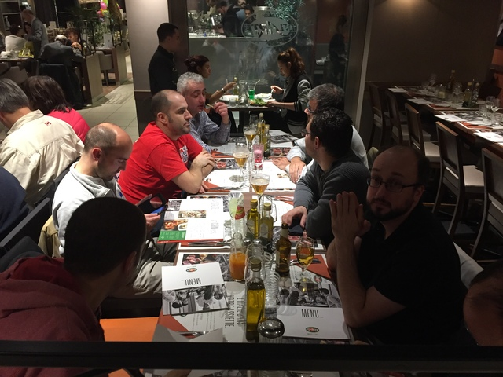
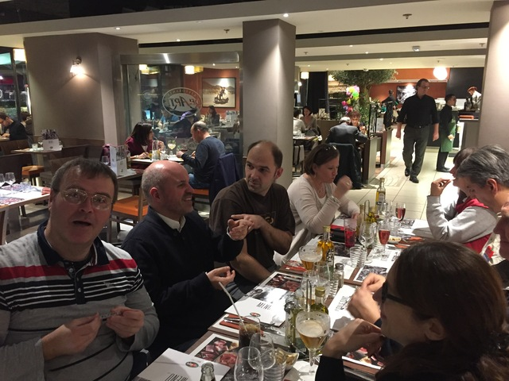
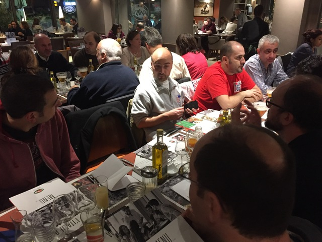
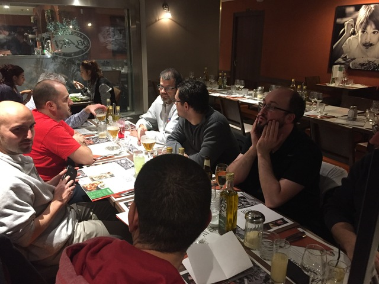
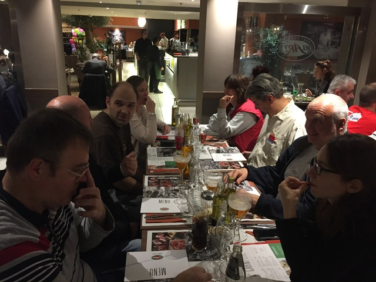

## 1) L’objet de la réunion

Le CA a décidé il y a plusieurs mois déjà d’organiser sur un week-end un groupe de travail entre les organisateurs de Briqu’Events (Briqu’Expo et Briqu’Convention) afin de partager un retour d’expérience et mettre en place une série de documents et outils qui permettront de faciliter le travail des membres organisant des événements.

Pour cela, les personnes suivantes ont répondu présent à l’appel :  
**–** Pierre Laurenge et Fabrice Ville (pour la Briqu’Convention Villeurbanne)  
**–** Daniela Drost (pour la Briqu’Expo Veneux-Les Sablons)  
**–** Kris Heirman (pour la Briqu’Expo Combrailles)  
**–** Denis Laurençon (pour la Briqu’Expo la Ville du Bois)  
**–** Christophe Roudet (pour la Briqu’Expo Montdidier)  
**–** Yannick Vignat (pour la Briqu’Expo Diemoz, et référent BE auprès des organisateurs)  
**–** Antoine Clément-Larosière (pour la Briqu’Expo Rhône-Alpes)  
**–** Denis Havart (pour un futur événement dans la région toulousaine)  
**–** Philippe Label en tant que trésorier de l’association  
**–** Erik Amzallag en tant que président de l’association et membre du CA ayant été présent à tous les Briqu’Events.

Manquait à l’appel un représentant de la Briqu’Expo de Lomme en raison d’une contrainte de dernière minute.

## 2) Déroulement du week-end

Tout le groupe s’est retrouvé dès le samedi matin dans les locaux de l’INSA, débutant par un tour de table. Il était déjà intéressant de voir que plusieurs personnes ne s’étaient pas encore rencontrées en vrai. L’atelier s’est poursuivi jusqu’au dimanche après-midi.

Merci aux petites mains qui ont œuvré dans l’ombre pour l’accueil (repas, hébergement), et à Yannick pour avoir mené le déroulement des différents sujets tout au long des deux jours.

## 3) Les sujets abordés

-   Historique des expositions FreeLUG
-   But des expositions
-   Comment se démarquer auprès des visiteurs
-   Comment se démarquer auprès des exposants
-   Besoins récurrents
-   Manques et difficultés
-   Avenir des expositions
-   Relations avec les vendeurs
-   Package organisateur
-   Autres sujets abordés
    -   Indemnisation des exposants
    -   Les tombolas
    -   La gestion des accompagnants
    -   Les bénévoles
    -   La communication
    -   Horaires d’ouvertures
    -   Espace de partage

## 4) Petit resto LEGO et visite au LEGO Store

Profitant de la présence d’adhérents venant de loin, un restolego a été organisé le samedi soir, après une petite virée obligatoire au LEGO Store.

Quelques photos :

