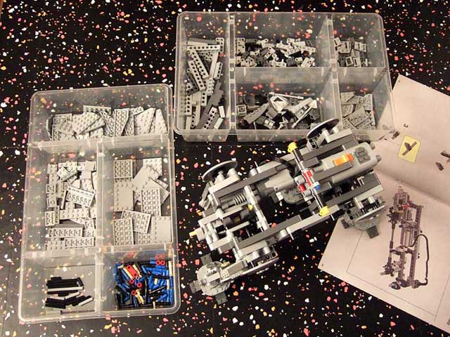
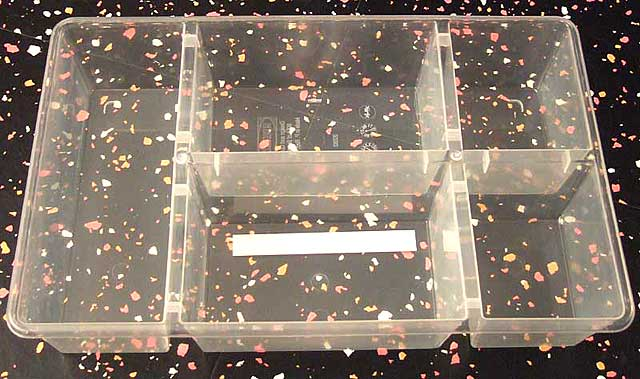
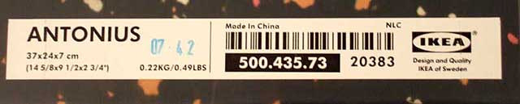
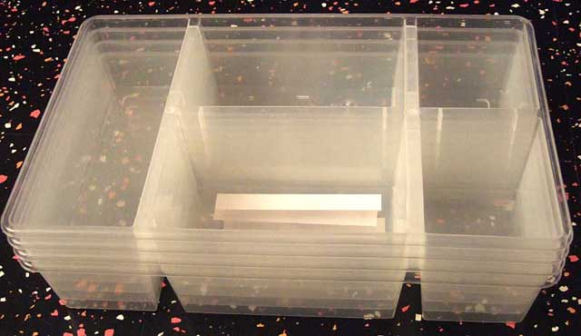
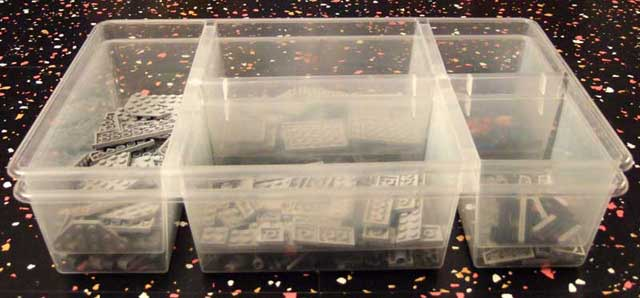
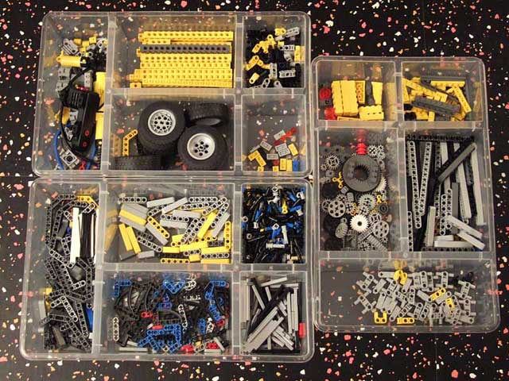
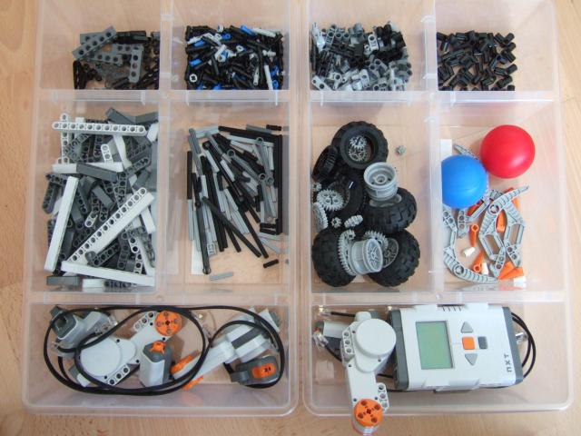

Ces boîtes, commercialisées par Ikea, sont très pratiques pour ranger les sachets de pièces d’un set en cours de construction.

La boîte mesure 37 cm x 24 cm, les cases de trois tailles différentes ont une profondeur de 7 cm. Cette taille est suffisante pour recevoir pas mal de pièces tout en conservant un accès aisé. De plus, comme elles sont transparentes, on peut regarder par dessous pour localiser la petite pièce unique qui s’est glissée dans le fond du compartiment...

Ces boîtes nommées "Antonius" sont vendues au prix de 1.50 Euro pièce.

Vides, elles prennent peu de place car elles s’empilent très bien...

...et ce même en cours de montage si elles ne sont pas trop pleine. C’est donc facile de débarrasser la table à l’heure du repas !

Pour un gros set (ici la grue 8421 après démontage) il faut compter 4 à 5 boîtes pour être confortable.

Et au delà du tri provisoire, on peut aussi les utiliser pour le rangement soigné des sets ! Ainsi ce NXT :

