Nous vous proposons de replonger un peu plus dans ce sujet des décorations de Noël en pièces LEGO® à travers cette traduction adaptée d’un article à paraître dans le numéro 3 de [BrickJournal](http://www.legofan.org/BrickJournal/?sgrp=20).

Vos enfants sont bientôt en vancances d’hiver et il vous faut les occuper. Pourquoi ne pas leur proposer une activité créative et décorative ? Nous vous suggérons de regarder de plus près comment créer des décorations en briques LEGO® pour votre arbre de Noël ou pour vos étagères.

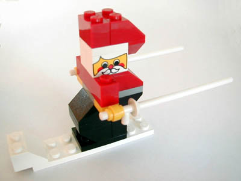

Il y a des classiques : Le Père Noël bien sur, avec ses rênes et les cadeaux, le bonhomme de neige, le sapin de Noël, les anges et les elfes. Tous ont fait l’objet d’au moins un [modèle officiel](http://guide.lugnet.com/set/?qc=lego/holiday/christmas), principalement dans les calendriers de l’avent ou en exclusif du [ShopAtHome](http://shop.lego.com/) (magasin sur Internet).

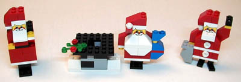

Le Père Noël est très reconnaissable avec sa barbe blanche, son chapeau et son manteau rouge et ses bottes noires. Des détails blancs commes des boutons, ourlets et ponpons et un ceinturon noir complètent le portrait.

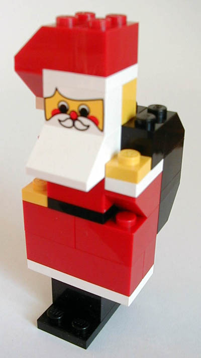

Les enfants devraient être capables de reproduire la plupart des modèles officiels de Père Noël avec seulement des briques, des plaques , beaucoup de briques pentues et quelques pièces spécialisées comme des briques 1x2 imprimées ou des plaques 1x1 modifiées.

Pour commencer ils recréeront le corps à l’aide de briques rouges, séparées d’une plaque noire pour la ceinture. Le tout sera placé sur des éléments noirs qui représenteront les bottes. Des briques pentues blanches feront l’affaire pour la barbe blanche et les cheveux - une brique jaune 1x2 complètera ce visage. Le chapeau est certainement l’élément le plus reconnaissable de ce personnage et c’est pour cela que vous choisirez précautionneusement des briques rouges pentues normales et inversées pour le recréer ainsi qu’une plaque ronde 1x1 blanche en guise de ponpon.

Le Père Noël est souvent accompagné par un ou deux accessoires : Le haut d’une cheminée dans le set [n°1549](http://guide.lugnet.com/set/1549),

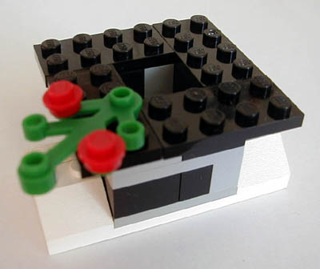

un rêne (set [#1129](http://guide.lugnet.com/set/1129_2)),

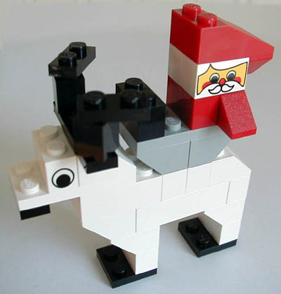

et un traineau ([1628](http://guide.lugnet.com/set/1628))

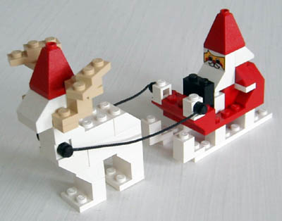

ou plus simplement avec son sac sur le dos ([1627](http://guide.lugnet.com/set/1627)) ou à la main ([1127](http://guide.lugnet.com/set/1127))

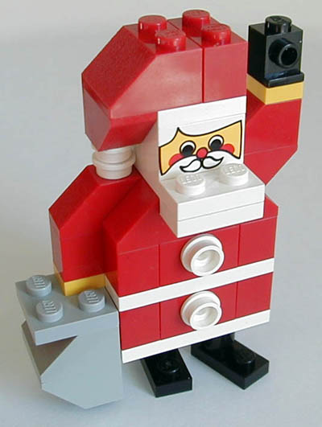

ou bien même avec un cadeau ([1549](http://guide.lugnet.com/set/1549)).

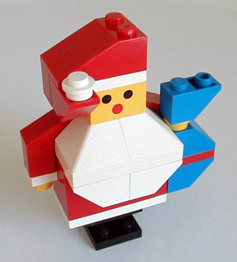

Vous pourrez recréer ces modèles à partir d’une simple photo, dans le cas contraire, la plupart des instructions de montage peuvent être trouvées sur [Peeron PICSL](http://www.peeron.com/scans/).

Une fois ces Pères Noël construits, les elfes sont aisés à reproduire puisque vous y retrouvez des éléments communs : habit et chapeau rouge, ourlets blancs. Les elfes sont simplement plus petits et généralement accompagnés de cadeaux.

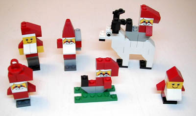

Pour leur part, les cadeaux seront construits à l’aide de briques colorées. Les rubans sont constitués par des plaques de couleurs contrastées ainsi que les noeuds pour lesquels vous utiliserez des éléments variés comme de petites briques pentues ou des plaques 1x1 modifiées, lisses ou non.

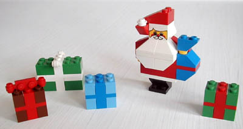

Dans certains pays, Noël arrive avec la neige... et les bonhommes de neige. Même si leur corps et leur tête sont sphériques, les enfants en construiront facilement à l’aide de votre vrac de pièces blanches parmi lesquelles ils trouveront des briques pentues 2x2. Le détail le plus remarquable est sans doute le nez rouge - un cône 1x1 de cette couleur fera l’affaire.

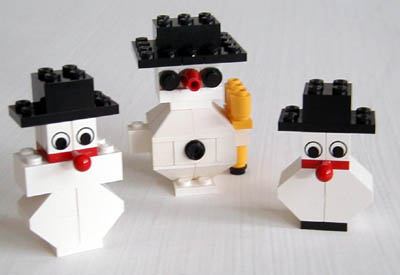

Mais ne rangez pas déjà votre vrac de blanc. Il conviendra parfaitement pour la création des anges avec leurs ailes faites de briques pentues 1x2 et 1x3.

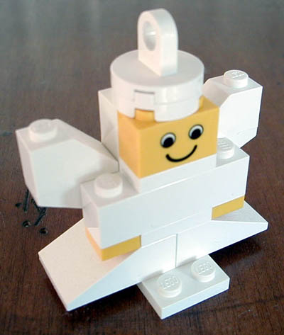

Des briques pentues rouges pour les Pères Noël et les elfes, des blanches pour les bonhommes de neige et les anges... les vertes conviendront parfaitement pour le sapin de Noël. Bien sûr un simple brique marron fera un joli tronc mais n’oubliez pas de placer quelques briques translucides et colorées sur les branches pour donner l’illusion des bougies ou des boules.

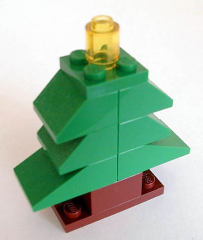

Et voila. Vous pouvez maintenant poser simplement ces créations sur des étagères ou préférer rajouter des "briquatrous" (briques Technic 1x1) pour les accrocher à votre sapin (le vrai cette fois ci) à l’aide d’un petit fil de coton.

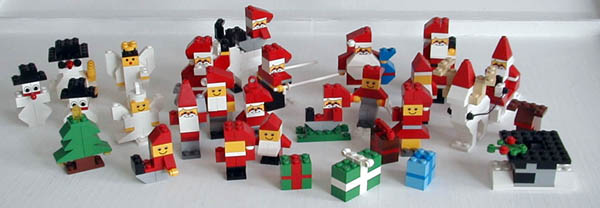
