La plupart des grandes entreprises réalisent régulièrement des enquêtes de satisfaction auprès de leurs clients.

Nouveauté chez LEGO, cette enquête dont je vous propose les traductions, pour nos amis et visiteurs pas trop à l’aise dans la langue de Shakespeare, est spécialement dédiée aux consommateurs "Adultes", achetant des jeux LEGO® pour leur usage personnel.

Tout d’abord le lien pour accéder à cette enquête :

[Enquête AFOL 2009](http://www.legokidsinnercircle.com/legokids/eFocus/jsp/efocus?DST=Lego_2009TrackingAFOL)

Après avoir cliqué sur le lien, vous accédez à cet écran d’accueil, qui vous demande votre appréciation générale sur les produits et les services. En gros il s’agit de préciser si vous recommanderiez les produits et services de chez LEGO à votre famille et à vos amis.

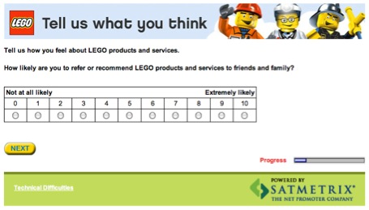

**Ecran 1**

Vous pouvez attribuer une note de 1 à 10, 10 étant la meilleure note. Cliquez ensuite sur "Next" pour passer à la page suivante.

L’écran suivant vous permet de préciser les axes d’amélioration que vous souhaiteriez voir améliorés.

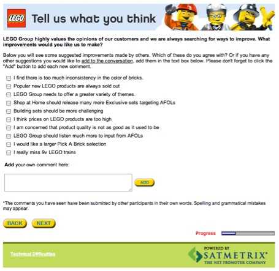

**Ecran 2**

La liste propose les options suivantes :  
**–** Je trouve qu’il y a trop d’inconsistance dans les coloris des briques.  
**–** Les produits LEGO les plus populaires sont toujours en rupture de stock.  
**–** La compagnie LEGO devrait proposer une plus grande variété de thèmes  
**–** Le S@H [^1] devrait proposer plus d’exclusivités à l’attention des AFOLs [^2]  
**–** Les boîtes de construction devraient être plus complexes  
**–** Je pense que les prix des produits LEGO sont trop élevés  
**–** Je me sens concerné par le fait que la qualité des produits n’est plus aussi bonne que ce qu’elle devrait être  
**–** La compagnie LEGO devrait être plus attentive aux retours des AFOLs  
**–** J’aimerais une plus grande variété dans l’offre Pick A Brick [^3]  
**–** Les trains 9V me manquent fortement

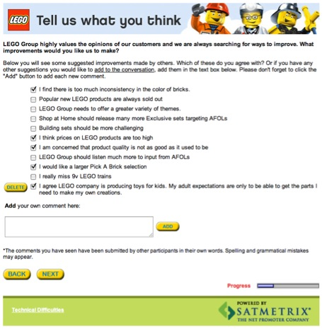

**Ecran 3**

Vous pouvez bien évidemment faire plusieurs choix et même ajouter vos propres commentaires.

L’écran d’après vous permet de hiérarchiser vos commentaires par ordre du plus important (1) au moins important (n...)

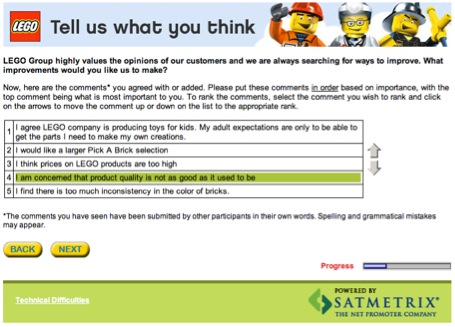

**Ecran 4**

L’écran suivant vous permet de donner un ordre de grandeur du montant annuel de vos achats en LEGO (quelque soit le mode d’achat, neuf, S@H, occasion, enchères, brocantes). N’oubliez pas de préciser la monnaie utilisée avant de saisir votre montant d’achat.

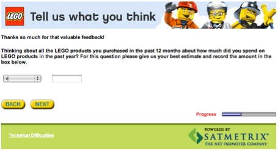

**Ecran 5**

LEGO s’intéresse ensuite au volume d’achat que vous réalisez en produit d’occasion. Indiquez par rapport au montant saisie précédemment le pourcentage de ce montant consacré à l’achat de produits d’occasion.

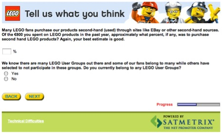

**Ecran 6**

L’autre question de cet écran s’intéresse de savoir si vous faites partie d’un LEGO User Group, ou LUG. Une bonne façon de mesurer l’importance de votre communauté.

Si, comme moi vous avez répondu "Oui", vous passez alors à l’écran suivant, qui vous demande auprès de combien de communautés vous êtes enregistrés.

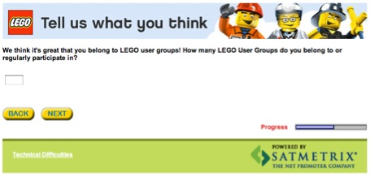

**Ecran 7**

Vous pouvez ensuite préciser quels sont parmi tous les groupes auprès de qui vous êtes inscrits les 5 principaux dans votre ordre de préférence.

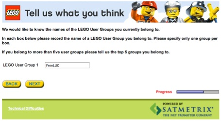

**Ecran 8**

Une petite question personnelle vous demandant votre sexe et votre tranche d’age.

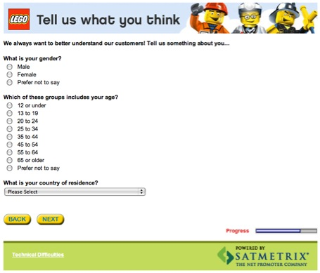

**Ecran 9**

Avant de vous demander les sites auxquels vous contribuez, soit en participant aux activités du site, chat, forum, listes de discussion soit en contribuant à la vie du site, comme en hébergeant vos photos, articles.

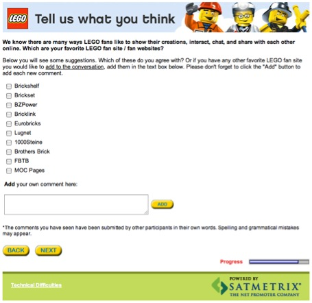

**Ecran 10**

Vous pouvez ajouter à la liste, les sites de votre choix.

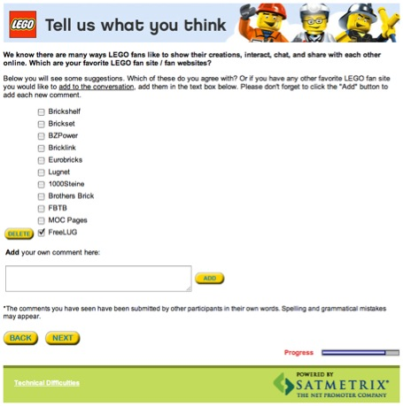

**Ecran 11**

L’enquête est terminée, la petite barre de progression située en bas à droite de l’écran vous l’indique et la compagnie LEGO vous remercie pour le temps que vous avez consacré à apporter vos réponses.

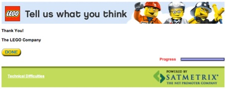

**Ecran 12**

Voilà, Jan Beyer le responsable chez LEGO Danemark de la communication auprès des AFOLs Européens nous a fait parvenir ce lien il y a quelques jours en nous demandant de faire circuler l’information auprès de notre communauté. Un retour important et c’est autant d’informations permettant à LEGO de mesurer où se situent les attentes des fans Européens. Il est donc important pour nous d’en profiter pour se faire connaître.

_Nota 1 :_ Il se peut qu’en fonction de vos réponses les écrans et leur ordre d’apparition ne soient pas identiques à ceux qui sont présentés dans cet article. Si vous avez un problème de traduction avec un écran particulier, n’hésitez pas à m’en adresser la copie et je vous dirai de quoi il est question.

_Nota 2 :_ Jan Beyer n’a pas précisé dans son mail la durée de cette campagne d’enquête. Elle est de toute façon limitée, n’hésitez donc pas à y répondre rapidement, si vous souhaitez que vos avis puissent être pris en compte.

[^1]: Ndlr : Shop At Home - Magasin de vente en ligne de la société LEGO

[^2]: Ndlr : Adult Fan of LEGO - Fan adultes

[^3]: Ndlr : Service de vente de pièces individuelles en ligne mais aussi dans les magasins, notamment à l’étranger
