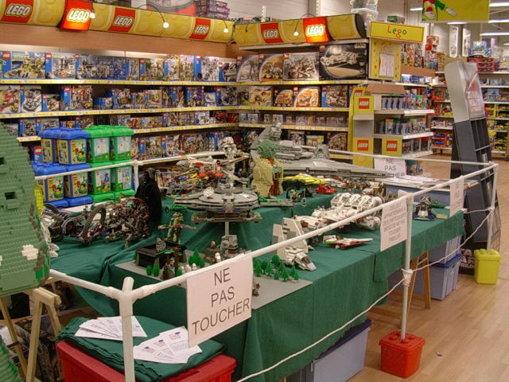
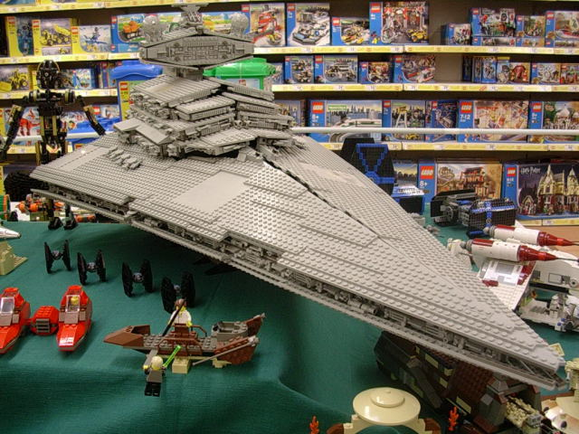
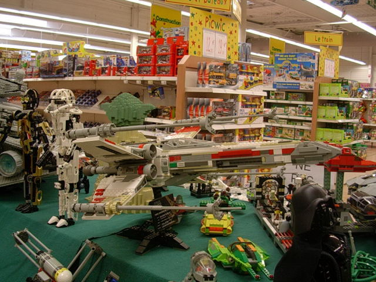
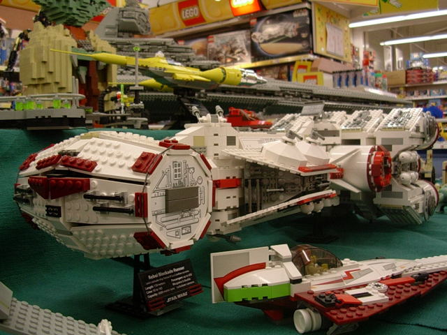
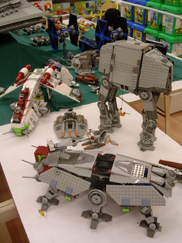
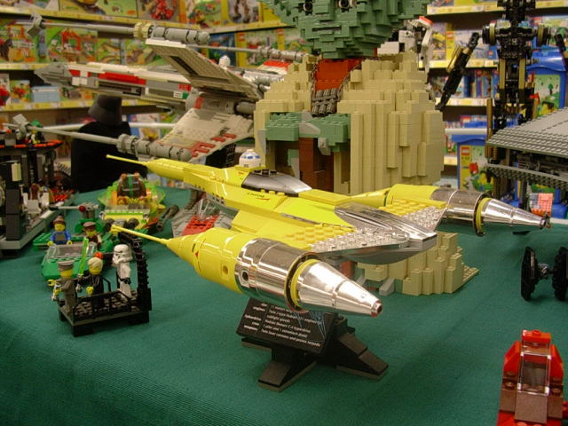
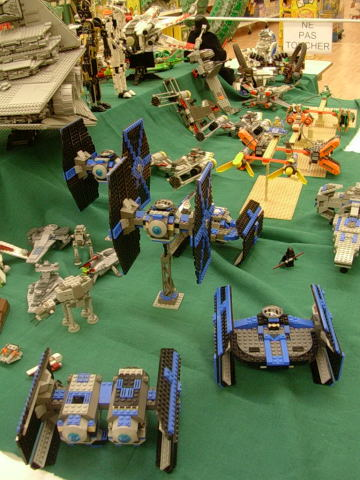

Sortir les modèles des boîtes ! Tel est le leitmotiv de notre partenaire Pic Wic et telle a été notre action, à l’occasion de cette exposition consacrée au thème Star Wars, histoire de fêter dignement la sortie du coffret DVD des trois "premiers" épisodes.

Nous sommes donc revenus chez PicWic, à Sainte-Genneviève des Bois pour exhiber une nouvelle fois nos collections.

Cette fois ci les modèles Star Wars étaient à l’honneur et faute de ne pouvoir déménager les MOC en cours (d’autres déménagements sont en projet...), nous nous sommes rabattus (en plus il a fallu faire vite), sur ce que nous avions de disponibles en modèles Star Wars.

**Vue amirale de la flotte**

En vidant nos bacs et nos étagères, l’ami Gilles (gmi) et moi-même, avons pu trouver de quoi garnir la table prévue (même qu’il a fallu en demander un peu plus, histoire que ça tienne sans faire trop brouillon).

Gilles avait pris avec lui ses collectors,

Imperial Star Destroyer...

**ISD**

...et X-Wings Ultima Collector Series

**X-wing UCS**

De mon coté, j’ai déstocké le Rebel Blockhade Runner...

**Le coin des rebelles !**

...et les robots à pattes.

**Assez d’AT ?**

J’avais même prévu pour les allergiques au gris, le Naboo Fighter UCS, dont mon épouse apprécie particulièrement les couleurs. (Et attention à ceux qui voudraient remettre en cause les goûts de ma petite femme !)

**Quand un beau vaisseau jaune et chromé tu auras....**

Voici donc comment en petit commité et en une semaine de préparation nous avons pu répondre aux sollicitations de notre partenaire.

Encore une fois nous avons pu goûter le temps d’un week-end au même plaisir de rencontrer un public surpris de l’étendue de la gamme existante et nous avons d’hors et déjà pris rendez-vous avec bon nombre de nos visiteurs pour nos prochaines expositions.

**Empire buildings, en l’état**

Allez, à bientôt et que la force soit avec vous.
