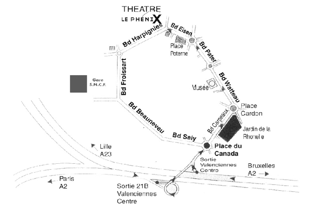

Du 24 au 26 novembre 2004 se déroulera la 6ème édition des [e-magicien](http://www.youngcreation.net/), salon destiné à la création numérique, les logiciels libres, la maison du futur et la robotique.

FreeLUG y a été invité pour animer une initiation à la robotique avec des sets Mindstorms.

Le salon s’inscrit dans le cadre d’une rencontre sur lex jeux vidéos et la création numérique. En parallèle, un espace LAB proposera des activités sur un theme précis.

Cette année, 4 sujets :  
**–** 3D video  
**–** Maison du futur (France Télécom) et Biométrie (Sagem)  
**–** Sup Info Game (seule ecole de formation jeu video en FR)  
**–** Robotique ludique

Suite à l’intervention de FreeLUG à Polytechnique, la Chambre de Commerce et d’Industrie souhaite nous avoir pour animer une initiation aux joies de la robotique via des sets LEGO Mindstorms 2.0.

Dans la partie Robotique, 2 aspects  
**–** Mindstorm (donc FreeLUG)  
**–** EyeBot (Sony)

L’animation se passe du mercredi au vendredi, les participants dans la semaine sont des étudiants des écoles d’ingénieur (sup info Com, Sup Info Game, ecole de design, section transport, design d’objets)

Notre intervention se ferait en 2 parties.  
**–** Tout d’abord montré des créations robotiques.  
**–** Initiation

De facon non définitive voici ce qui a été prévu :  
**–** 4 PC avec tour IR et BrickCC ou sous Linux  
**–** kit de pièces afin de construire un robot de base (1 capteur contact, 1 de lumiere, 2 moteurs, 1 RCX)  
**–** on leur apprend à faire un robot avec capteur contact sous NQC  
**–** utilisation de la plaque SUMO (avec la bande blanche), afin de créerun robot qui doit rester sur la table centrale.  
**–** groupe de 5 personnes maximum, 4 groupes en parallèle pendant 1h30.

## PLAN

Pour ceux qui desisrerai venir en visiteur, voici le plan et l’adresse :

Le Phénix - Scène Nationale de Valenciennes  
BP 39  
59301 VALENCIENNES CEDEX

