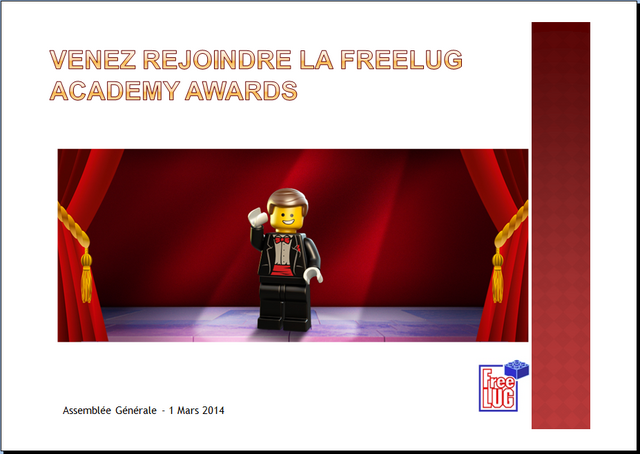
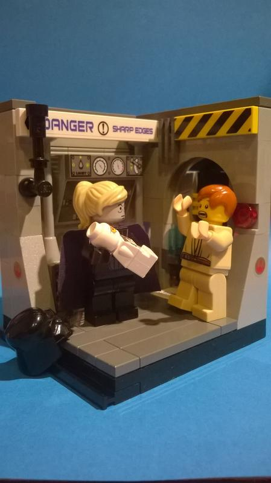
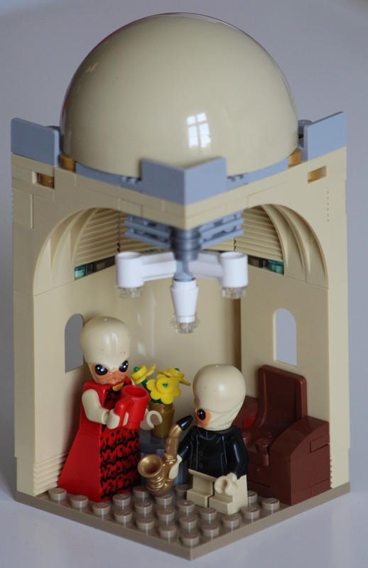
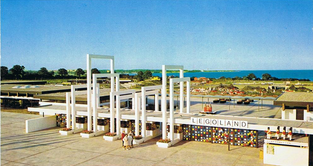
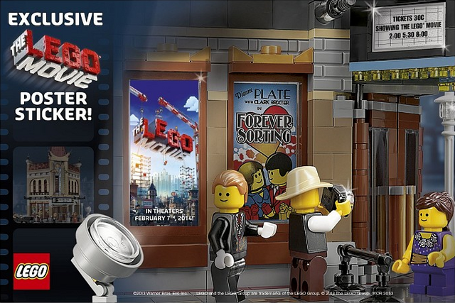
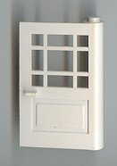
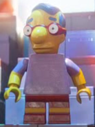
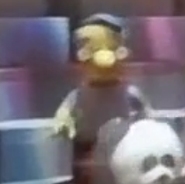
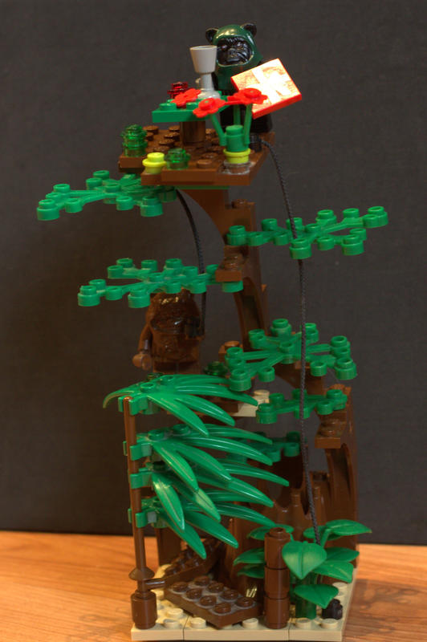
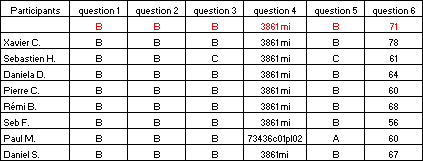

**

## Préambule

**

La FAA ou FreeLUG Academy Awards est le nom donné à un groupe de personnes, membres de FreeLUG, en charge d’organiser des concours sous la bannière de l’association.  
Ce groupe a pour rôles d’imaginer les concours, leurs règlements et d’être jury.  
Ce groupe est composé actuellement de 12 membres.

Trois concours furent proposés au deuxième trimestre 2014. Voici leurs comptes-rendus respectifs.

**

## Concours mensuel d’avril 2014

**

Le 7 avril, il fut proposé le tout premier concours organisé par la FAA.  
Il s’agissait de réaliser en pièces LEGO un œuf de Pâques et de le prendre en photo dans un lieu public. Les participants devaient ensuite nous envoyer leurs clichés que nous aurions départagés sur des critères subjectifs.

Il n’y a pas eu de participants pour ce concours.

**

## Concours mensuel de mai 2014

**

Au mois de mai, il fut proposé un concours sur le thème Star Wars intitulé :  
En ce mois de mai, “Star Wars célèbre les mamans”  
Il s’agissait de réaliser, en pièces LEGO, une petite vignette de base 8x8 tenons mettant en scène la fête des mères version Jedi et autres personnages de la série. Les participants devaient ensuite nous envoyer un cliché de leur création.

Nous avons eu 2 participants pour ce concours :

Stéphane B. a proposé sa vignette intitulée “Luke... C’est ton fils ! ... NOOOON !!!”

Dark Vador grimé en femme, dans la célèbre scène où il avoue être le père de Luke. Mais cette fois ci, dans une version remaniée !

Samir L. a proposé sa vignette intitulée “Mommy, may this song be with you !”

Le jury était composé de :  
**–** 11 membres de la FAA ne participant pas au concours ;  
**–** 0 membre FreeLUG ne participant pas au concours.

et voici le résultat des votes que nous avons effectués :

-   Votes exprimés : 6
-   Stéphane : 4 voix
-   Samir : 2 voix

Stéphane remporte donc ce concours et, de ce fait, un lot de 500 grammes de pièces diverses neuves (ou quasi neuves).

## **Concours mensuel de juin 2014**

Au mois de juin, il fut proposé aux adhérents de participer à un quiz.

Les questions étaient les suivantes :

1ère question :  
Quelle brique peut s’emboiter parfaitement sur le dessus d’une brique Quatro.

-   A – Une brique Modulex 2x4
-   B – Une brique Duplo 2x2
-   C – Une brique Duplo 2x4

La réponse était B, une brique Duplo 2x2. La brique Modulex n’est emboitable sur aucun autre type de brique. La brique Duplo 2x4 ne s’adapte pas non plus aux briques Quatro. Ceci est principalement dû à la plaque de rigidification entre les tubes.  
[http://www.freelug.org/spip.php?article372](http://www.freelug.org/spip.php?article372)

2ème question :  
Voici une photo représentant l’entrée d’un parc Legoland. De quel parc s’agit-il ?

-   A – Billund
-   B – Sierksdorf
-   C – Windsor

La réponse était B, Sierksdorf. LEGOLAND Sierksdorf était un parc LEGOLAND qui était situé à Sierksdorf en Allemagne. Il fut ouvert en 1973 pour trois ans seulement avant sa fermeture en 1976. Il était situé en bord de mer, contrairement à ceux de Billund et de Windsor.  
[http://lego.wikia.com/wiki/LEGOLAND\_Sierksdorf?file=Skierksdorf1.jpg](http://lego.wikia.com/wiki/LEGOLAND_Sierksdorf?file=Skierksdorf1.jpg)

3ème question :  
Pour tout achat du set 10232 Palace Cinema entre le 1er sept et le 31 déc 2013, vous obteniez un cadeau exclusif. Quel était ce cadeau ?

-   A - Un démonte brique blanc
-   B - Un sticker Lego Movie
-   C – Une place de cinéma

La réponse était B, un sticker LEGO Movie. Cet autocollant est en fait un set exclusif (réf. 5002891) donné pour l’achat du Palace Cinema

4ème question :  
Quelle est la référence Bricklink de cette porte ?

La réponse était 3861mi.  
LEGO Minitalia était une gamme produite et disponible uniquement en Italie dans les années 1970 à 1976. La majorité des pièces était différente des autres pièces LEGO en plusieurs points. Au total, il y eut 21 ensembles Minitalia produits.  
[http://www.bricklink.com/catalogItem.asp?P=3861mi](http://www.bricklink.com/catalogItem.asp?P=3861mi)

5ème question :  
Lequel de ces personnages tirés des Simpsons est Maître Constructeur dans le film LEGO MOVIE ?

-   A : Lisa Simpson
-   B : Milhouse Van Houten
-   C : Ned Flanders

La réponse était B, Milhouse Van Houten. Contrairement à la plupart des constructeurs et des personnages du film , Milhouse est apparu dans LEGO Movie avant sa sortie physique dans la gamme 71005 Minifigures Les Simpsons. Il apparaît et est cité parmi les maîtres constructeurs présents à Cloud Cuckoo Land.

6ème question :  
Combien y a-t-il de pièces dans ce MOC ?

Cette question servait à départager les participants ayant correctement répondu aux cinq précédentes questions.  
La bonne réponse était 71 pièces (deux ewoks contenant 3 pièces chacun, un tronc d’arbre N°30131, 4 feuilles N°30239, 3 plantes avec trois feuilles N°x8, 4 feuilles d’arbres N°2417, 2 petites feuilles d’arbres N°2423, 1 tige de fleur N°3741, 4 fleurs N°3742, 7 arches marron formant les branches N°2339, 1 tile 2x2 rouge décorée N°88409, 9 plate round 1x1 N°4073, 5 round 1x1 N°4062, 1 lance N°3841, 12 plates 2x4 N°3020, 2 plates 2x8 N°3034, 2 plates 4x4 N°3031, 4 plates 1x6 N°3666, 2 cordes N°x127c11 et 1 verre)

Ci-dessous, un tableau reprenant les réponses des participants (en rouge, la bonne réponse pour chaque question) :

Rémi remporte donc ce concours et, de ce fait, un lot de 500 grammes de pièces diverses neuves (ou quasi neuves).

**

## Au troisième trimestre, il y aura quoi au programme ?

**

Pour la Réunion Estivale FreeLUG (REF), deux concours nous ont été proposés par les organisateurs de l’évènement afin de donner notre avis et de peaufiner les règlements. Des propositions leurs ont été communiquées.

La réflexion pour les prochains concours mensuel et trimestriel a débuté.  
En raison des traditionnelles vacances d’été, le concours mensuel deviendra bimestriel (juillet-aout) puis reprendra son rythme à partir de septembre.  
Un premier concours trimestriel sera proposé aux adhérents courant juillet. Sa date de fin de participation sera certainement le 30 septembre.

**

## Postambule

**

En tant que membre de FreeLUG, vous pouvez nous rejoindre à tout moment par simple inscription à la liste de discussion dédiée. Vous pouvez également nous envoyer des idées, vos avis, et bien sur participer à ces concours.

L’équipe FAA
