## Préambule

La FAA ou FreeLUG Academy Awards est le nom donné à un groupe de personnes, membres de FreeLUG, en charge d’organiser des concours sous la bannière de l’association. Ce groupe a pour rôle d’imaginer les concours, leurs règlements et d’être jury. Ce groupe est composé actuellement de 11 membres.

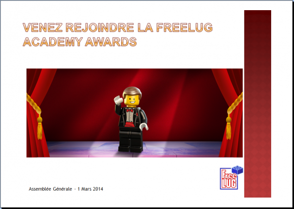

Cinq concours furent proposés au troisième trimestre 2014. Voici leurs comptes-rendus respectifs.

**Concours mensuel de juillet/août**

Le temps des vacances d’été, le concours mensuel est devenu exceptionnellement bimestriel. Pour participer, il suffisait d’emmener vos figurines en vacances avec vous et de les prendre en photo. Il était possible de prendre jusqu’à 5 photos pour former un album souvenir de vacances.

Nous avons eu 2 participants pour ce concours :

Mickbatto a proposé une escapade en Bretonie.

Stéphane B. a fait voyager ses minifigs en Auvergne et en Vendée.

Deux prix composés de minifigs étaient mis en jeu pour ce concours :  
**–** le prix de l’album le plus original.  
**–** le prix de la photo coup de cœur.

Le jury était composé de :  
**–** 11 membres de la FAA ne participant pas au concours ;  
**–** 5 membres FreeLUG ne participant pas au concours.

Voici le résultat des votes que nous avons effectués :

Prix de l’album le plus original

Votes exprimés : 10  
**–** Stéphane : 9 voix  
**–** Mickbatto : 1 voix

[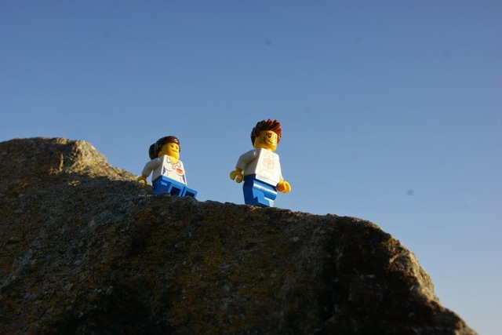](https://www.freelug.org/IMG/jpg/02-2.jpg)

Stéphane remporte donc ce concours et, de ce fait, un lot de 5 LEGO Minifigures®.

Prix de la photo coup de coeur :  
Votes exprimés : 10  
**–** Photo 3 : 1 voix  
**–** Photo 4 : 1 voix  
**–** Photo 5 : 3 voix  
**–** Photo 6 : 1 voix  
**–** Photo 10 : 4 voix

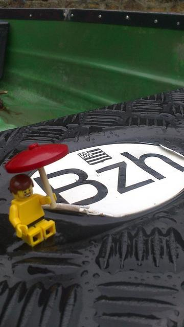

Mickbatto, auteur de la photo 10, remporte donc ce concours et, de ce fait, un lot de 5 LEGO Minifigures®

[Lien](http://photos.freelug.org/main.php/v/FreeLUG/FAA/juillet-aout2014/Stephane+B/) vers l’album de Stéphane B.

[Lien](http://photos.freelug.org/main.php/v/FreeLUG/FAA/juillet-aout2014/Mickbatto/) vers l’album de Mickbatto

**Concours mensuel de septembre**

En ce mois de septembre : retour à la construction. Ce concours était basé sur la création de mobilier urbain à l’échelle Minifig.  
Nous avons reçu 7 participations pour ce concours.

L’Abribus de Loop :

[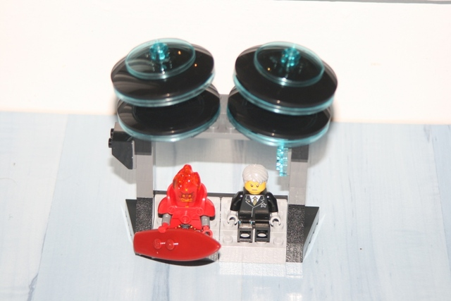](https://www.freelug.org/IMG/jpg/abribus_1.jpg)

La station de vélo de Thomas L. :

[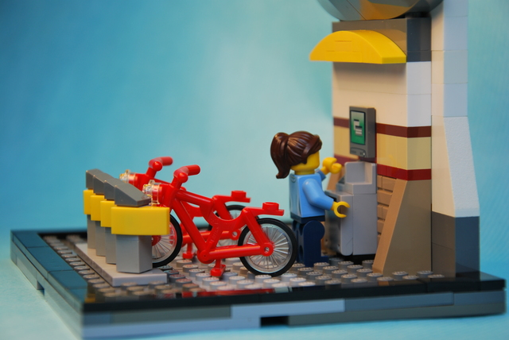](https://www.freelug.org/IMG/jpg/Station_de_velo_1.jpg)

Le passage à niveau de Soda Maître :

[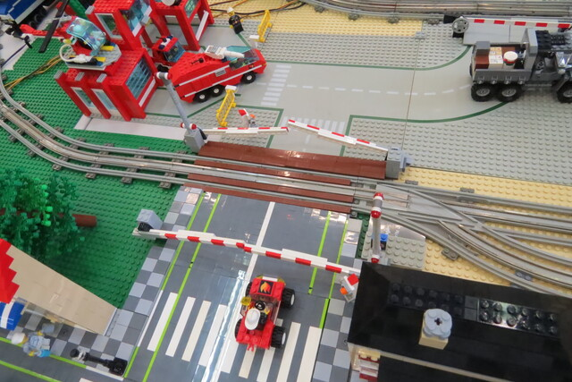](https://www.freelug.org/IMG/jpg/grand_passage_a_niveau_1.jpg)

**Le passage à niveau de Soda Maître**

Le lampadaire de JAC :

[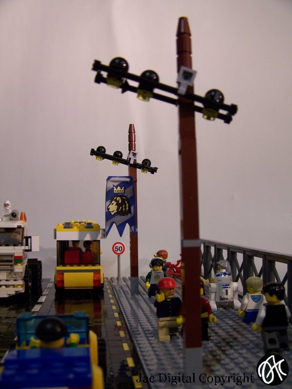](https://www.freelug.org/IMG/jpg/Lampadaire_2.jpg)

La poubelle de Denis Ha. :

[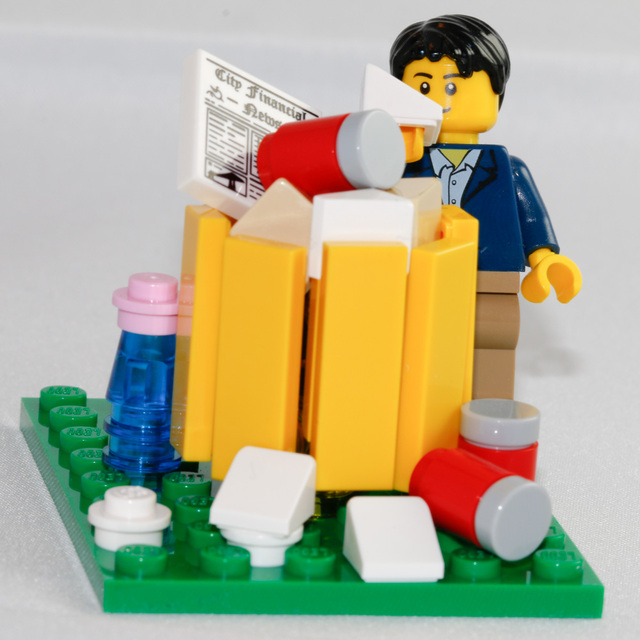](https://www.freelug.org/IMG/jpg/Poubelle.jpg)

La barrière de chantier d’Eric B. :

[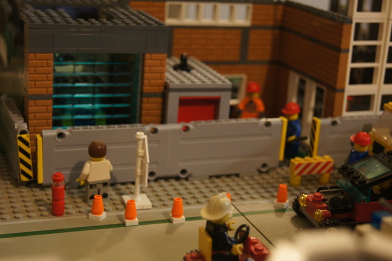](https://www.freelug.org/IMG/jpg/Barriere_de_chantier.jpg)

Le kiosque de Laurent C. :

[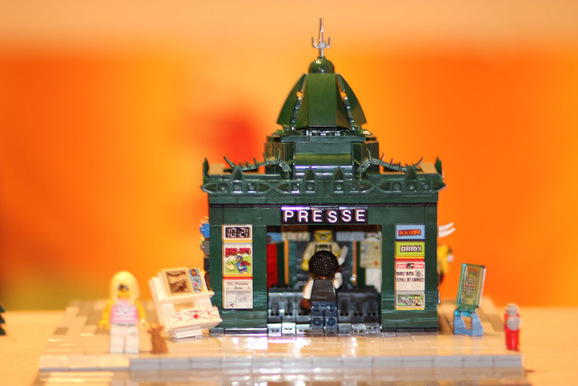](https://www.freelug.org/IMG/jpg/Kiosque_1.jpg)

Le jury était composé de :  
**–** 11 membres de la FAA ne participant pas au concours ;  
**–** 0 membres FreeLUG ne participant pas au concours.

et voici le résultat des votes que nous avons effectués :

Votes exprimés : 6  
**–** Le kiosque de Laurent : 4 voix  
**–** La station de vélo de Thomas : 1 voix  
**–** Le grand passage à niveau de Sodamaître : 1 voix

Laurent C. remporte donc ce concours et, de ce fait, un lot de 500 grammes de pièces diverses neuves (ou quasi neuves).

**Concours trimestriel d’été.**

Au mois de juillet, il fut proposé aux adhérents de participer à notre tout premier concours trimestriel. Ce concours, étalé sur trois mois, doit permettre aux participants de présenter des MOCs plus approfondis techniquement ou répondant à un challenge particulier.

Les FreeLUGiens devaient réaliser un MOC solitaire ou un diorama avec l’obligation d’utiliser uniquement deux types de pièces (par exemple des briques 2x4 et des tiles 1x4).  
Pas de contraintes concernant le nombre de couleurs, la quantité de pièces ou le thème. La taille de l’oeuvre était libre mais devait toutefois pouvoir rentrer dans un cube de 32 tenons de coté.

Nous avons reçu deux participations pour ce concours.

Denis Ha. a proposé un Rubik’s Cube :

[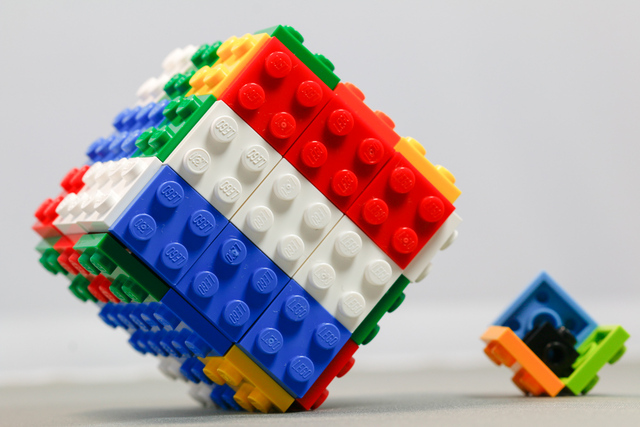](https://www.freelug.org/IMG/jpg/LEGO_-_Rubix_Cube.jpg)

Et Scrat1982 (membre FAA) a proposé une église :

[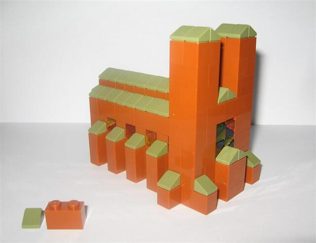](https://www.freelug.org/IMG/jpg/Concours_Trimestriel_-_Scrat1982_Medium_.jpg)

Le jury était composé de :  
**–** 10 membres de la FAA ne participant pas au concours ;  
**–** 2 membres FreeLUG ne participant pas au concours.

et voici le résultat des votes que nous avons effectués :

Votes exprimés : 7  
**–** Denis Ha. : 4 voix  
**–** Scrat1982 : 3 voix

Denis Ha. remporte donc ce concours et, de ce fait, un lot de trois sets city.

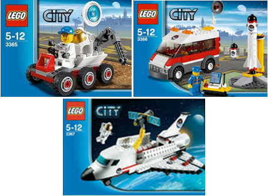

**Concours organisés pour la Rencontre Estivale FreeLUG (REF) :**

Le week-end du 15 août, s’est déroulée la REF à Saint-Goazec dans le Finistère. Traditionnellement, des concours sont organisés pour animer cet évènement annuel.  
Sébastien H. nous a proposer de peaufiner deux concours qu’il nous a soumis.  
Après discussions, nous avons retenu 1 seul de ses concours et imaginé celui qui remplacerait le second.

1er concours :

La Bretagne est souvent décriée car, soit disant, il pleut tout le temps.  
Il s’agissait donc d’imaginer ce dicton ou son contraire, sur une vignette 16x16.

5 participants ayant comme décompte de point  
**–** Thomas D. : 104 pts  
**–** Serge D. : 94 pts  
**–** Pierre C. : 91 pts  
**–** Pascal B. : 83 pts  
**–** Sasha Th. : hors concours

Membres du Jury : "JAC", Géraldine, "Jul-boy" et "Bibou"

[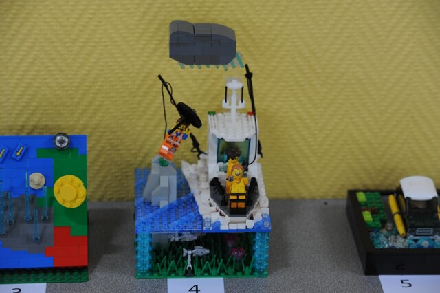](https://www.freelug.org/IMG/jpg/DSC_7026.jpg)

[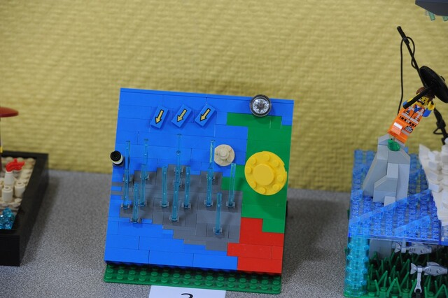](https://www.freelug.org/IMG/jpg/DSC_7027.jpg)

2nd concours :

Cette année, Darth Vador, Emmet, Bilbo, Olivia, Donatello et toutes les autres minifigs sont parties en vacances en Bretagne. Afin de les  
guider, vous deviez construire un phare sur la base d’un thème ayant déjà été commercialisé par The LEGO Group.

9 participants ayant comme décompte de point  
**–** Pierrick D : 125 pts  
**–** Thomas D. : 123 pts  
**–** Sébastien H. : 92 pts  
**–** Pascal B. : 89 pts  
**–** Pierre C. : 84 pts  
**–** Médérik G. : 74 pts  
**–** Gilles B. : 71 pts  
**–** Sasha Th. : 64 pts  
**–** Anaïs Th. : 49 pts

Membres du Jury : Yann , Rémi L., Jean Yves B., Mickael E. et un bulletin sans nom (mais ne participant au concours)

[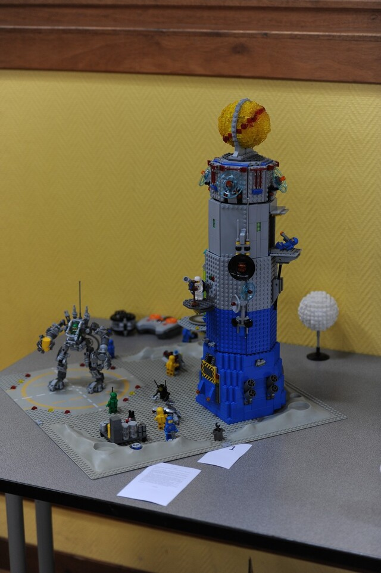](https://www.freelug.org/IMG/jpg/DSC_7006.jpg)

[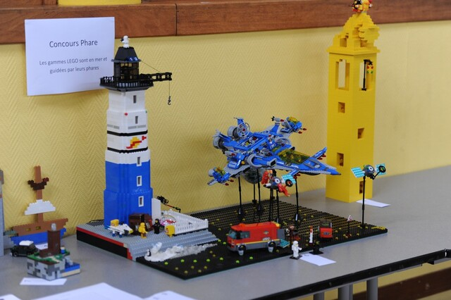](https://www.freelug.org/IMG/jpg/DSC_7001.jpg)

L’ensemble des concours était noté sur 3 critères : créativité, esthétisme et complexité de la création. Une échelle de 1 à 10 pts a été utilisée avec 10 pts comme maximum.

Un set a récompensé les deux premiers de chaque concours.

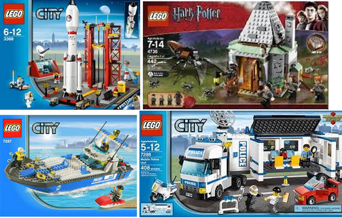

_Merci à LEGnOme pour ses photos._

## Au quatrième trimestre, il y aura quoi au programme ?

La réflexion pour les trois prochains concours mensuels a débuté. Il y aura également un concours trimestriel dont la date de fin sera mi-janvier  
Nous vous présenterons également le concours annuel qui sera le point d’orgue de nos activités pour cette année.

## Postambule

En tant que membre de FreeLUG, vous pouvez nous rejoindre à tout moment par simple inscription à la liste de discussion dédiée. Vous pouvez également nous envoyer des idées, vos avis, et bien sur participer aux concours.

**L’équipe FAA**
