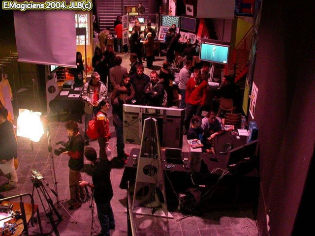
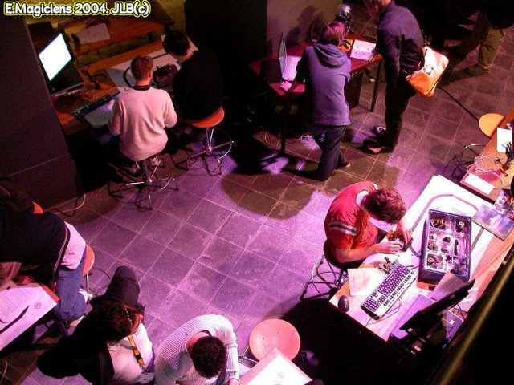

## Voyage

Après avoir récupéré Chris à la gare, nous avons filé vers Valenciennes en faisant une pause sur la route, histoire de remplir nos petits ventres :-)

Arrivés sur Valenciennes vers 23h00, notre première tâche fut de trouver l’hôtel, pas forcement évident surtout lorsque l’on ne connait pas la région. Etrangement, pas de gardien à l’hôtel et impossible de joindre qui que ce soit au téléphone ... Ah ben ca commence bien.

On se décide finalement à faire le tour des autres hotels pour trouver des chambres libres ... Ils sont presque tous plein ! Finalement à 1h du mat, on se décide pour un hotel qui accepte que nous soyons 3 dans une chambre. La nuit fut courte !

## Mercredi

Après un bon petit déjeuner, nous nous dirigeons vers le centre de Valenciennes. Là, tout se passe bien et nous trouvons très facilement le Phenix - lieu du salon. On récupere nos badges (oups ... MoultiPass !!! ) et passons au lieu de notre intervention.

Notre action se situe dans la zone LAB, qui regroupe France-Telecom Recherche & Developpement (maison du futur - vêtements communiquants), Nvidia et LightWave 3D (animations videos en calcul direct), le pôle "logiciel libre" représenté par des Linux Users Group locaux (CLX et Val-libre), et une entreprise faisant de l’impression en 3D.

Les PCs étaient en place, mais avec Windows XP. Bon pas grave, on a prévu [BrickCC](http://bricxcc.sourceforge.net/) aussi. On se met donc rapidement en place. Et là, première surprise, les tours USB du RIS font planter les Windows .. Ca commence bien. Jean-Louis sort une tour série (Note pour plus tard : avoir toujours une tour série sous la main :-)).

Les étudiants arrivent pour la premiere session. Ils commencent par construire le modèle, pendant que nous cherchons une solution au problème des tours USB. Finalement la partie programmation consiste à faire tourner la tour série d’un PC à l’autre ... pas forcément l’idéal.

On avise d’annuler la session de 11h30 à la recherche d’un patch sur le Net. Hourra, il existe, on l’applique et tout fonctionne bien ! Ouf ... on se voyait mal continuer avec la tour série ! On a aussi profiter pour construire les modèles, car les groupes y passaient trop de temps. Pour info, il y a un problème entre les tours USB et les processeurs en HyperThreading.

Apres un copieux déjeuner, les groupes de l’après-midi arrivent. Richard nous a également rejoint et l’équipe de FreeLUG est au grand complet.

Tout se passe pour le mieux. Les étudiants d’abord surpris, s’investissent très vite avec passion et ont même du mal a arrêter au bout de l’heure et demi.

Le soir, nous avons droit à l’inauguration officielle en présence des élus de la ville et de la région, suivi d’un repas sandwich. Nous partons en quête de notre hotel, le bon cette fois, car celui de la veille n’était malheureusement pas celui où nous aurions du arriver ! On le trouve cette fois très facilement.

Apres avoir soufflé un peu, nous repartons à la soirée organisée, qui se compose de diffusion de courts métrages, notamment en liaison avec le thême du salon : la typographie dans les films et génériques TV (Le titre exacte étant : "de la typo à la picto").

## Jeudi

Tout se passe pour le mieux, étudiants fort interessés, visite des enseignants qui cherchent comment intégrer un atelier robotique dans le cursus des étudiants en Design. L’après-midi est réservé pour l’ecole [ISD](http://www.isd-valenciennes.com/) (non, non, les étudiants ne sont pas des StormTroopers ;-) mais étudiant le Design).

Après un passage à l’hôtel, nous repartons sur le lieux du salon pour une soirée "intéractive". Cette fois nous avons le droit à la projection de projets d’étudiants, le tout animé dans ce qui aurait du être inter-actif. En fait l’interactivité consistait pricipalement à lancer des avions en papier pour les faire atterrir sur la scène sous un tonnerre d’applaudissement ... Ah ils sont joueurs les étudiants (et nous aussi) ;-)

## Vendredi

C’est parti pour une nouvelle journée. A nouveau de nombreux étudiantes et étudiants viennent expérimenter les joies de la robotique et de la programmation via les LEGO Mindstorms.

## Bilan

Trois jours intenses mais également fort interessant sur plusieurs aspects. Tout d’abord, nous nous sommes apercu que la robotique, même au travers des LEGO plait beaucoup. De plus, on s’aperçoit que ce n’est pas uniquement des informaticiens qui sont intéressés.  
L’intérêt porté, notemment par les enseignants, montre une autre dimension de l’utilisation des Mindstorms dans un cadre éducation aussi bien robotique que design.

Nous sommes donc fort satisfait de ces 3 jours et remercions Cyril et toute l’équipe de la CCI de Valenciennes de nous avoir invité.

Petits points à conserver/corriger pour le futur :  
**–** attention à la lumière, les gros spots génèrent des Infra-Rouges qui perturbent les tours IR des Mindstorms.  
**–** prévoir de la place suffisante sur les tables pour mettre la piste.  
**–** groupes de 2 voir 3 personnes, plus c’est moins intéressant pour les participants.  
**–** avoir les robots montés car sinon 1h30 c’est un peu court, surtout lorsque le groupe n’a que 2 personnes.  
**–** prévoir une bannière FreeLUG pour concurrencer les autres entreprises ;)  
**–** PC relié à Internet pour montrer d’autres sites.  
**–** refaire le CD "freelug" avec les maj pour XP/HyperThread (le CD contenait la "carcasse" du programme, BrickCC).

Gallerie de photos : [http://gallery.freelug.org/Emagicie...](http://gallery.freelug.org/Emagiciens2004)

Documents :

|  |  |  |
| --- | --- | --- |
|  **Initiation a la robotique** apprentissage pas a pas de la programmation des RCX via NQC. |  **Corrections des programmes** Une facon de faire les programmations demander dans le document d’initiation. |  **Liste de liens relatifs a la robotique Mindstorms** Liens sur les LEGO et sur la robotique |
