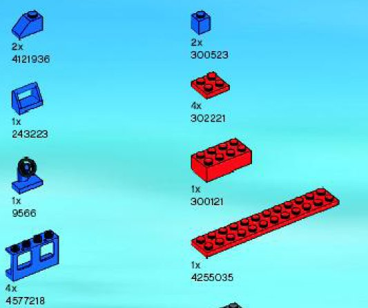
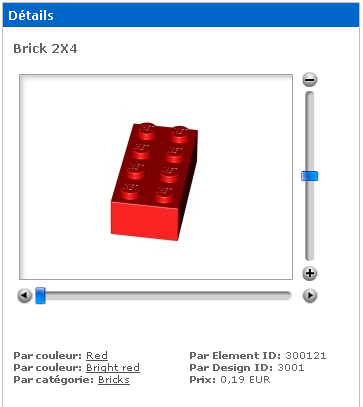
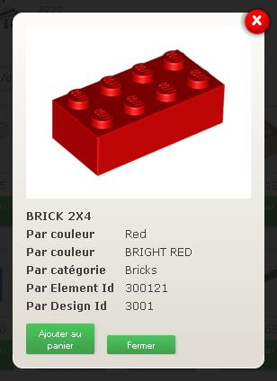
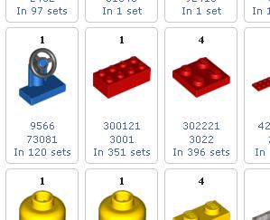
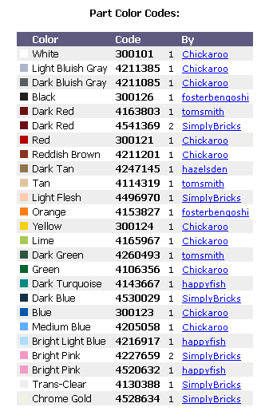

L’item, ou _element ID_, est la référence interne à LEGO d’une pièce dans une couleur. Il permet d’identifier de manière unique une pièce, et permet de commander en toute simplicité des pièces soit auprès du service consommateur ou au programme LUGBulk.

## A quoi ressemble un item ?

L’item peut se présenter sous deux formes.

Pour les anciennes pièces, l’item peut être composé du design de la pièce et du code couleur de la pièce.  
Le design est la référence de la pièce, quelque soit sa couleur. Attention, le design LEGO est très souvent le même que celui de Bricklink ou Peeron, mais ce n’est pas toujours le cas.

La [liste des codes couleur officiels LEGO](http://www.peeron.com/inv/colors) est disponible sur Peeron.

_Exemple :_ l’item de la brique 2x4 de couleur rouge est le composé de son design (3001) et de sa couleur (21) : 300121.

Pour les pièces récentes, l’item est un nombre à 7 chiffres commençant par 4 : _4xxxxxx_ ou 6 : _6xxxxxx_. Ce nombre n’a pas de signification. Attention, pour une même pièce dans une couleur donnée, l’item peut changer dans le temps. Dans ce cas, le numéro le plus grand est le plus récent, c’est celui qu’il faut utiliser.

_Exemple :_ l’item de la brique 2x4 de couleur verte est 4106356.

## Où trouver l’item d’une pièce ?

Il existe plusieurs méthodes. Les exemples portent sur la brique 2x4 rouge.

  
**A l’aide des notices**

Depuis 2006, les notices de montage contiennent à leur fin l’inventaire des pièces avec leur numéro d’item.

Ainsi, si vous savez dans quelle boite se trouve une certaine pièce, avec la notice il est très facile de trouver l’item.

Si vous n’avez pas les notices, vous pouvez les télécharger directement sur le [site de LEGO](http://service.lego.com/fr-fr/buildinginstructions), elles sont toutes référencées sur le site [Brickset](http://www.brickset.com/).

  
**A l’aide du Pick-a-Brick en ligne de LEGO**

Depuis 2007, LEGO propose sur son [site de vente en ligne un pick-a-brick](http://shop.lego.com/pab/). Sur ce site, on y trouve également l’item (ici l’_element ID_) d’une pièce.

Toutefois, l’assortiment du Pick-a-Brick étant limité, on peut ne pas trouver la pièce voulue.

  
**A l’aide du service de remplacement de pièces**

Depuis la même période, LEGO offre via son [site de service de remplacement de pièces](https://service.lego.com/fr-fr/replacementparts/), la possibilité de consulter (totalement ou partiellement) l’inventaire d’une boîte. Ces inventaires peuvent remonter jusqu’aux sets de 2000 !

Il suffit d’indiquer la référence de la boite dans laquelle se trouve la pièce pour obtenir l’inventaire.

L’item est indiqué dans la fenêtre d’information qui s’affiche lorsqu’on clique sur la pièce.

  
**A l’aide de Brickset**

Brickset propose un affichage plus aisé de l’inventaire des sets extraits du site LEGO.

En se rendant sur la page de la boîte dont on sait où se trouve la pièce, il faut alors se rendre dans l’onglet "Parts" (cet onglet n’est affiché que si la liste des pièces est disponible).

La liste des pièces avec leur numéro d’item s’affiche alors.

  
**A l’aide de Bricklink**

Avec l’apparition de tous ces moyens de connaitre les items, et avec l’aide de passionnés impliqués dans cette tâche énorme de référencement, BrickLink référence désormais les items.

Il suffit de se rendre sur la page catalogue de la pièce souhaitée, ici [notre brique 2x4](http://www.bricklink.com/catalogItem.asp?P=3001) puis de cliquer sur [View Small Images](http://www.bricklink.com/catalogColors.asp?itemType=P&itemNo=3001&v=2).

Au bas de cette page, vous trouverez la liste de toutes les couleurs dans laquelle apparait cette pièce avec l’item correspondant.

  
**A partir de l’extrait de la base de Bricklink**

Bricklink proposant de télécharger les éléments de sa base de données, je vous propose la liste complète des items connus de Bricklink dans une unique page html, avec ou sans affichage des images.

[http://brickerik.free.fr/items/](http://brickerik.free.fr/items/)

Ces fichiers seront mis à jour régulièrement.

## Conclusion

Comme vous pouvez le voir, il existe de nombreuses méthodes pour connaitre l’item d’une pièce.

Si malgré tout, vous n’arrivez pas à trouver l’item d’une pièce, le personnel du service consommateur ([coordonnées sur le site de LEGO](http://service.lego.com/fr-fr/contactus/)) vous aidera sans problème. Pensez à fournir soit le numéro de la boîte où se trouve la pièce, soit à fournir le numéro du design de la pièce. Avec ces éléments, la recherche sera aisée.
