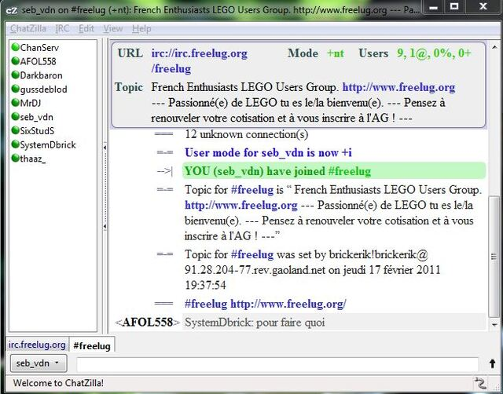
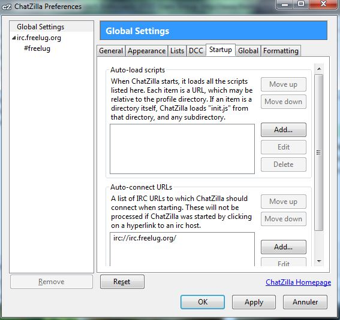
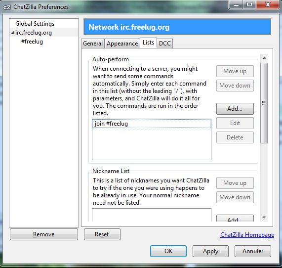
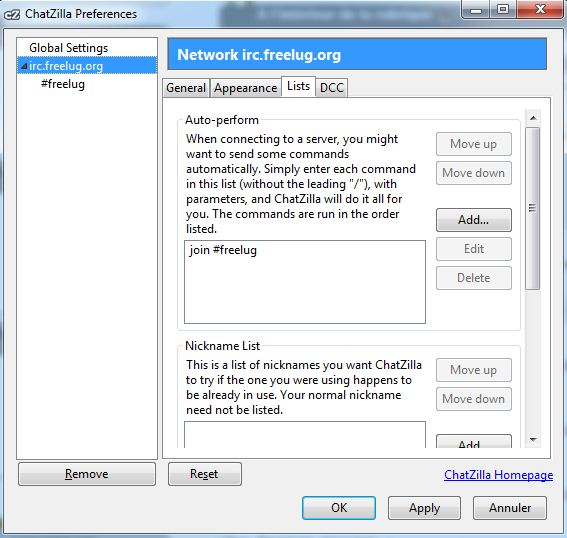

Voici un petit tutoriel pour ce connecter sur le canal irc de FreeLUG depuis votre navigateur Firefox.

Tout d’abord,installer l’add-on [Chatzilla](https://addons.mozilla.org/en-US/firefox/addon/chatzilla/),

**Interface**

Une fois celui-ci installé, il nous faut le configurer.

Rien de plus simple. Dans l’onglet "Outils" de votre navigateur, cliquez sur Chatzilla.

Une fenêtre s’ouvre :

**Ecran1**

Il nous faut maintenant le configurer pour qu’il se connecte automatiquement sur le canal irc de FreeLUG.

Sur le menu Chatzilla dans le menu Préférences, onglet startup ; dans la section auto connect urls, cliquez sur add et dans la boîte de dialogue, saisir `irc://irc.freelug.org/`

**capture 2**

cliquez sur apply

Pour vous connecter automatiquement au canal FreeLUG,

il suffit de cliquez sur add dans la section List, dans la boîte de dialogue, vous tapez `join #freelug`

de nouveau apply.

Fermez Chatzilla et relancer celui-ci.

Et voilà, vous voilà sur l’irc FreeLUG,

En bonus, [une petite video tutorial pour résumer cela](http://www.youtube.com/watch?v=sRNPo0rKr5k).

> Note de migration : le lecteur vidéo intégré était vide dans la capture du site d’origine. Le lien vidéo ci-dessus figurait explicitement dans l’article et a été conservé, sans importer de contenu externe.
