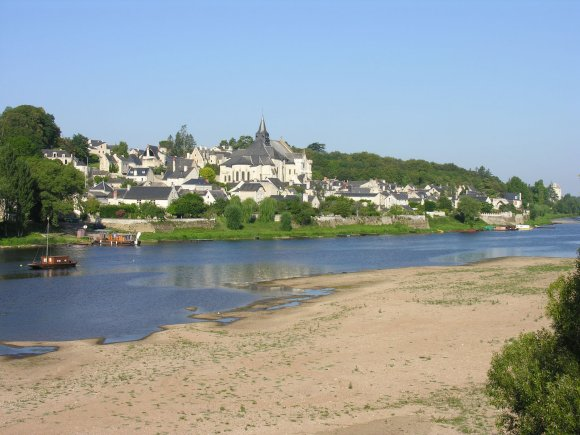

Voici une nouvelle édition de la rampe infernale mais avec l’ajout de bancs de sable de la Loire pour l’[édition 2011 de la Rencontre Estivale FreeLUG](/articles/rencontre-estivale-freelug-la-menitre-49-30-et-31-juillet-2011/) !

**Banc de sable**

Source de la photo - [http://www.all-free-photos.com/](http://www.all-free-photos.com/)

Pour rappel, le but du jeu est de faire descendre un bolide sur une rampe et aller le plus loin possible dans un duel sans pitié !

Mais pour cette fois-ci nous allons corser un peu les choses en s’adaptant aux couleurs locales.

En bas de la rampe se trouveront des bancs de sable de la Loire. Ces bancs seront faits de baseplate, plates, tiles et briques. Le but du jeu reste le même, allez le plus loin possible.

Les contraintes :  
**–** le bolide doit être uniquement constitué de pièces LEGO ;  
**–** il doit y avoir au moins un pilote ;  
**–** il doit y avoir au moins une roue ;  
**–** tout système à propulsion ou moteur est interdit.

Les [règles générales](/articles/la-rampe-infernale/) ont déjà été appliquées lors d’une précédente édition et seront à nouveau appliquer pour cette édition. Des lots sont à gagner !

A vos briques !
