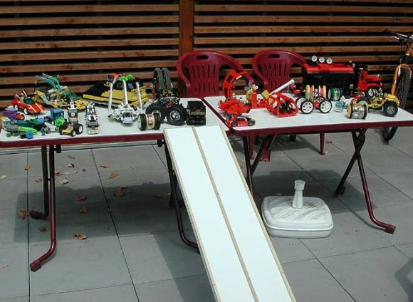
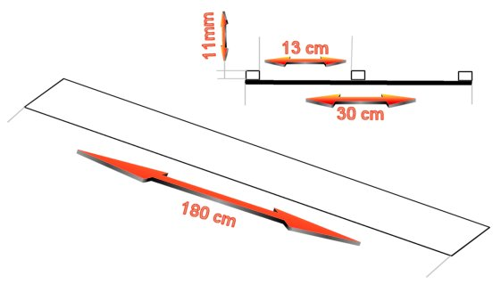

La rampe infernale (ou Wacky Race chez nos confrères américains) est une compétition déjantée où l’objectif est de faire descendre un bolide sur une rampe et d’aller le plus loin possible.

**Le but :** faire descendre un bolide sur une rampe et aller le plus loin possible dans un duel sans pitié !

La rampe :

**Les contraintes :**  
**–** le bolide doit être uniquement constitué de pièces LEGO ;  
**–** il doit y avoir au moins un pilote ;  
**–** il doit y avoir au moins une roue ;  
**–** tout système à propulsion ou moteur est interdit.

N’hésitez pas à fouiller dans les galeries photos de [Bric’Mania (REF 2004)](/articles/bric-mania-2004-l-afol-rencontre/) pour y trouver toutes sortes de véhicules, du simple XPod au gros camion libérant un tas de briques sur la piste voisine !

**Dans le même esprit**  
**–** Les Bolides-Racers-sauteurs  
**–** [Le Bull-Train](/articles/le-bull-train/)  
**–** [Le crash test](/articles/le-crash-test/)
