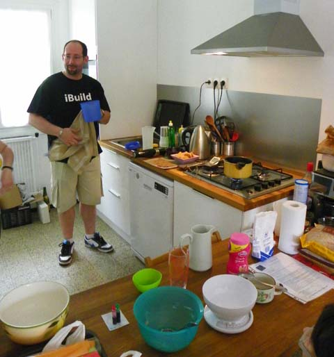
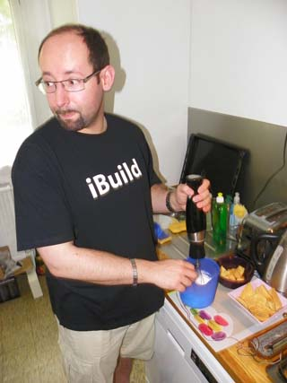
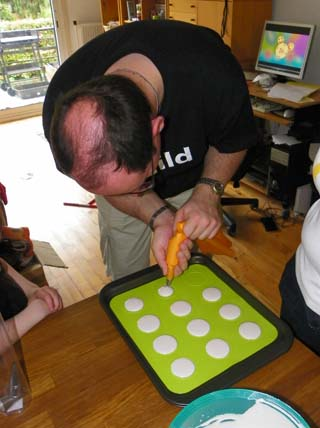
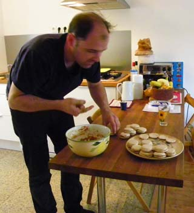
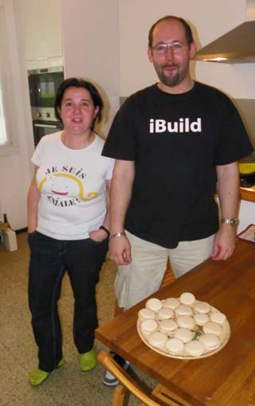

Tous les ingrédients sont là : poudre d’amande, sucre glace, chocolat au lait, oeufs etc.

Tous les ingrédients sont là : poudre d’amande, sucre glace, chocolat au lait, oeuf etc. et même la balance est prête.

On monte les blancs en neige. C’est Laurent qui s’y colle.

La pâte est prête. A l’aide d’une poche, elle est moulée pour faire les coques des macarons (le four est préchauffé à 170°C)

Une ganache caramel a passé quelques instants au frigo. Didier garni les coques avec celle ci.

Il ne reste plus qu’à déguster mais on invite l’aide pâtissière à prendre la pose devant les macarons caramel.

Vous me direz que tout cela n’a rien à voir avec les LEGO ? C’est exact mais c’est tellement bon ;-)
