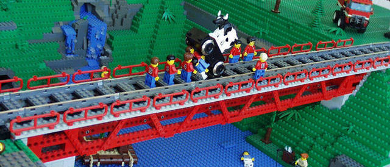
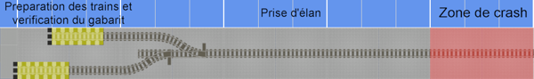

Nouveau sport demandant un esprit d’analyse extrêmement pointu : le Bull train est en fait très simple.

Pour pratiquer ce sport réservé à l’élite il faut :  
**–** un engin motorisé capable de se déplacer sur des rails ;  
**–** un réseau de rails avec une grande ligne droite ;  
**–** 30 minifigs désirant prendre un train.

**Le but :** lancer son bolide sur les rails le plus vite possible et faire tomber le maximum de minifigs.

**Bull-train sauvage**

Exemple de bull train sauvage à Miramas

**Le réseau :**

**Réseau type de Bull-train**

**Les contraintes :**  
**–** l’engin doit pouvoir circuler sur le réseau ci-dessus ;  
**–** avoir pour dimensions maximum 48 tenons de long, 8 de large (pas de limite de hauteur) et peser 1kg maximum.
