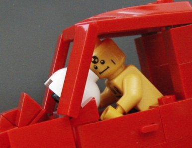
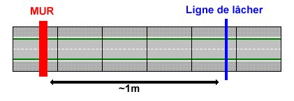

Dans le même esprit que les concours déjantés des précédentes REF, le crash test offre la belle part à la nouvelle minifig crash test, plus connue sous le doux nom _Dummy_

Les besoins sont simples :  
**–** un véhicule  
**–** un mur de briques

**Le but :** lancer son véhicule contre l’obstacle, et perdre un maximum de pièces (ou d’ensembles de pièces).

**La piste d’essai :**

**Les contraintes :**  
**–** le véhicule doit ressembler à un véhicule ;  
**–** le véhicule doit être doté de trois roues minimum, pouvant accueillir au moins 4 Dummies (la présence d’un conducteur est obligatoire _\- NdGO : des minifigs pourront être prêtées)_ ;  
**–** le véhicule ne doit pas perdre de pièces avant le choc avec l’obstacle ;  
**–** le véhicule ne doit pas excéder les 8 tenons de large et les 24 tenons de long ;  
**–** le lâcher du véhicule doit être fait à un mètre de l’obstacle.

**Dans le même esprit :**  
**–** [La rampe infernale](/articles/la-rampe-infernale/)  
**–** [Les Bolides-Racers-sauteurs](http://ref.freelug.org/2007/ref_concours.html#bolides)  
**–** [Le Bull-Train](/articles/le-bull-train/)
