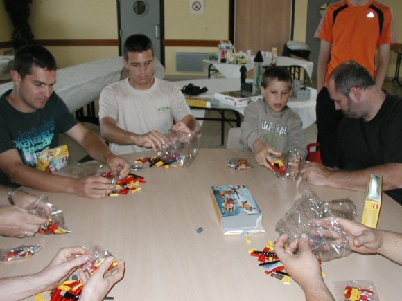
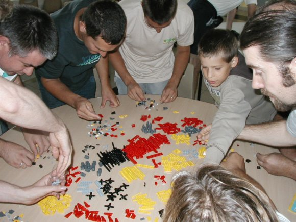
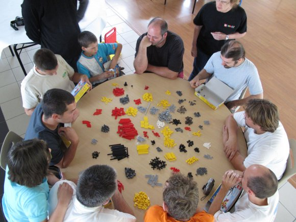
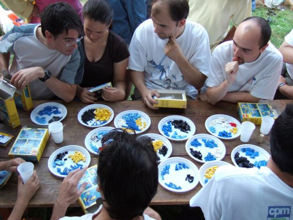
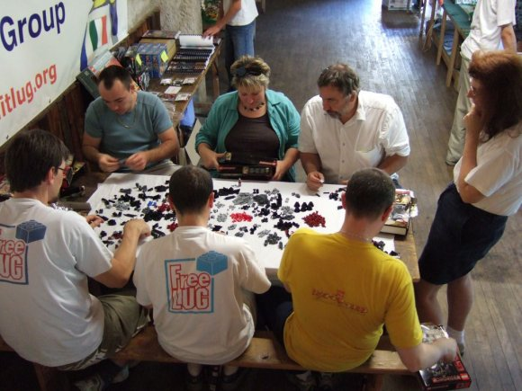
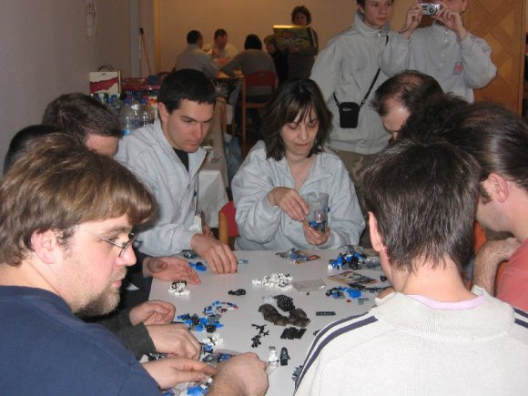
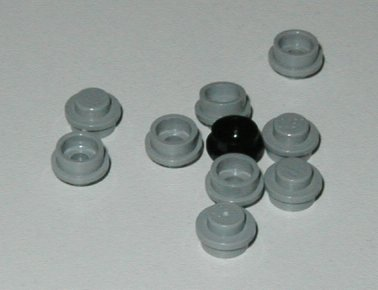
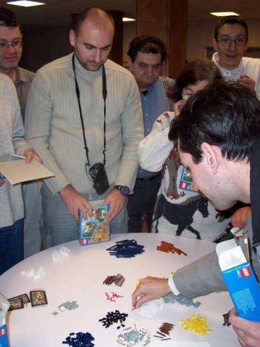

Activité que nous essayons de pratiquer lors de nos rencontres, le draft consiste à partager un ensemble de boîtes identiques entre plusieurs personnes par piochage à tour de rôle des pièces triées.

## Principe

Chaque participant dispose d’un exemplaire d’une même boîte LEGO.

Toutes les pièces sont mises en commun et triées.

**Tous les participants ouvrent leur boîte (ici l’hélicoptère Creator 5866 lors de la REF 2010)**

Par exemple, si il y a 10 participants, et donc 10 boîtes, les briques sont réunies en lot de 10 pièces identiques.

**Les mains s’affairent pour tout trier**

Chacun son tour, chaque participant pioche un lot de 10 pièces.

**Les stratégies se mettent en place !**

L’intérêt premier du draft est la possibilité de repartir avec plusieurs pièces identiques. Mais c’est surtout une activité ludique. Qui arrivera à obtenir en premier les pièces voulues par plusieurs personnes ? Qui arrivera à échapper aux pièces que personne ne veut ? Arrivera-t-on à obtenir les pièces appairées ? La stratégie, les ententes entre participants peuvent aider ! Et à la fin du jeu, des échanges peuvent permettre à chacun de s’y retrouver.

**Draft sur le poisson Designer 4401 à la REF 2007**

De gauche à droite :  
**–** Je prends lesquelles alors ?  
**–** Prend celles-là !  
**–** Hum... je prendrais bien celles-ci au prochain tour...

Pour un bon draft qui ne dure pas trop longtemps, il faut favoriser les petites boîtes ou de taille moyenne : 150 pièces maximum. Les soldes peuvent être une bonne occasion de trouver plusieurs exemplaires d’une même boîte à tarif intéressant.

**Draft sur l’Exo-Force 7702 à la REF 2007**

Les boîtes avaient été soldées car elles avaient pris l’eau...

Entre 6 et 10 participants permet à la fois d’avoir des multiples de pièces intéressants, tout en évitant que le draft ne s’éternise.

Les boîtes Creator ou celles présentant une grande variété de pièces sont à favoriser. Si il y a des minifigs, on peut décider que chaque participant récupère ses minifigs, ou bien de drafter avec.

**Draft sur le SW 7667 à l’AG 2008**

Un tirage au sort détermine le premier à choisir. Par exemple, si une même pièce existe dans 2 couleurs différentes, celui qui piochera la pièce de couleur différente commencera.

A travers cette activité, il est étonnant de voir que les besoins ou goûts de chacun sont très différents. Vous pouvez fuir une pièce dont vous n’avez pas l’usage ou que vous possédez déjà suffisamment tandis qu’un autre les prendra très rapidement.

**Draft sur l’Orient Expedition 7411 à l’AG 2004**

## Variantes

Une première variante peut consister à piocher des pièces, mais pas nécessairement identiques.

En se basant sur ce principe, on peut très bien imaginer faire un draft sur des boîtes différentes.

Mais la durée du jeu s’allonge généralement, puisque chaque participant va chercher dans le tas les pièces qui peuvent l’intéresser.
