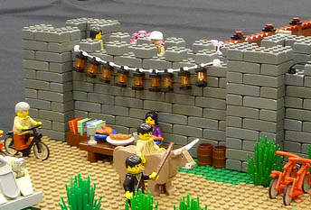
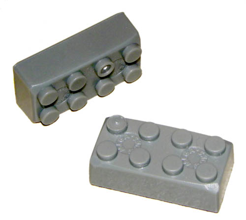

Det Bedste er ikke for godt - Seul le meilleur est assez bien. Mais suffit-il de l’énoncer pour en faire une vérité ?

Commençons par le principe de "Good Enough" (_Assez bien_) [^1]. Il est assez ancien mais un [article récent](http://www.wired.com/gadgets/miscellaneous/magazine/17-09/ff_goodenough?currentPage=all%20dans%20le%20magazine%20WIRED) l’a remis [au goût du jour](http://pisani.blog.lemonde.fr/2009/09/01/nouvelle-tendance-lourde-ce-qui-est-good-enough-pas-mal/).

Pour faire simple, le "Good Enough" s’oppose au "Best" (_le meilleur_) [^2] : un produit moins complexe - et par conséquent moins cher - est moins performant mais "Good Enough" - suffisant.

Ce qui nous amène assez naturellement aux produits LEGO dont le leitmotiv, la devise, est "Only the Best is Good Enough" [^3].

Il est vrai que la qualité (notamment les tolérances dimensionnelles des pièces et la qualité d’emboîtement entre pièces qui en découle) est ou est globalement perçue comme étant supérieure à celle des marques concurrentes compatibles (clones), la plus connue étant [MegaBloks (MB)](http://www.megabrands.com/Nos_produits/MEGA_Bloks/).

La position des fans sur le sujet pourrait être claire : ils ne peuvent concevoir de mélanger leurs pièces LEGO avec d’autres marques. Mais les choses changent. D’abord on modifie les pièces (peintures, coupes et collages, chromage et gravure) ou on en crée des nouvelles, au point même que des fans vendent leurs propres pièces : animaux, armes, roues de trains, pièces techniques en métal... et ce avec succès [^4].

Quelle est alors cette dernière barrière qui encore nous prive de l’usage de pièces de marques clones ? On s’aperçoit en fait qu’elle a déjà sauté et que peut-être même elle n’a jamais existé. Et c’est un membre reconnu de la communauté, [Steve Barile](http://factory.lego.com/trains/fanfiles/steve%20barile.aspx) [^5], qui nous en [donne un exemple ici](http://www.flickr.com/photos/66978286@N00/sets/72157622407819201/) :

La muraille qu’il a construite pour son [jardin zen](http://www.flickr.com/photos/66978286@N00/sets/72157622407819201/show/) est constituée d’une brique 2x4 modifiée - elle est rabotée aux coins - qui n’existe pas chez LEGO. C’est une brique MegaBloks.

Cette brique est parfaite pour constituer un mur de pierres. De plus, l’imprécision dimensionnelle des briques MB est ici sans conséquence - c’est même un atout pour cette vieille muraille. Ce qui nous ramène au principe de "Good Enough" évoqué en introduction. La brique MB est moins chère, elle a tendance à s’emboîter de manière irrégulière mais elle est bien suffisante pour construire une muraille. Elle est "Good Enough".

Pour autant est-ce que nous souhaitons que LEGO abandonne ses exigences de qualité ? Je ne le sais pas, mais il faut concevoir que le "Best" n’est pas obligatoirement "Good Enough".

[^1]: Assez bien, assez bon, suffisant, pas mal,...

[^2]: le meilleur, le plus complet mais aussi le plus complexe

[^3]: Seul le meilleur est assez bien

[^4]: Visitez par exemple [BrickArms](http://www.brickarms.com/), [BrickForge](http://www.brickforge.com/), [Big Ben Bricks](http://www.bigbenbricks.com/), [Lifelites](http://www.lifelites.com/) ou encore [HiTechnic](http://www.hitechnic.com/)

[^5]: Président de [ILTCO](http://www.iltco.org/), membre de [RailBricks](http://www.railbricks.com/), fondateur de LUG et organisateur d’expositions comme BrickFest
