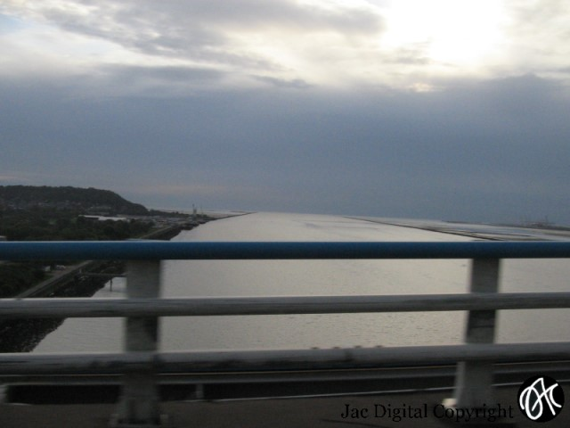
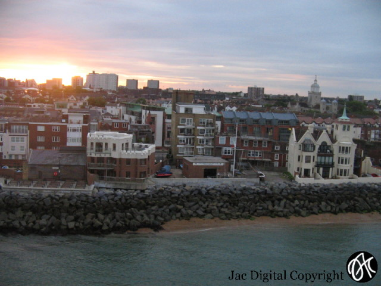
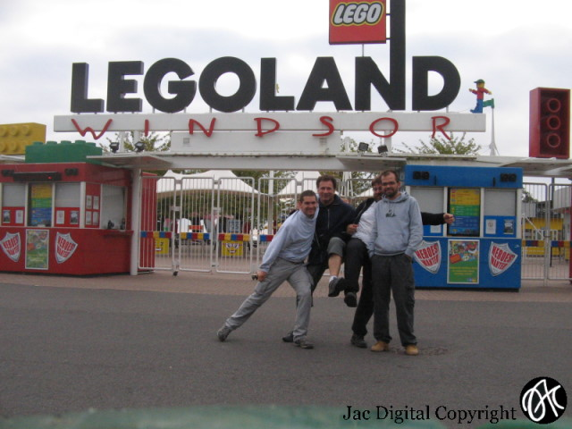
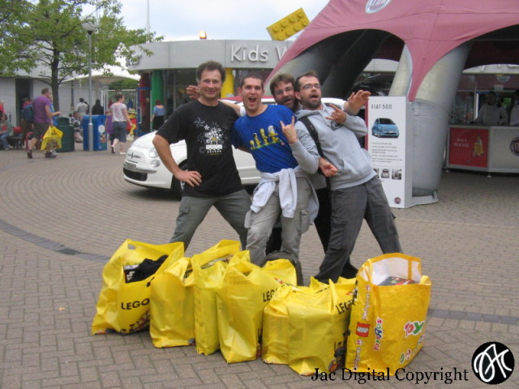
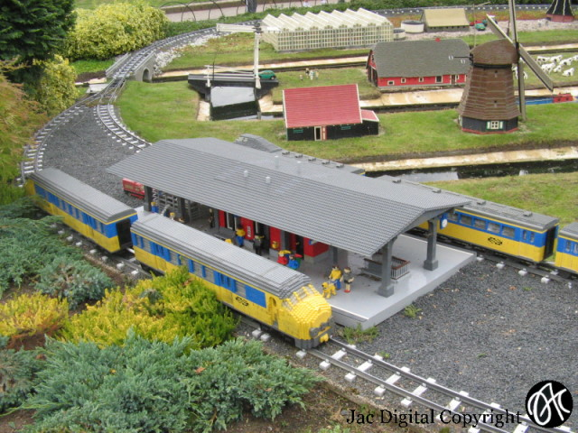
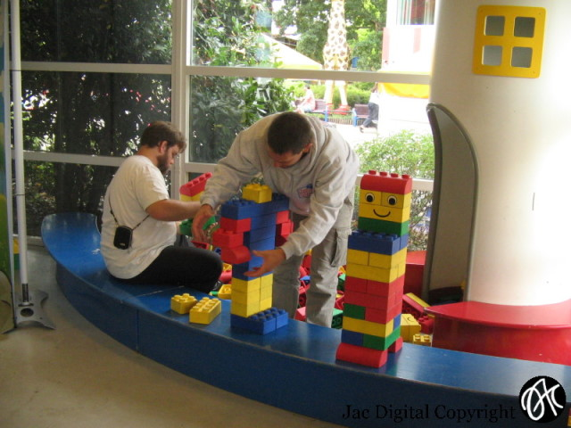
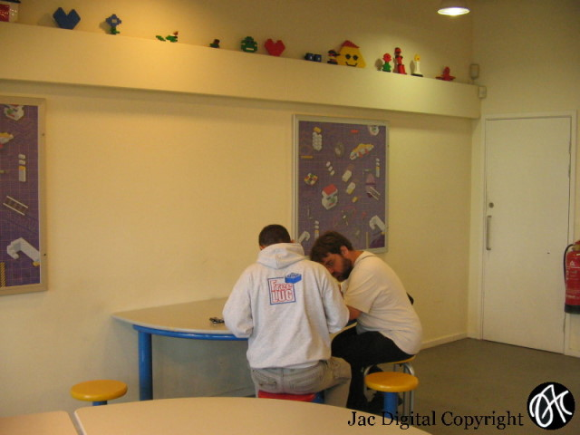

Description de la visite du parc, avec notre expérience pour ne pas renouveler les erreurs !

C’est décidé, cette année nous allons visiter le parc Legoland anglais. Nous partons le soir du 15 aout. Nous nous rendrons compte après que ce n’est pas la meilleure date (vous verrez plus bas). Mais nous avons réussi à faire correspondre nos vacances sur cette période. Nous, ce sont les 4 afols lancés dans cette petite aventure.

Je dis petite aventure car c’en est une. Il nous faut traverser le "Channel". Ce n’est pas une simple ballade en voiture, si je puis dire.

La réservation de l’hôtel est faite, ainsi que celle du ferry. Y’a plus qu’à prendre la voiture pour rejoindre les copains aussi fou que moi. Première étape, la région parisienne où je rejoint "Jicé". Deuxième étape, Le Havre où on retrouve Médérick et Pierre. Tout se passe bien et nous partons un peu en avance pour l’embarcadère du ferry (Ouistreham). Je dis un peu en avance et heureusement. Il y a encore des postes frontière pour aller en Angleterre. Sur 4 voyageurs Afols, 2 n’avaient pas de cartes d’identité à jour. Ca fait quand même 50% ! Mais vous verrez que ça n’a pas été le seul soucis en poste frontière ! Nous avons passé cette contrariété tranquillement, juste avec une petite angoisse très partagée par Jicé.

Le voyage en bateau nous a beaucoup occupé. La mer était bien calme, c’est quand même le mois d’aout, donc, pas de tangage en vue. Mais vers 23h, le bateau est "mort", enfin, tous le monde dort. Nous sommes les seuls à se balader partout et à contempler les flots et les moindres lumières de l’horizon. On a choisi le ferry de nuit pour le prix. Mais on ne dort pas très bien dans un siège à dossier inclinable, dont le fonctionnement est très capricieux, surtout à 2h du matin ! Enfin, il était peut être même 3h quand on s’est couché. A 5h30, heure anglaise (la compagnie des ferry est anglaise) réveil pour contempler le port de Porthmouth.

Le débarquement et la route jusqu’à Windsor se fait sans soucis. Le GPS de Pierre est bien pratique et en plus le parc est très bien indiqué. Il faut surtout faire attention à la conduite à gauche, les ronds points étant le plus difficile, il nefaut pas partir à droite. Mais notre chauffeur s’en sort très bien.

On arrive sur le parking du parc vers 8h30. Là au moins on a le temps de contempler l’entrée et surtout de se rendre compte que, le mois d’aout n’est pas la meilleure période pour venir visiter. Il n’y a aucun ticket pratique à acheter. Le pass 2 jours n’est pas valable et il faut prendre le pass à l’année plein tarif, environ 99 Livres pour bénéficier de 10% sur les achats dans les shops. Du coup, on va acheter des tickets à l’unité et l’un de nous prendra un pass. Du coup, l’un de nous ne rentrera au parc qu’un seul jour.

Que dire sur le parc, bin rien. Ah si, les constructions présentes sont magnifiques, bien sûr, comme vous vous en doutez. Mais y’a du monde, une heure de queue pour certaines attractions. Bin oui, on est en plein mois d’aout. Et encore il fait à peu près beau, sinon, ça serait bondé ! Le soir c’est la rué dans les shops. On a beau se dire qu’il faut y aller tôt, c’est quand même la folie. Des boîtes sortent du magasin à vitesse grand "V". Nous y sommes aussi pour quelque chose !

Je ne m’étendrais pas sur notre nuit à l’hôtel un peu banale, surtout que c’était notre premier vrai dodo depuis l’avant veille. Autant dire que la veillée a été courte. Juste à prévoir ce que l’on ferait le lendemain, avec l’arrangement pour retrouver l’afol qui ne venait pas le deuxième jour au parc. Il en a d’ailleurs profité pour balader dans Londres et trouver un chouette magasin LEGO.

Le deuxième jour, nous avons passé au crible toutes les maquettes du Miniland : trouver les défauts, les beautés, les nouvelles constructions... Les voies des trains ont des devers à l’envers. Mais bon, c’est pas pour des TGV !

Il y a des animations sympa dans des salles, sur le parc. Vous pouvez construire un modèle Technic de votre choix, essayer de faire un immeuble sur une base qui tremble, ou construire ce que vous voulez avec des briques en mousse. Il y a même des rampes infernales. Ils nous ont copié !

Si vous voulez revenir du parc avec 4 afols et beaucoup de boîtes, il faut éviter la 206. Ou alors, bien gérer la chose ! Bin, c’est ce qu’on a fait.

Pour le poste frontière anglais, avant d’embarquer, évitez d’avoir des couteaux dans les sacs, ça évitera de perdre du temps...

Le retour c’est fait sans autre soucis majeur. Si ce n’est que, comme à l’aller, nous avons très peu dormi. La nuit suivante chez Médérick et au calme a été un vrai bonheur. Surtout que nous avions tout de même trouvé une boîte sympathique pour faire un draft entre nous, je pense qu’il restera mémorable.

Je suis désolé pour les illustrations, mais les photos de nous sont très rares, vous imaginez, tant de LEGO au mètre carré !

Pour cette super ballade, je remercie Jicé, Médérick, Pierre L, pis aussi Florence et Pascal Bréard pour leur accueil.

Il me manque plus que le parc Californien et évidement Billund. Je patiente gentiment...

[Galerie photo](http://photos.freelug.org/main.php/v/JAC/Exposition/Expositions2011/Windsor/)
